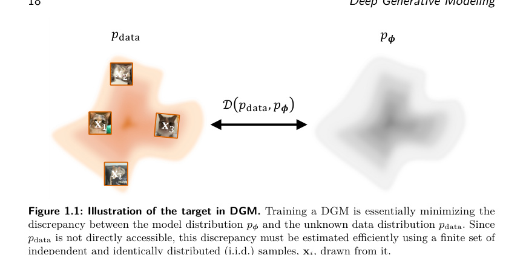

# 1.1 深層生成モデリングとは何か？

深層生成モデル（Deep Generative Models; DGMs）は、未知かつ複雑な分布 $p_{\mathrm{data}}$ から抽出された大量の実世界サンプル（例：画像、テキスト）を入力とし、近似分布 $p_\phi$ をパラメータ化した学習済みニューラルネットワークを出力する。その目標は次の二つである。

1. **現実的な生成（Realistic Generation）**: 実データと区別できない、新規で現実的なサンプルを生成すること。
2. **制御可能な生成（Controllable Generation）**: 生成過程に対して、きめ細かく解釈可能な制御を可能にすること。

本節では、DGM の背後にある基本概念と動機を示し、その数学的枠組みと実用的応用の詳細な探求に備える。

## 1.1.1 数学的設定

画像・音声・テキストなどの有限なサンプル集合 $\{x^{(i)}\}_{i=1}^{N}$ が与えられたとする。これらのサンプルはある潜在的なデータ分布 $p_{\mathrm{data}}$ から抽出されたものと想定するが、この分布を明示的には知らない。とりわけ、観測できるのは利用可能な訓練サンプルだけであり、$p_{\mathrm{data}}$ の式や、そこから任意の新規サンプルを直接抽出する手続きは持っていない[^1]。

**DGM の目標。** したがって深層生成モデリングの目標は、観測データの統計的特性に似た新しいサンプルを生成できるモデルを学習することである。パラメータ $\phi$ をもつモデルが表す分布を $p_\phi$ と書く。学習後のパラメータを $\phi^\times$ と記し、生成に関して重要な側面において

$$
p_{\phi^\times} \approx p_{\mathrm{data}}
$$

であることを期待する。

この式は概念的に理解すべきである。有限データ・有限モデル容量・不完全な最適化のもとでは、二つの分布が厳密に一致するとは期待しない。むしろ、学習済みモデルはデータ分布の構造を十分に捉え、現実的で多様な新規サンプルを生成できるべきである。

いったんモデルが学習されると、生成とは単に新しいサンプルを

$$
x \sim p_{\phi^\times}
$$

と抽出することを意味する。

[^1]: これは機械学習における一般的な仮定である。簡単のため、記号 $p$ は文脈に応じて確率分布そのもの、またはその確率密度／質量関数のいずれかを表すものとする。

異なる生成モデルの族は、これを行うための異なる機構を提供する。一部のモデルは観測サンプルに割り当てる密度を評価することも許すが、他のモデルは主にサンプリング手続きを通じて定義される。この区別は、後に異なる生成モデルの学習法を議論する際に有用になる。今のところ中心的な目的は、単にデータから新しいサンプルを生成できる分布を学習することである。

**DGM の学習。** モデル族 $\{p_\phi\}$ のパラメータ $\phi$ は、不一致 $D(p_{\mathrm{data}}, p_\phi)$ を最小化することで学習する：

$$
\phi^* \in \arg\min_\phi D(p_{\mathrm{data}}, p_\phi). \tag{1.1.1}
$$

$p_{\mathrm{data}}$ は未知であるため、$D$ の実用的な選択は、$p_{\mathrm{data}}$ からの i.i.d. サンプルによる効率的な推定を許すものでなければならない。十分な容量があれば、$p_{\phi^*}$ は $p_{\mathrm{data}}$ をよく近似できる。

**前方 KL と最尤推定（Maximum Likelihood Estimation; MLE）。** $p_\phi$ が $p_{\mathrm{data}}$ に似るようにモデルパラメータをどう選ぶべきか？ モデル密度 $p_\phi(x)$ が評価可能なとき、自然な考えは、観測データがモデルのもとで高い密度を受けるようにすることである。これは最尤推定（MLE）につながる：訓練サンプルが集合的に高いモデル密度を割り当てられるように $\phi$ を選ぶ[^2]。

[^2]: 固定された観測サンプル $x$ に対し、$p_\phi(x)$ をモデルパラメータ $\phi$ の関数として見た量を尤度（likelihood）と呼ぶ。連続データでは、$p_\phi(x)$ はちょうど $x$ を観測する確率ではなく、確率密度である。

この考えを定式化する標準的な方法は、（前方）Kullback–Leibler ダイバージェンス（Kullback–Leibler divergence）[^3] を通じてである：

$$
D_{\mathrm{KL}}(p_{\mathrm{data}} \Vert p_\phi) := \int p_{\mathrm{data}}(x) \log \frac{p_{\mathrm{data}}(x)}{p_\phi(x)}\, dx
= \mathbb{E}_{x\sim p_{\mathrm{data}}}\bigl[\log p_{\mathrm{data}}(x) - \log p_\phi(x)\bigr].
$$

KL ダイバージェンスは非対称である。すなわち

$$
D_{\mathrm{KL}}(p_{\mathrm{data}} \Vert p_\phi) \neq D_{\mathrm{KL}}(p_\phi \Vert p_{\mathrm{data}}).
$$

一見すると、データ密度 $p_{\mathrm{data}}(x)$ が未知であるため前方 KL は使えないように見える。しかし次のように分解できる：

$$
D_{\mathrm{KL}}(p_{\mathrm{data}} \Vert p_\phi)
= \mathbb{E}_{x\sim p_{\mathrm{data}}}\Bigl[\log \frac{p_{\mathrm{data}}(x)}{p_\phi(x)}\Bigr]
= -\mathbb{E}_{x\sim p_{\mathrm{data}}}\bigl[\log p_\phi(x)\bigr] - H(p_{\mathrm{data}}),
$$

ここで

$$
H(p_{\mathrm{data}}) := -\mathbb{E}_{x\sim p_{\mathrm{data}}}\bigl[\log p_{\mathrm{data}}(x)\bigr]
$$

はデータ分布のエントロピーである。決定的に、この項は $\phi$ に依存しない。したがって、$p_{\mathrm{data}}(x)$ そのものは評価できなくても、モデルパラメータを最適化するためにそれを知る必要はない。これにより次の同値が得られる：

> **補題 1.1.1: KL の最小化 ⇔ MLE**
>
> $$
> \min_\phi D_{\mathrm{KL}}(p_{\mathrm{data}} \Vert p_\phi)
> \iff
> \max_\phi \mathbb{E}_{x\sim p_{\mathrm{data}}}\bigl[\log p_\phi(x)\bigr]. \tag{1.1.2}
> $$

言葉で言えば、前方 KL ダイバージェンスの最小化は、実データサンプルがモデルのもとで高い対数尤度を受けるようにすることと同値である。これはまさに最尤推定である。

実際には、$p_{\mathrm{data}}$ 上の期待値は、i.i.d. に $p_{\mathrm{data}}$ から抽出されたと仮定する利用可能な訓練サンプル $\{x^{(i)}\}_{i=1}^{N}$ で置き換えられる。これにより経験的負の対数尤度目的関数

$$
\hat{\mathcal{L}}_{\mathrm{MLE}}(\phi) := -\frac{1}{N}\sum_{i=1}^{N}\log p_\phi\bigl(x^{(i)}\bigr)
$$

が得られ、ミニバッチ上の確率的勾配で最適化できる。したがって MLE は $p_{\mathrm{data}}$ からのサンプルだけを必要とし、未知のデータ密度そのものを評価する必要はない。

[^3]: すべての積分はルベーグの意味であり、計数測度のもとでは和に帰着する。

KL ダイバージェンスの向きは、不一致がどこで平均されるかを決めるため重要である。前方 KL

$$
D_{\mathrm{KL}}(p_{\mathrm{data}} \Vert p_\phi)
= \mathbb{E}_{x\sim p_{\mathrm{data}}}\Bigl[\log \frac{p_{\mathrm{data}}(x)}{p_\phi(x)}\Bigr]
$$

では、期待値はデータ分布上で取られる。したがって、$p_{\mathrm{data}}$ のもとで生じる領域はモデルによって説明されなければならない。対照的に、逆 KL $D_{\mathrm{KL}}(p_\phi \Vert p_{\mathrm{data}})$ は、代わりにモデル分布からのサンプル上で平均する。

この違いは重要な帰結をもつ。正のデータ確率 $p_{\mathrm{data}}(A) > 0$ をもつ領域 $A$ が存在するが、モデルがそこへ零密度を割り当てる、すなわち $x \in A$ に対して $p_\phi(x) = 0$ であるとせよ。すると前方 KL は無限大になる。なぜならその領域上で

$$
\log \frac{p_{\mathrm{data}}(x)}{p_\phi(x)} = +\infty
$$

となるからである。したがって前方 KL の最小化は、データ分布が確率質量を置く領域を完全に見逃すモデルを強く罰する。この振る舞いを一般にモード被覆（mode covering）と呼ぶ。

**Fisher ダイバージェンス。** Fisher ダイバージェンスは、（スコアベースの）拡散モデリング（第3章参照）にとってもう一つの重要な概念である。二つの分布 $p$ と $q$ に対し、次で定義される：

$$
D_F(p\Vert q) := \mathbb{E}_{x\sim p}\bigl\|\nabla_x \log p(x) - \nabla_x \log q(x)\bigr\|_2^2. \tag{1.1.3}
$$

これはスコア関数 $\nabla_x \log p(x)$ と $\nabla_x \log q(x)$——より高い確率の領域を指すベクトル場——の間の不一致を測る。要するに、$D_F(p\Vert q) \ge 0$ であり、等号はほとんど至るところで $p = q$ のとき、かつそのときに限り成立する。スコアは対数密度の勾配のみに依存するため正規化定数に不変であり、スコアマッチング（式 (3.1.3) および (3.2.1)）の基盤をなす。スコアマッチングは、生成のために対数密度の勾配を学習する方法である（スコアベースモデル）。この設定では、データ分布 $p = p_{\mathrm{data}}$ が目標となり、モデル $q = p_\phi$ はそのスコア場をデータのそれに揃えるよう学習される。

**KL を超えて。** KL ダイバージェンスは確率分布間の差の最も広く用いられる測度であるが、唯一のものではない。異なるダイバージェンスは、不一致の異なる幾何的または統計的な概念を捉え、それが学習アルゴリズムの最適化ダイナミクスに影響する。広い族の一つが $f$-ダイバージェンス（Csiszár, 1963）である：

$$
D_f(p\Vert q) = \int q(x)\, f\Bigl(\frac{p(x)}{q(x)}\Bigr)\, dx, \qquad f(1) = 0. \tag{1.1.4}
$$

ここで $f : \mathbb{R}_+ \to \mathbb{R}$ は凸関数である。$f$ を変えることで、多くのよく知られたダイバージェンスが得られる：

- $f(u) = u \log u$ $\Rightarrow$ $D_f = D_{\mathrm{KL}}(p\Vert q)$（前方 KL）
- $f(u) = \tfrac{1}{2}\bigl[u\log u - (u+1)\log\tfrac{1+u}{2}\bigr]$ $\Rightarrow$ $D_f = D_{\mathrm{JS}}(p\Vert q)$（Jensen–Shannon）
- $f(u) = \tfrac{1}{2}|u-1|$ $\Rightarrow$ $D_f = D_{\mathrm{TV}}(p,q)$（全変動）

明示的な形は次のとおりである：

$$
D_{\mathrm{JS}}(p\Vert q)
= \tfrac{1}{2} D_{\mathrm{KL}}\bigl(p \Vert \tfrac{1}{2}(p+q)\bigr)
+ \tfrac{1}{2} D_{\mathrm{KL}}\bigl(q \Vert \tfrac{1}{2}(p+q)\bigr),
$$

および

$$
D_{\mathrm{TV}}(p,q) = \tfrac{1}{2}\int |p-q|\, dx = \sup_{A\subset\mathbb{R}^D}|p(A)-q(A)|.
$$

直観的に、JS ダイバージェンスは両分布をバランスさせ、KL の非有界な罰則を避ける滑らかで対称な測度を与える（後に生成的敵対ネットワーク（Generative Adversarial Network; GAN）枠組みの解釈に役立つことがわかる）。一方、全変動距離は二つの間の可能な最大の確率差を捉える。

別の視点は最適輸送（第7章参照）から来ており、その代表は Wasserstein 距離（式 (7.2.2) 参照）である。これはある分布から別の分布へ確率質量を移す最小コストを測る。密度比を比較する $f$-ダイバージェンスと異なり、Wasserstein 距離はサンプル空間の幾何に依存し、$p$ と $q$ の台が重ならなくても意味をもつ。

各ダイバージェンスは分布間の近さの異なる概念を体現し、したがって異なる学習振る舞いを引き起こす。本モノグラフを通じて生成モデリングの文脈で自然に現れるとき、これらのダイバージェンスを再訪する。

## 1.1.2 分布モデリングにおける課題

複雑なデータ分布をモデル化するため、確率密度関数 $p_{\mathrm{data}}$ をパラメータ $\phi$ をもつニューラルネットワークでパラメータ化し、モデル $p_\phi$ を作ることができる。$p_\phi$ が有効な確率密度関数であるためには、次の二つの基本性質を満たさなければならない：

1. **非負性**: 領域内のすべての $x$ に対して $p_\phi(x) \ge 0$。
2. **正規化**: 領域全体の積分が 1 に等しいこと、すなわち $\int p_\phi(x)\, dx = 1$。

ネットワークは入力 $x$ に対して自然に実スカラー $E_\phi(x) \in \mathbb{R}$ を出力できる。この出力を有効な密度として解釈するには、条件 (i) と (ii) を満たすよう変換しなければならない。実用的な代替は、$E_\phi : \mathbb{R}^D \to \mathbb{R}$ を非正規化密度を定義するものと見なし、これらの性質を明示的に強制することである。

**ステップ 1: 非負性の確保。** ニューラルネットワークの生の出力 $E_\phi(x)$ に正値関数、例えば $|E_\phi(x)|$、$E_\phi^2(x)$ などを適用することで、モデルの出力が常に非負であることを保証できる。標準的で便利な選択は指数関数である。これにより、正であることが保証された非正規化密度 $\tilde{p}_\phi(x)$ が得られる：

$$
\tilde{p}_\phi(x) = \exp\bigl(E_\phi(x)\bigr).
$$

**ステップ 2: 正規化の強制。** 関数 $\tilde{p}_\phi(x)$ は正であるが、積分は 1 にならない。有効な確率密度を作るには、空間全体での積分で割らなければならない。これによりモデルの最終形が得られる：

$$
p_\phi(x)
= \frac{\tilde{p}_\phi(x)}{\int \tilde{p}_\phi(x')\, dx'}
= \frac{\exp\bigl(E_\phi(x)\bigr)}{\int \exp\bigl(E_\phi(x')\bigr)\, dx'}.
$$

この式の分母は正規化定数（normalizing constant）または分配関数（partition function）として知られ、$Z(\phi)$ と記される：

$$
Z(\phi) := \int \exp\bigl(E_\phi(x')\bigr)\, dx'.
$$

この手続きは $p_\phi(x)$ の有効な構成を与えるが、大きな計算上の課題を持ち込む。ほとんどの高次元問題では、正規化定数 $Z(\phi)$ の計算に必要な積分は扱い不能である。この扱い不能性は、多くの異なる深層生成モデルの族の発展を動機づける中心的な問題である。

以下の節では、DGM のいくつかの主要なアプローチを導入する。それぞれが、この正規化定数を評価する計算コストを回避または低減するように設計されている。
