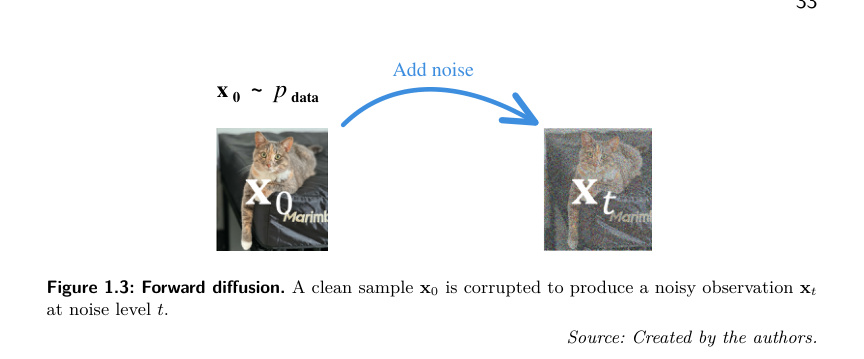
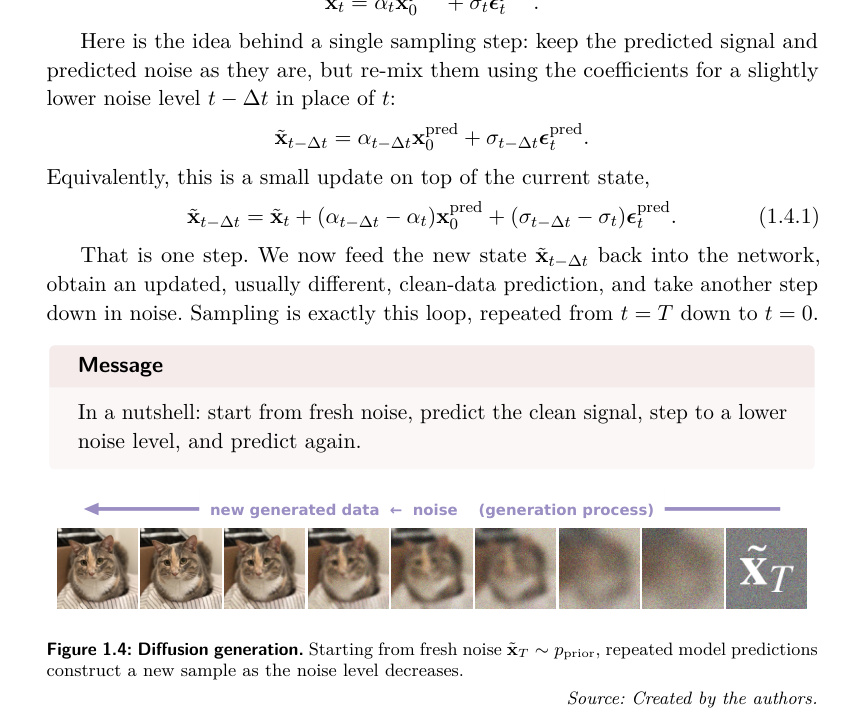

# 1.4 結びの言葉

本章では、深層生成モデリングの基礎概念を確立した。まず第一の目標を定義した：未知で複雑なデータ分布 $p_{\mathrm{data}}$ を近似する、扱い可能なモデル分布 $p_{\mathrm{model}}$（$\phi$ でパラメータ化）を学習することである。中心的な課題は、有効な確率密度を定義するために必要な正規化定数、すなわち分配関数 $Z(\phi)$ の計算上の扱い不能性である。

この問題を回避するため、それぞれが異なる戦略を用いる様々な深層生成モデルの族が開発されてきた。主要なアプローチとして、エネルギーベースモデル（EBMs）、自己回帰モデル（ARs）、変分オートエンコーダ（VAEs）、正規化フロー（NFs）、および生成的敵対ネットワーク（GANs）を概観した。これらのモデルは大きく、扱い可能な密度を定義する明示的モデルと、サンプリング手続きを通じてのみ分布を定義する暗黙的モデルに分類できる。

これらの古典的枠組みはそれぞれ重要であるが、とりわけ三つが、本モノグラフの焦点である拡散モデルの概念的起源として機能する：VAE、EBM、および NF である。続く章では、これら三つの基礎パラダイムから拡散モデルの進化を辿る：

1. **Part B** は変分的視点（第2章）の探求から始まり、（階層的潜在変数構造をもつ）VAE がどのように自然にデノイジング拡散確率モデル（Denoising Diffusion Probabilistic Models; DDPMs）の定式化につながるかを示す。

2. 次に、スコアベースの視点（第3章）を検討する。これは EBM とスコアマッチングに起源をもち、ノイズ条件付きスコアネットワーク（Noise Conditional Score Networks; NCSN）およびより一般的な Score SDE 枠組み（第4章）へと発展する。

3. 最後に、フローベースの視点（第5章）を調べる。これは正規化フローの原理の上に構築され、生成を連続変換として枠づけ、フローマッチング（Flow Matching）の概念によって一般化される。

これらの起源を理解することで、拡散モデルの多様な定式化を解釈し、それらを統一する深い原理を明らかにする一貫した枠組みを築く。

---

# Part B

## 拡散モデルの基礎と視点

本章までの Part A で深層生成モデリングの概観を与えた。Part B では、拡散モデルを三つの視点から展開する：

| 視点 | 起源 | 拡散モデル |
|------|------|------------|
| 変分的視点（Variational View） | 変分オートエンコーダ（第2章） | デノイジング拡散確率モデル（DDPM） |
| スコアベース視点（Score-Based View） | エネルギーベースモデル（第3章） | ノイズ条件付きスコアネットワーク（NCSN） |
| フローベース視点（Flow-Based View） | 正規化フロー（第5章） | ガウスフローマッチング（Gaussian Flow Matching） |

連続時間定式化（例：Score SDE）は第4章で扱い、統一原理（条件付け戦略、Fokker–Planck 方程式など）は第6章で扱う。

---

## 拡散モデルの学習とサンプリングへの最初の操作的視点

拡散モデルの数学に踏み込む前に、まずそれらがどのように学習され、どのようにサンプルを生成するかについての単純な操作的視点を養おう。

基本的な構成は二つの部分からなる。第一に、任意に選んだノイズレベルでクリーンなデータをノイズの多い観測に変えられる、既知の劣化規則を定義する。第二に、そのようなノイズの多い観測からクリーン信号を推論するようニューラルネットワークを学習する。この予測規則が多くのノイズレベルにわたって学習されると、それを生成にも使える。新鮮なノイズサンプルから始め、高いノイズレベルから低いレベルへ移りながらネットワークを繰り返し適用する。結果は、データ分布の構造を徐々に獲得する新しいサンプルである。

> **メッセージ**
>
> 多くのノイズレベルでノイズの多いデータを作り、クリーン信号を予測するよう学習し、高いノイズから低いノイズへこの予測を繰り返し適用して生成する。

### ノイズの多いデータの作成

データのあるノイズ版が実際に何を意味するかを正確にしよう。クリーンなデータサンプル

$$
x_0 \sim p_{\mathrm{data}}
$$

——画像や関心が関心を置く他の種類のデータ——を取る。ノイズレベル $t$ で独立ガウスノイズを混ぜて劣化する[^1]：

$$
x_t = \alpha_t x_0 + \sigma_t \epsilon, \qquad \epsilon \sim \mathcal{N}(0, I).
$$

$\alpha_t$ と $\sigma_t$ を、ノイズレベル $t$ でどれだけのクリーン信号とどれだけのノイズが混ざるかを設定する、あらかじめ固定された二つのノブと思え。

最も単純な選択 $\alpha_t = 1$、$\sigma_t = t$ は

$$
x_t = x_0 + t\epsilon
$$

を与える。今や $t$ は文字どおりノイズのダイヤルである：ゼロに近づければ $x_t$ はほぼクリーンサンプルであり、上げればノイズ項 $t\epsilon$ がますます支配する。

より一般に、あらゆるノイズレベル $t$ はノイズの多いサンプル上の分布 $p_t$ を定義する。$p_t$ をスナップショットと考えると有用である：同じ $t$ の値を用いて多くのノイズの多いサンプルを生成すれば、その分布は $p_t$ になる。

[^1]: 式 $x_t = \alpha_t x_0 + \sigma_t \epsilon$ は、選んだノイズレベル $t$ における累積劣化を直接与える。DDPM と Score SDE では、同じ周辺分布はそのレベルにおいて、より小さな逐次ステップでノイズを加えることによっても得られる；第2.2節および第4章を参照。後に導入する離散 DDPM 記法では、この累積劣化は $x_i = \bar{\alpha}_i x_0 + \sqrt{1-\bar{\alpha}_i^2}\,\epsilon$ と書かれる。

スケジュール $(\alpha_t,\sigma_t)$ は、これらのスナップショットがクリーンデータから単純なノイズ分布へ向かうよう選ばれる：

$$
p_0 = p_{\mathrm{data}} \longrightarrow p_t \longrightarrow p_T \approx p_{\mathrm{prior}},
$$

ここで $p_{\mathrm{prior}}$ は典型的にはサンプリングが容易なガウス分布である。したがって族

$$
\{p_t\}_{t\in[0,T]}
$$

は、ノイズレベルが上がるにつれて分布がどのように徐々に変化するかを記述する。

### 学習：クリーン信号を予測するよう学ぶ

データを劣化させる方法が手に入った今、学習はほとんど機械的になり、一つの鍵となるトリックに依存する：データを劣化させているのは我々自身であるため、常に正しい答えを知っている。一つの訓練例を作るには、クリーンなデータ $x_0$ をサンプリングし、ノイズレベル $t$ を選び、ノイズ $\epsilon$ を引き、

$$
x_t = \alpha_t x_0 + \sigma_t \epsilon
$$

を形成する。

$x_t$ は自ら作ったものなので、どのクリーンな $x_0$ がそれを生じたかはすでに正確にわかっている。

しかしネットワークは $x_0$ も $\epsilon$ も直接は見ない。見るのは対 $(x_t, t)$——劣化された観測と、どれだけ劣化されているか——だけである。その課題は、背後のクリーンデータを推測することである：

$$
x_0^{\mathrm{pred}} := x_\phi(x_t, t).
$$

真の目標を知っているため、通常の二乗誤差損失を用いてこの推測を採点し改善できる：

$$
\bigl\|x_0^{\mathrm{pred}} - x_0\bigr\|_2^2.
$$

> **メッセージ**
>
> 要するに：既知のクリーン目標をもつノイズの多い観測を作り、その目標をネットワークから隠し、目標を予測して戻すよう学習する。

これを多くのデータサンプル・ノイズ抽出・ノイズレベルにわたって繰り返すと、単一のネットワークが、ほとんど触れられていないものからほぼ純粋ノイズまで、劣化の全範囲にわたってクリーンデータの予測を行うよう学習する。

この損失がネットワークに何を予測するよう教えるかを一呼吸置く価値がある。二乗誤差のもとで最良の可能な予測は

$$
x_0^*(x_t, t) = \mathbb{E}[x_0 \mid x_t, t]
$$

である。ノイズの多い観測は一般に一意のクリーンサンプルに対応しない。いくつかの異なるクリーンサンプルが似た $x_t$ を生じうる。この曖昧さは零でない任意のノイズレベルで存在するが、ノイズレベルが高いときずっと強くなる。したがってネットワークは、現在のノイズの多い観測が与えられたときに尤もらしいクリーンサンプルにわたって平均するよう学習する[^2]。

[^2]: ノイズレベルが文脈から明らかなときは、しばしばこれを $\mathbb{E}[x_0 \mid x_t]$ と短縮する。

### サンプリング：新鮮なノイズから始める

学習により、ノイズの多いデータからクリーンデータを推測するのが上手なネットワークが残る。次の問いは、その技能を新しいものを生成するためにどう使うかである。

学習が終わると、ネットワークのパラメータを凍結し、それらを $\phi^\times$ と呼ぶ。生成は今、これまで記述してきた方向と反対に走る：データから始めてノイズを加えるのではなく、ノイズだけから始まる、

$$
\tilde{x}_T \sim p_{\mathrm{prior}}.
$$

これらの生成状態を $\tilde{x}_t$ と記すためにチルダを用い、前方劣化によって生じる訓練変数 $x_t$ と視覚的に区別する。

この区別は一見そう見える以上に重要である。状態 $\tilde{x}_T$ は、ある実在の隠れたサンプルを密かに劣化させて作られたものではない：その背後に回復を待つ真の $x_0$ は存在しない。したがって生成は、ある特定の劣化の「録音を巻き戻す」ことではない。そのような録音は存在しないからである。代わりに、あらゆるノイズレベルで、学習済みネットワークに現在クリーン信号がどう見えると信じているかを尋ね、その信念を用いてデータへ一歩戻る。

具体的には、現在状態 $\tilde{x}_t$ を保持しているとする。それをネットワークに入力するとクリーンデータの推測

$$
x_0^{\mathrm{pred}} := x_{\phi^\times}(\tilde{x}_t, t)
$$

が得られる。

$t > 0$ では、予測された信号を現在状態から取り除いた残りとして定義される、含意されたノイズ残差も計算できる：

$$
\epsilon_t^{\mathrm{pred}} := \frac{\tilde{x}_t - \alpha_t x_0^{\mathrm{pred}}}{\sigma_t}.
$$

これら二つの量は独立な推測ではない：構成により、それらは現在状態を正確に再構成する、

$$
\tilde{x}_t = \alpha_t x_0^{\mathrm{pred}} + \sigma_t \epsilon_t^{\mathrm{pred}}.
$$

単一のサンプリングステップの背後にある考えは次である：予測された信号と予測されたノイズはそのまま保ちつつ、$t$ の代わりにわずかに低いノイズレベル $t-\Delta t$ の係数を用いてそれらを再混合する：

$$
\tilde{x}_{t-\Delta t} = \alpha_{t-\Delta t} x_0^{\mathrm{pred}} + \sigma_{t-\Delta t} \epsilon_t^{\mathrm{pred}}.
$$

同等に、これは現在状態の上の小さな更新である：

$$
\tilde{x}_{t-\Delta t}
= \tilde{x}_t
+ (\alpha_{t-\Delta t} - \alpha_t) x_0^{\mathrm{pred}}
+ (\sigma_{t-\Delta t} - \sigma_t) \epsilon_t^{\mathrm{pred}}. \tag{1.4.1}
$$

それが一歩である。新しい状態 $\tilde{x}_{t-\Delta t}$ を再びネットワークに入力し、更新された——通常は異なる——クリーンデータ予測を得て、ノイズをさらに一段下げる。サンプリングはまさにこのループであり、$t = T$ から $t = 0$ まで繰り返される。

> **メッセージ**
>
> 要するに：新鮮なノイズから始め、クリーン信号を予測し、より低いノイズレベルへ一歩進み、再び予測する。

この時点で自然な問いがある：なぜ最初の予測 $x_0^{\mathrm{pred}}$ をそのまま出力して止めないのか？ 高いノイズレベルでは現在状態はクリーン構造についての情報をほとんど運ばないため、予測は多くの尤もらしいサンプルにわたる粗い平均にすぎないからである。わずかに低いノイズレベルへ移ると、ネットワークはわずかに曖昧さの少ない状態から作業できるので、次の予測は鋭くなりうる。これを何度も繰り返すことが、真に詳細なサンプルが徐々に現れることを可能にする[^3]。

[^3]: 後にこの決定論的更新を DDIM サンプリングとその Euler 型解釈（Song et al., 2020a）に第9.2節で接続する；確率的 DDPM サンプラは第2.2節で導入される。

### 簡単な例

先の実行例 $\alpha_t = 1$、$\sigma_t = t$ を用いてこれを具体化しよう。上の更新に代入すると

$$
\tilde{x}_{t-\Delta t}
= x_0^{\mathrm{pred}} + (t-\Delta t)\frac{\tilde{x}_t - x_0^{\mathrm{pred}}}{t}
$$

が得られ、これは単純な加重平均に整理される：

$$
\tilde{x}_{t-\Delta t}
= \frac{t-\Delta t}{t}\,\tilde{x}_t + \frac{\Delta t}{t}\,x_0^{\mathrm{pred}}.
$$

言葉で言えば、小さな $\Delta t$ に対して次の状態は、現在いる場所と、ネットワークが到達すべきだと考える場所との単なるブレンドである。

したがって各ステップは、ネットワークが現在クリーンだと予測するものへサンプルを押しやる。ここで「現在」という言葉は実際に働いている：いったん動くと、ネットワークは新しく、よりノイズの少ない状態を見て、典型的には予測を変える。最終サンプルはしたがって、単一のクリーンデータ推測の出力ではない。それは一連の推測全体から構築され、各々が直前のものを踏まえて改訂される。

### これは次の章とどうつながるか？

ここで展開したクリーンデータ予測のテンプレートは、最初の操作的視点にすぎない。基本パターンは本書を通じて同じままである：学習中はクリーンデータからノイズの多い観測を作り、それらから有用な情報を予測するよう学ぶ；生成中は新鮮なノイズから始め、これらの学習済み予測を用いてノイズレベルを下げながら新しいサンプルを構成する。

続く章は、同じ過程を異なる数学的視点から説明する。第2章は DDPM を潜在変数モデルに接続する。そこでは固定されたノイズ付加過程がエンコーダの役割を、学習された逆遷移がデコーダの役割を果たす。第3章はスコアを通じたデノイジングを記述し、ノイズの多いサンプルを更新する方向を与える。第4章は離散ノイズレベルから連続時間へ移り、逆時間確率力学を通じて生成を記述する。第5章は代わりに、単純な事前からデータ分布へ向かう連続経路に沿ってサンプルを輸送することとして生成を見る。最後に第6章は、これらの視点がどのように接続されるかを説明する。

主な要点は単純である：拡散モデルは多くのノイズレベルでのデータのノイズ版から学習し、生成はこれらの学習済み予測を繰り返し用いて新鮮なノイズを新しいサンプルに変える。

---

# 第2章への導入

## 変分的視点：VAE から DDPM へ

本章では、拡散モデルを変分的レンズを通して見る。まず変分オートエンコーダ（VAEs）から始める。これはデータを潜在変数で表現し、対数尤度の扱い可能な下界を最大化することで学習される。この設定では、学習されたエンコーダが観測を潜在へ写し、学習されたデコーダが潜在を観測へ戻し、モデリングのループを閉じる。

このパターンに基づき、階層的変種（階層的 VAE）は複数の潜在層を積み重ね、複数のスケールで構造を捉える。この設定のもとで、デノイジング拡散確率モデル（DDPM）は概念的に似たテンプレートに従う：エンコーダとデコーダの両方を共同学習する代わりに、エンコーダはデータをノイズへ徐々に写す前方ノイズ付加過程として固定され、学習は逐次的なデノイジングステップでこの経路を逆転するデコーダを学ぶ。この見方では、VAE、階層的 VAE、および拡散モデルはすべて変分下界によって定義される尤度の代理を最適化し、ここで導入する手法の共通基盤を提供する。

本章の後には次ができるようになる：

- 厳密な最尤学習が困難なとき、なぜ VAE が ELBO を最適化するかを理解する；
- DDPM が VAE の潜在変数の見方を、固定されたノイズ付加過程と学習された逆過程をもつ多くのノイズ層へどう拡張するかを見る；
- 困難な逆デノイジング問題を扱い可能な学習目標に変える条件付けトリックを理解する；
- 平均予測・クリーンデータ予測・ノイズ予測を比較し、それらが同じ基礎的なデノイジング情報をどう表すかを見る；
- 実用的な DDPM デノイジング損失を、ELBO を通じてその変分的基礎に接続する。

**読者ルート。** VAE と ELBO 学習に既に親しんでいる読者は第2.1節を流し読みし、第2.2節から始めてよい。
