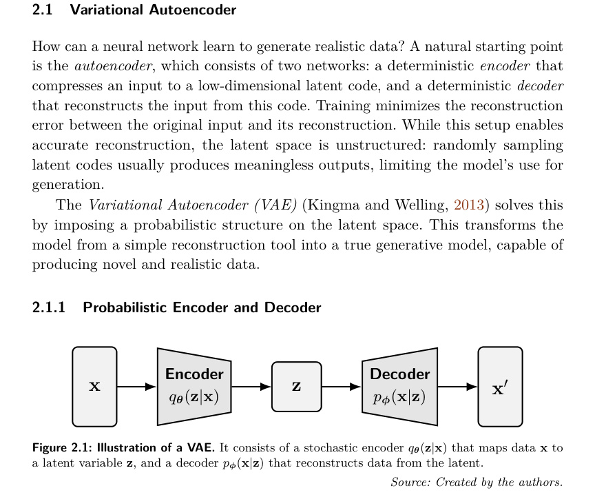
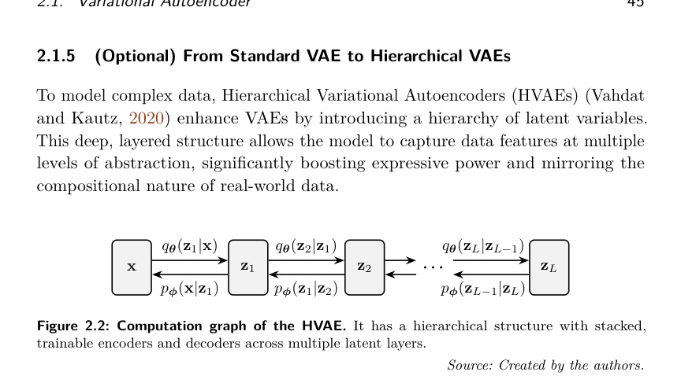

# 2.1 変分オートエンコーダ

ニューラルネットワークはどのように現実的なデータを生成するよう学習できるか？ 自然な出発点はオートエンコーダである。これは二つのネットワークからなる：入力を低次元の潜在符号へ圧縮する決定論的エンコーダと、この符号から入力を再構成する決定論的デコーダである。学習は元の入力とその再構成の間の再構成誤差を最小化する。この設定は正確な再構成を可能にするが、潜在空間は構造化されていない：潜在符号をランダムにサンプリングしても通常は無意味な出力しか得られず、生成への利用が制限される。

変分オートエンコーダ（Variational Autoencoder; VAE）（Kingma and Welling, 2013）は、潜在空間に確率的構造を課すことでこれを解決する。これによりモデルは単純な再構成ツールから、新規で現実的なデータを生成できる真の生成モデルへと変換される。

## 2.1.1 確率的エンコーダとデコーダ

**デコーダ（生成器）の構成。** VAE では二種類の変数を区別する：観測変数 $x$（見るデータ、例えば画像に対応）と、変動の隠れた要因（例えば物体の形状・色・様式）を捉える潜在変数 $z$ である。モデルは、各観測 $x$ が単純な事前分布——典型的には標準ガウス $z \sim p_{\mathrm{prior}} := \mathcal{N}(0,I)$——からサンプリングされた潜在変数から生成されると仮定する。

$z$ をデータ空間へ戻す写像として、デコーダ（生成器）分布 $p_\phi(x\mid z)$ を定義する。実際にはこのデコーダは単純に保たれ、しばしば因数分解ガウス（第2.1.3節参照）または類似の分布であり、学習がデータの暗記ではなく有用な潜在特徴の抽出に焦点を当てるようにする。直観的に、画素を一つずつ直接生成するのは極めて難しい；代わりに潜在変数がコンパクトな表現を提供し、そこから正確な画素配置を復号する方がはるかに容易になる。新しいサンプルは、まず $z \sim p_{\mathrm{prior}}$ をサンプリングし、次いで $x \sim p_\phi(x\mid z)$ で復号することで得られる。

これにより VAE は、周辺尤度を通じて潜在変数生成モデルを定義する：

$$
p_\phi(x) = \int p_\phi(x\mid z)\, p(z)\, dz.
$$

理想的には、デコーダパラメータ $\phi$ はこの周辺尤度を最大化することで学習される——最尤推定と同様（式 (1.1.2) 参照）。しかし、表現力豊かな非線形デコーダでは $z$ 上の積分が扱い不能であるため、直接の MLE は計算上実行不能であり、VAE で用いられる変分アプローチを動機づける。

**エンコーダ（推論ネットワーク）の構成。** 扱い不能な生成器を実データに接続するため、逆の問いを考えよ：観測 $x$ が与えられたとき、それを生じうる潜在符号 $z$ は何か？ ベイズの法則により、事後分布は

$$
p_\phi(z\mid x) = \frac{p_\phi(x\mid z)\, p(z)}{p_\phi(x)}
$$

である。

困難は、分母が周辺尤度 $p_\phi(x)$ を含み、すべての潜在変数上の積分を必要とし、非線形デコーダでは扱い不能であることである。したがって $x$ から $z$ への厳密推論は計算上禁止的である。

VAE における「変分」ステップは、扱い不能な事後を扱い可能な近似で置き換えることでこれに対処する。ニューラルネットワークでパラメータ化されたエンコーダ（または推論ネットワーク）$q_\theta(z\mid x)$ を導入し、学習可能な代理として機能させる：

$$
q_\theta(z\mid x) \approx p_\phi(z\mid x).
$$

実際には、エンコーダは各観測データ点 $x$ を潜在符号上の分布へ写し、$x$ から $z$ へ戻る実行可能で学習可能な経路を提供し、学習を可能にする。

## 2.1.2 エビデンス下界（ELBO）による学習

ここで計算可能な学習目的を定義する。$\log p_\phi(x)$ を直接最適化することはできないが、その下界——エビデンス下界（Evidence Lower Bound; ELBO）——を最大化できる：

> **定理 2.1.1: エビデンス下界（ELBO）**
>
> 任意のデータ点 $x$ に対し、対数尤度は
>
> $$
> \log p_\phi(x) \ge \mathcal{L}_{\mathrm{ELBO}}(\theta,\phi; x)
> $$
>
> を満たす。ここで ELBO は次で与えられる：
>
> $$
> \mathcal{L}_{\mathrm{ELBO}}
> = \underbrace{\mathbb{E}_{z\sim q_\theta(z\mid x)}\bigl[\log p_\phi(x\mid z)\bigr]}_{\text{再構成項}}
> - \underbrace{D_{\mathrm{KL}}\bigl(q_\theta(z\mid x)\Vert p(z)\bigr)}_{\text{潜在正則化}}. \tag{2.1.1}
> $$

**定理の証明。**
ELBO は Jensen の不等式から生じる：

$$
\begin{aligned}
\log p_\phi(x)
&= \log \int p_\phi(x,z)\, dz
= \log \int q_\theta(z\mid x)\, \frac{p_\phi(x,z)}{q_\theta(z\mid x)}\, dz \\
&= \log \mathbb{E}_{z\sim q_\theta(z\mid x)}\Bigl[\frac{p_\phi(x,z)}{q_\theta(z\mid x)}\Bigr]
\ge \mathbb{E}_{z\sim q_\theta(z\mid x)}\Bigl[\log \frac{p_\phi(x,z)}{q_\theta(z\mid x)}\Bigr].
\end{aligned}
$$

■

ELBO 目的は自然に二つの部分に分解する：

- **再構成**: 潜在符号 $z$ からの $x$ の正確な回復を促す。ガウスのエンコーダ・デコーダ仮定のもとでは、この項はオートエンコーダのなじみ深い再構成損失に正確に帰着する（第2.1.3節参照）。しかしオートエンコーダと同様、この項だけを最適化すると訓練データの暗記のリスクがあり、追加の正則化を動機づける。

- **潜在 KL**: エンコーダ分布 $q_\theta(z\mid x)$ を単純なガウス事前 $p_{\mathrm{prior}}(z)$ に近づけるよう促す。この正則化は潜在空間を滑らかで連続な構造に形作り、事前から抽出されたサンプルが信頼して復号できることを保証することで、意味のある生成を可能にする。

このトレードオフは、忠実な再構成と一貫したサンプリングの両方を保証する。

**情報理論的視点：ダイバージェンス下界としての ELBO。** ELBO 目的は自然な情報理論的解釈をもつ。最尤学習は KL ダイバージェンス

$$
D_{\mathrm{KL}}\bigl(p_{\mathrm{data}}(x)\Vert p_\phi(x)\bigr)
$$

の最小化に帰着することを思い出そう。これはモデル分布がデータ分布をどれだけよく近似するかを測る。この項は一般に扱い不能であるため、変分枠組みは同時比較を導入する。

具体的には、二つの同時分布を考える：

- **生成同時分布** $p_\phi(x,z) = p(z)p_\phi(x\mid z)$。モデルがデータをどう生成するかを記述する；
- **推論同時分布** $q_\theta(x,z) = p_{\mathrm{data}}(x)q_\theta(z\mid x)$。実データをその推論された潜在と結合する。

これらの分布を比較すると不等式

$$
D_{\mathrm{KL}}\bigl(p_{\mathrm{data}}(x)\Vert p_\phi(x)\bigr)
\le D_{\mathrm{KL}}\bigl(q_\theta(x,z)\Vert p_\phi(x,z)\bigr) \tag{2.1.2}
$$

が得られ、これはときに KL ダイバージェンスの連鎖律と呼ばれる。直観的に、周辺（$x$）だけを比較すると、完全な潜在–データ同時を考えると明らかになる不一致を隠しうる。

形式的には、同時 KL を次のように展開できる：

$$
\begin{aligned}
&D_{\mathrm{KL}}\bigl(q_\theta(x,z)\Vert p_\phi(x,z)\bigr)
\quad\text{（総誤差上界）} \\
&= \mathbb{E}_{q_\theta(x,z)}\Bigl[\log \frac{p_{\mathrm{data}}(x)q_\theta(z\mid x)}{p_\phi(x)\, p_\phi(z\mid x)}\Bigr] \\
&= \mathbb{E}_{p_{\mathrm{data}}(x)}\Bigl[\log \frac{p_{\mathrm{data}}(x)}{p_\phi(x)}\Bigr]
+ D_{\mathrm{KL}}\bigl(q_\theta(z\mid x)\Vert p_\phi(z\mid x)\bigr) \\
&= \underbrace{D_{\mathrm{KL}}(p_{\mathrm{data}}\Vert p_\phi)}_{\text{真のモデリング誤差}}
+ \underbrace{\mathbb{E}_{p_{\mathrm{data}}(x)}\bigl[D_{\mathrm{KL}}(q_\theta(z\mid x)\Vert p_\phi(z\mid x))\bigr]}_{\text{推論誤差}},
\end{aligned}
$$

ここで第1項は真のモデリング誤差、第2項は推論誤差、すなわち近似事後と真の事後の間のギャップである。後者は常に非負であり、これが式 (2.1.2) を説明する。

最後に、

$$
\log p_\phi(x) - \mathcal{L}_{\mathrm{ELBO}}(\theta,\phi; x)
= D_{\mathrm{KL}}\bigl(q_\theta(z\mid x)\Vert p_\phi(z\mid x)\bigr)
$$

であることに注意せよ。したがって推論誤差は対数尤度と ELBO の間のギャップそのものである。ELBO の最大化はしたがって推論誤差を直接減らすことに対応し、学習が全体の上界の意味のある部分を最小化することを保証する。

## 2.1.3 ガウス VAE

VAE の標準的定式化は、エンコーダとデコーダの両方にガウス分布を用いる。

**エンコーダ部。** エンコーダ $q_\theta(z\mid x)$ は典型的に次のガウス分布としてモデル化される：

$$
q_\theta(z\mid x) := \mathcal{N}\bigl(z;\, \mu_\theta(x),\, \mathrm{diag}(\sigma_\theta^2(x))\bigr),
$$

ここで $\mu_\theta : \mathbb{R}^D \to \mathbb{R}^d$ および $\sigma_\theta : \mathbb{R}^D \to \mathbb{R}_+^d$ はエンコーダネットワークの決定論的出力である。

**デコーダ部。** デコーダは典型的に固定分散のガウス分布としてモデル化される：

$$
p_\phi(x\mid z) := \mathcal{N}\bigl(x;\, \mu_\phi(z),\, \sigma^2 I\bigr),
$$

ここで $\mu_\phi : \mathbb{R}^d \to \mathbb{R}^D$ はニューラルネットワークであり、$\sigma > 0$ は分散を制御する小さな定数である。

この仮定のもとで、ELBO の再構成項は次のように簡略化される：

$$
\mathbb{E}_{q_\theta(z\mid x)}\bigl[\log p_\phi(x\mid z)\bigr]
= -\frac{1}{2\sigma^2}\mathbb{E}_{q_\theta(z\mid x)}\bigl[\|x - \mu_\phi(z)\|^2\bigr] + C,
$$

ここで $C$ は $\theta$ と $\phi$ に独立な定数である。したがって ELBO 目的は次に帰着する：

$$
\min_{\theta,\phi}
\mathbb{E}_{q_\theta(z\mid x)}\Bigl[\frac{1}{2\sigma^2}\|x - \mu_\phi(z)\|^2\Bigr]
+ D_{\mathrm{KL}}\bigl(q_\theta(z\mid x)\Vert p_{\mathrm{prior}}(z)\bigr),
$$

ここで KL 項はガウス仮定により閉形式解をもつ。したがって VAE の学習は、正則化された再構成損失の最小化に帰着する。

## 2.1.4 標準 VAE の欠点

VAE 枠組みの理論的魅力にもかかわらず、それは致命的な欠点に苦しむ：しばしばぼやけた出力を生成する[^1]。

**VAE におけるぼやけた生成。** この現象を理解するため、固定されたガウスエンコーダ $q_{\mathrm{enc}}(z\mid x)$ と、次の形のデコーダを考える：

$$
p_{\mathrm{dec}}(x\mid z) = \mathcal{N}\bigl(x;\, \mu(z),\, \sigma^2 I\bigr),
$$

ここで $\mu(z)$ はデコーダネットワークを表す。任意のエンコーダのもとで、ELBO の最適化は（加法定数を除き）期待再構成誤差の最小化に帰着する：

$$
\arg\min_\mu \mathbb{E}_{p_{\mathrm{data}}(x)\, q_{\mathrm{enc}}(z\mid x)}\bigl[\|x - \mu(z)\|^2\bigr].
$$

これは $\mu(z)$ に関する標準的な最小二乗問題であり、その解は条件付き平均によって閉形式で与えられる：

$$
\mu^*(z) = \mathbb{E}_{q_{\mathrm{enc}}(x\mid z)}[x],
$$

[^1]: ここで調べる限界は、上で導入した一般的な VAE 設定——二乗再構成誤差を通じて学習される単純なガウスデコーダ——に特有である。この設定では、母集団最適デコーダは条件付き平均を返す。視覚的に異なる複数の入力が重なる潜在領域に対応するとき、この平均化はぼやけとして現れうる。これはあらゆる VAE アーキテクチャや観測モデルについての普遍的主張として読むべきではない。

ここで $q_{\mathrm{enc}}(x\mid z)$ はエンコーダが誘導する、潜在が与えられたときの入力上の事後であり、ベイズの法則を通じて定義される：

$$
q_{\mathrm{enc}}(x\mid z) = \frac{q_{\mathrm{enc}}(z\mid x)\, p_{\mathrm{data}}(x)}{q_{\mathrm{enc}}(z)},
\qquad
q_{\mathrm{enc}}(z) := \int q_{\mathrm{enc}}(z\mid x)\, p_{\mathrm{data}}(x)\, dx.
$$

ベイズの法則による最適生成器の同等な形は：

$$
\mu^*(z)
= \frac{\mathbb{E}_{p_{\mathrm{data}}(x)}\bigl[q_{\mathrm{enc}}(z\mid x)\cdot x\bigr]}{q_{\mathrm{enc}}(z)}
= \frac{\mathbb{E}_{p_{\mathrm{data}}(x)}\bigl[q_{\mathrm{enc}}(z\mid x)\cdot x\bigr]}{\mathbb{E}_{p_{\mathrm{data}}(x)}\bigl[q_{\mathrm{enc}}(z\mid x)\bigr]}.
$$

今、二つの異なる入力 $x \neq x'$ が潜在空間の重なる領域に写される、すなわち $q_{\mathrm{enc}}(\cdot\mid x)$ と $q_{\mathrm{enc}}(\cdot\mid x')$ の台が交わるとする。すると $\mu^*(z)$ は複数の、潜在的に無関係な入力にわたって平均し、ぼやけた・非鮮明な出力につながる。衝突するモードにわたるこの平均化効果は、VAE 生成サンプルに特徴的なぼやけの根本的理由である。

## 2.1.5 （任意）標準 VAE から階層的 VAE へ

複雑なデータをモデル化するため、階層的変分オートエンコーダ（Hierarchical Variational Autoencoders; HVAEs）（Vahdat and Kautz, 2020）は潜在変数の階層を導入して VAE を強化する。この深い層状構造により、モデルは複数の抽象レベルでデータ特徴を捉えることができ、表現力を大きく高め、実世界データの合成的性質を映す。

**HVAE のモデリング。** 単一の潜在符号 $z$ を用いる標準 VAE と異なり、階層的 VAE（HVAE）は上から下への階層に配置された複数層の潜在変数を導入する。各潜在層は下の層を条件付け、徐々に細かい抽象レベルで構造を捉える条件付き事前の連鎖を形成する。これにより同時分布の次の上から下への因数分解が得られる：

$$
p_\phi(x, z_{1:L})
= p_\phi(x\mid z_1)\prod_{i=2}^{L} p_\phi(z_{i-1}\mid z_i)\, p(z_L).
$$

この構造は周辺データ分布

$$
p_{\mathrm{HVAE}}(x) := \int p_\phi(x, z_{1:L})\, dz_{1:L}
$$

を定義する。

生成は漸進的に進む：最上位の潜在変数 $z_L$ から始め、各潜在が $z_1$ まで順に復号され、最後に最終観測 $x$ が生成される。

符号化については、HVAE は生成階層を映す構造化された学習可能な変分エンコーダ $q_\theta(z_{1:L}\mid x)$ を用いる。一般的な選択は下から上へのマルコフ因数分解である：

$$
q_\theta(z_{1:L}\mid x)
= q_\theta(z_1\mid x)\prod_{i=2}^{L} q_\theta(z_i\mid z_{i-1}).
$$

**HVAE の ELBO。** 式 (2.1.1) と同様、ELBO は Jensen の不等式を通じて導かれる：

$$
\begin{aligned}
\log p_{\mathrm{HVAE}}(x)
&= \log \int p_\phi(x, z_{1:L})\, dz_{1:L} \\
&= \log \int \frac{p_\phi(x, z_{1:L})}{q_\theta(z_{1:L}\mid x)}\, q_\theta(z_{1:L}\mid x)\, dz_{1:L} \\
&= \log \mathbb{E}_{q_\theta(z_{1:L}\mid x)}\Bigl[\frac{p_\phi(x, z_{1:L})}{q_\theta(z_{1:L}\mid x)}\Bigr] \tag{2.1.3} \\
&\ge \mathbb{E}_{q_\theta(z_{1:L}\mid x)}\Bigl[\log \frac{p_\phi(x, z_{1:L})}{q_\theta(z_{1:L}\mid x)}\Bigr] \\
&=: \mathcal{L}_{\mathrm{ELBO}}(\phi).
\end{aligned}
$$

因数分解形を代入すると：

$$
\mathcal{L}_{\mathrm{ELBO}}
= \mathbb{E}_{q_\theta(z_{1:L}\mid x)}
\Biggl[\log
\frac{p(z_L)\prod_{i=2}^{L} p_\phi(z_{i-1}\mid z_i)\, p_\phi(x\mid z_1)}
{q_\theta(z_1\mid x)\prod_{i=2}^{L} q_\theta(z_i\mid z_{i-1})}
\Biggr].
$$

この階層的 ELBO は、再構成項、隣接層マッチング項、および事前への最上位 KL 正則化を含む、解釈可能な項に分解する。

浅いネットワークから深いネットワークへの飛躍が機械学習を革命し、同様の考えが生成モデルを変えた。HVAE は、データを構築するために深く積み重ねられた層を用いる力を示した。層状階層というこの概念は現代の生成モデリングの要石であり、スコアベース手法（第3.4節）および正規化フロー（第5.1節）に再び現れる。中核の洞察は単純だが強力である：

> **観察 2.1.1:**
> 層を積み重ねることで、モデルは粗い詳細から始め、各ステップでより細かいものを加えてデータを漸進的に生成できる。この過程により、高次元データの複雑な構造を捉えることがはるかに容易になる。

**平坦な VAE でより深いネットワークでは不十分な理由。** 標準の平坦な VAE には、エンコーダとデコーダを単により深くするだけでは解決されない二つの根本的限界がある。

第一の限界は変分族である。標準 VAE では

$$
q_\theta(z\mid x) = \mathcal{N}\bigl(z;\, \mu_\theta(x),\, \mathrm{diag}(\sigma_\theta^2(x))\bigr)
$$

なので、固定された各 $x$ に対しエンコーダ事後は対角共分散をもつ単一ガウスである。より大きなネットワーク深さは $\mu_\theta$ と $\sigma_\theta$ の精度を改善するが、族を広げない；完全共分散であっても一つの単峰楕円体のままである。$p_\phi(z\mid x)$ が多峰であるとき、この族はそれに一致できず、ELBO を緩め、推論を弱める。これに対処するには、単により深いネットワークではなく、より豊かな事後クラスが必要である。

第二に、デコーダが過度に表現力豊かだと、モデルは事後崩壊（posterior collapse）に苦しむことがある。なぜかを見るため、VAE の目的が

$$
\begin{aligned}
&\mathbb{E}_{p_{\mathrm{data}}(x)}\bigl[\mathcal{L}_{\mathrm{ELBO}}(x)\bigr] \\
&= \mathbb{E}_{p_{\mathrm{data}}(x)\, q_\theta(z\mid x)}\bigl[\log p_\phi(x\mid z)\bigr]
- \mathbb{E}_{p_{\mathrm{data}}(x)}\bigl[D_{\mathrm{KL}}\bigl(q_\theta(z\mid x)\Vert p(z)\bigr)\bigr] \\
&= \mathbb{E}_{p_{\mathrm{data}}(x)\, q_\theta(z\mid x)}\bigl[\log p_\phi(x\mid z)\bigr]
- I_q(x; z)
- D_{\mathrm{KL}}\bigl(q_\theta(z)\Vert p(z)\bigr)
\end{aligned}
$$

であることを思い出そう。ここで $I_q(x; z)$ は相互情報量であり、

$$
I_q(x; z)
= \mathbb{E}_{q(x,z)}\Bigl[\log \frac{q_\theta(z\mid x)}{q(z)}\Bigr]
= \mathbb{E}_{p_{\mathrm{data}}(x)}\bigl[D_{\mathrm{KL}}\bigl(q_\theta(z\mid x)\Vert q(z)\bigr)\bigr]
$$

で定義され、集約事後は $q_\theta(z) = \int p_{\mathrm{data}}(x)q_\theta(z\mid x)\, dx$ である。

デコーダクラスが $z$ を用いずにデータをうまくモデル化できる（すなわち、$p_{\mathrm{data}}$ に近いある $p_\phi(x\mid z) = r(x)$ を含む）なら、ELBO の最大化子は $q_\theta(z\mid x) = p(z)$ と設定し、したがって $I_q(x; z) = 0$ かつ $q_\theta(z) = p(z)$ となる。この「$z$ を無視する」解はネットワークを深くしても消えない：(1) 学習された符号は $x$ と独立になる（したがって下流タスクに有用なデータ依存構造を運ばない）、(2) $z$ における条件付けや移動が生成サンプルに影響しないため、制御可能な生成が失敗する。

**階層は何を変えるか？** HVAE は複数の潜在レベルを導入する：

$$
p_\phi(x, z_{1:L})
= p_\phi(x\mid z_1)\prod_{i=2}^{L} p_\phi(z_{i-1}\mid z_i)\, p(z_L),
$$

ELBO は

$$
\begin{aligned}
\mathcal{L}_{\mathrm{ELBO}}(x)
&= \mathbb{E}_{q_\theta(z_1\mid x)}\bigl[\log p_\phi(x\mid z_1)\bigr] \\
&\quad - \mathbb{E}_{q_\theta(z_{1:2}\mid x)}\bigl[\log q_\theta(z_1\mid x) - \log p_\phi(z_1\mid z_2)\bigr] \\
&\quad - \sum_{i=2}^{L-1}
\mathbb{E}_{q_\theta(z_{1:i+1}\mid x)}\bigl[\log q_\theta(z_i\mid z_{i-1}) - \log p_\phi(z_i\mid z_{i+1})\bigr] \\
&\quad - \mathbb{E}_{q_\theta(z_{L-1}\mid x)}\bigl[D_{\mathrm{KL}}\bigl(q_\theta(z_L\mid z_{L-1})\Vert p(z_L)\bigr)\bigr].
\end{aligned}
$$

ここで $\mathbb{E}_q := \mathbb{E}_{p_{\mathrm{data}}(x)\, q_\theta(z_{1:L}\mid x)}$ と記す。各潜在レベルは階層内の隣接レベルとのみ相互作用する：エンコーダは $q_\theta(z_i\mid z_{i-1})$ を通じて情報を上へ渡し、デコーダは $p_\phi(z_{i-1}\mid z_i)$ を通じて情報を下へ渡す。したがって ELBO は再構成項、隣接層マッチング項、および事前への最上位 KL 正則化に分解する。これらの性質は階層的潜在グラフに由来し、平坦な VAE でネットワークを単に深くすることからではない。

**これからどうなるか？** HVAE は表現力のために複数の潜在層で VAE 枠組みを拡張するが、その学習は独特の課題を突きつける。エンコーダとデコーダを共同最適化しなければならないため、学習は不安定になる：下位層とデコーダがすでに $x$ を再構成でき、上位レベルの潜在にはほとんど有効な信号が残らない。さらに、より深い変数に到達する勾配情報はしばしば間接的で弱く、それらが意味のある貢献をするのを難しくする。追加の困難はモデル容量のバランスにあり、過度に表現力豊かな条件付きが再構成タスクを支配し、上位潜在の有用性を抑圧しうる。

興味深いことに、深く層状の階層という中核の考えは、変分拡散モデル——第2.2節で探る話題——においてより強力な具現化を見出す。拡散モデルは HVAE の漸進的構造を継承しつつ、その中心的弱点を優雅に回避する。符号化過程を固定し、生成的逆転の学習のみに焦点を当てることで、新たな安定性とモデリングの柔軟性を解き放ち、生成出力の品質における大きな飛躍につながる。

記法の簡単のため、エンコーダに $q$、生成器に $p$ を用いる一般的な VAE の慣例から逸脱する。曖昧さを避けるため、分布を $p$ と記し、適切な添字や上付き添字を通じて常にその役割を指定し、文脈で明確にする。
