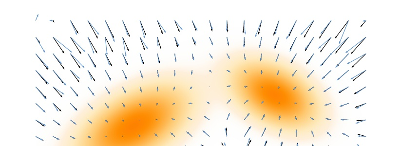

# 3.2 エネルギーベースからスコアベース生成モデルへ

- **原題**: From Energy-Based to Score-Based Generative Models
- **日本語タイトル**: エネルギーベースからスコアベース生成モデルへ
- **出典**: §3.2

EBM は、生成が正規化された完全な密度ではなく、より高い確率の領域を指すスコアのみに依存することを示す。スコアマッチングは分配関数を避けるが、エネルギーを通じた学習は依然として高価な 2 階微分を要する。鍵となる考えは、ランジュバン動力学によるサンプリングがスコアだけを必要とするのだから、ニューラルネットワークでそれを直接学習できる、ということである。エネルギーをモデル化することからスコアをモデル化することへのこの転換が、スコアベース生成モデル（score-based generative models）の基礎をなす。

## 3.2.1 スコアマッチングによる学習

**スコアマッチング。** $p_{\mathrm{data}}$ のサンプルからスコア関数 $s(x)=\nabla_x\log p_{\mathrm{data}}(x)$ を近似するため、ニューラルネットワーク $s_\phi(x)$ でパラメータ化されたベクトル場として直接近似する（図 3.4 を参照）：

$$
s_\phi(x) \approx s(x).
$$

スコアマッチングは、真のスコアと推定スコアの間の平均二乗誤差（MSE, mean squared error）を最小化することでこのベクトル場を当てはめる：

$$
\mathcal{L}_{\mathrm{SM}}(\phi) := \tfrac{1}{2}\,\mathbb{E}_{x\sim p_{\mathrm{data}}}\bigl\|s_\phi(x) - s(x)\bigr\|_2^2.
\quad (3.2.1)
$$

**扱いやすいスコアマッチング。** 一見すると、回帰ターゲットである真のスコア $s(x)$ が未知であるため、この目的は実行不可能に見える。幸い、Hyvärinen and Dayan (2005) は、部分積分により、真のスコアへのアクセスを必要とせず、モデル $s_\phi$ とデータサンプルのみに依存する等価な目的が得られることを示した。この鍵となる結果を次の命題で述べる。

> **命題 3.2.1（Hyvärinen の扱いやすい SM の形）**
>
> 次の等式が成り立つ：
>
> $$
> \mathcal{L}_{\mathrm{SM}}(\phi) = \widetilde{\mathcal{L}}_{\mathrm{SM}}(\phi) + C.
> $$
>
> ここで
>
> $$
> \widetilde{\mathcal{L}}_{\mathrm{SM}}(\phi) := \mathbb{E}_{x\sim p_{\mathrm{data}}(x)}\Bigl[\operatorname{Tr}\bigl(\nabla_x s_\phi(x)\bigr) + \tfrac{1}{2}\|s_\phi(x)\|_2^2\Bigr].
> \quad (3.2.2)
> $$
>
> であり、$C$ は $\phi$ に依存しない定数である。最小化子 $s^*$ は $s^*(\cdot)=\nabla_x\log p(\cdot)$ として得られる。

**命題の証明。** 結果は $\mathcal{L}_{\mathrm{SM}}$ の MSE を展開し部分積分を適用することで従う。証明は §D.2.1 に与える。■

式 (3.2.2) の等価な目的を用い、$p_{\mathrm{data}}$ の観測サンプルのみからスコアモデル $s_\phi(x)$ を学習し、真のスコア関数の必要性を取り除く。

**式 (3.2.2) の直感。** 代替のスコアマッチング目的 $\widetilde{\mathcal{L}}_{\mathrm{SM}}(\phi)$ は、その 2 つの項から理解できる。ノルム項 $\tfrac{1}{2}\|s_\phi(x)\|_2^2$ は、特に $p_{\mathrm{data}}$ が大きい領域で大きなスコア値を罰する。ダイバージェンス項 $\operatorname{Tr}(\nabla_x s_\phi(x))$ は損失で正の符号を持つので、目的の最小化は局所的に収縮する振る舞いも好む。これら 2 項が合わさって、母集団最適スコア場 $s^*(x)=\nabla_x\log p_{\mathrm{data}}(x)$ を与える。幾何的直感をより詳しく以下で説明する。

**大きさの項の効果。** $\widetilde{\mathcal{L}}_{\mathrm{SM}}(\phi)$ の期待値は $p_{\mathrm{data}}$ の下で取られるため、$p_{\mathrm{data}}(x)$ が大きい（データ密度が高い）領域が損失により強く寄与する。したがって大きさの項 $\tfrac{1}{2}\|s_\phi(x)\|_2^2$ は、これらの領域での大きなスコア値に対してより強い罰を課す。ただしこの項だけでは、すべての高密度点で $s_\phi(x)=0$ であることを意味しない。母集団最適では

$$
s^*(x) = \nabla_x \log p_{\mathrm{data}}(x)
$$

であり、これは対数密度の停留点でのみ消える。

**場が（近似的に）勾配であるときの凹性。** ダイバージェンス項 $\operatorname{Tr}(\nabla_x s_\phi(x))$ が損失で正の符号を持つため、目的の最小化はデータ分布が強調する領域での負のダイバージェンスを好む。負のダイバージェンスは正味の局所収縮を示すが、それだけでは停留点が吸い込みであることを保証しない。これを精密にするため、対数密度を一致させるときに自然であるように、スカラー関数 $u:\mathbb{R}^D\to\mathbb{R}$ に対して $s_\phi=\nabla_x u$ と仮定する。すると $\nabla_x s_\phi=\nabla_x^2 u$（ヘッセ）であり、$\nabla\cdot s_\phi(x)=\operatorname{Tr}(\nabla_x^2 u(x))$（ダイバージェンス）である。

停留点 $x^\star$（ここで $s_\phi(x^\star)=\nabla_x u(x^\star)=0$）では、2 次のテイラー展開により

$$
u(x) = u(x^\star) + \tfrac{1}{2}(x-x^\star)^\top\nabla_x^2 u(x^\star)(x-x^\star) + o(\|x-x^\star\|^2).
$$

ヘッセ $\nabla_x^2 u(x^\star)$ が負定値なら、$u$ は $x^\star$ で局所凹であり、対数密度はそこで厳密な局所最大[^fn-3-2-1]を達成する。ヘッセのすべての固有値が負なので、トレースも負である：$\operatorname{Tr}(\nabla_x^2 u(x^\star))<0$。したがってこの場合、停留点はスコア場の下で局所的に吸引的である：小さな摂動は $x^\star$ へ引き戻される。

## 3.2.2 ランジュバン動力学によるサンプリング

式 (3.2.2) の最小化により学習された後、スコアモデル $s_{\phi^\times}(x)$ は、サンプリングのためのランジュバン動力学におけるオラクルスコアの代わりに使える：

$$
x_{n+1} = x_n + \eta s_{\phi^\times}(x_n) + \sqrt{2\eta}\,\epsilon_n, \qquad \epsilon_n\sim\mathcal{N}(0,I),
\quad (3.2.3)
$$

$n=0,1,2,\ldots$、初期値 $x_0$。EBM の場合の式 (3.1.6) と同様、この漸化式は連続時間ランジュバン SDE

$$
\mathrm{d}x(t) = s_{\phi^\times}\bigl(x(t)\bigr)\,\mathrm{d}t + \sqrt{2}\,\mathrm{d}w(t)
$$

のオイラー–丸山離散化そのものであり、初期化は $x(0)$ である。したがってステップサイズが小さい極限では、離散と連続の定式化は一致する。実際には、離散サンプラーを走らせるか、SDE を直接シミュレートするかのいずれも可能である。

## 3.2.3 序章：スコアベース生成モデル

本章の残りの部分では、現代の拡散モデルにおけるスコア関数の基礎的役割を調べる。当初は EBM の効率的な学習を可能にするために導入されたスコア関数は、新しい世代の生成モデルの中心要素へと進化した。この基礎の上に、スコア関数がスコアベース拡散モデルの理論的定式化と実用的実装にどのように情報を与え、確率過程を通じたデータ生成のための原理的枠組みを提供するかを探る。

[^fn-3-2-1]: 厳密な凹性（したがって対数密度の厳密な局所最大）には、ヘッセ $\nabla_x^2 u$ 全体が負定値であることが必要であり、単に負のトレースを持つだけでは不十分である。負のトレースは固有値の和が負であることを保証するが、一部の固有値が正のままで、最大ではなく鞍点になりうる。
