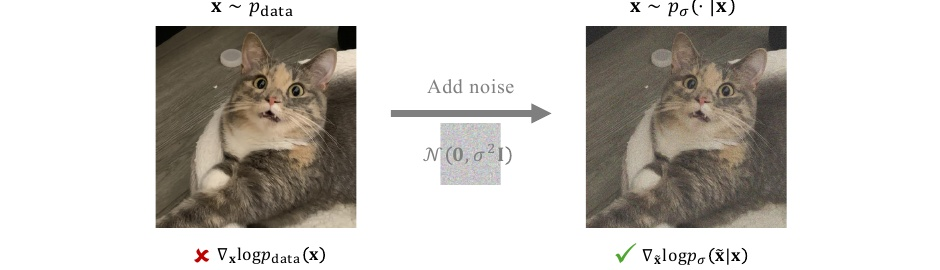

# 3.3 デノイジング・スコアマッチング

- **原題**: Denoising Score Matching
- **日本語タイトル**: デノイジング・スコアマッチング
- **出典**: §3.3

## 3.3.1 動機

式 (3.2.2) の代替目的

$$
\widetilde{\mathcal{L}}_{\mathrm{SM}}(\phi)
= \mathbb{E}_{x\sim p_{\mathrm{data}}}\Bigl[\operatorname{Tr}\bigl(\nabla_x s_\phi(x)\bigr) + \tfrac{1}{2}\|s_\phi(x)\|_2^2\Bigr]
$$

はより扱いやすいが、依然としてヤコビアンのトレース $\operatorname{Tr}(\nabla_x s_\phi(x))$ の計算を要する。これはヤコビアン行列全体を構成する必要はないが、厳密な評価は一般に入力次元 $D$ が増えるにつれ高価になる。入力座標全体にわたる微分情報の集約が必要だからである。したがって高次元では計算コストが高くなりうる。

これに対処するため、スライスド・スコアマッチング（sliced score matching）（Song et al., 2020b）は、トレース項をランダム射影に基づく確率的推定で置き換える。以下でその考えを簡潔に概説する。

**スライスド・スコアマッチングとハッチンソン推定器。** スライスド・スコアマッチングは、スコアマッチングのトレースを、ランダムな「スライス」に沿った方向微分の平均で置き換える。$u\in\mathbb{R}^D$ を等方的なランダムベクトル（例: ラデマッハまたは標準ガウス）とし、$\mathbb{E}[u]=0$、$\mathbb{E}[uu^\top]=I$ とする。ハッチンソンの恒等式（Hutchinson's identity）

$$
\operatorname{Tr}(A)=\mathbb{E}_u[u^\top A u],\qquad
\mathbb{E}_u[(u^\top s_\phi(x))^2]=\|s_\phi(x)\|_2^2
$$

により、厳密な形

$$
\widetilde{\mathcal{L}}_{\mathrm{SM}}(\phi)
= \mathbb{E}_{x,u}\Bigl[u^\top\bigl(\nabla_x s_\phi(x)\bigr)u + \tfrac{1}{2}(u^\top s_\phi(x))^2\Bigr]
$$

が得られる。この目的は、大きなヤコビアンやヘッセ行列を明示的に計算する代わりに、ヤコビアン–ベクトル積／ベクトル–ヤコビアン積（JVP/VJP）操作を用いた自動微分で効率的に評価できる。$K$ 本のランダムプローブにわたる平均は分散 $O(1/K)$ の不偏推定器を与え、方向項 $u^\top(\nabla_x s_\phi)u$ は明示的ヤコビアンなしに JVP/VJP ルーチンで効率的に計算できる。直感的には、ランダムな方向に沿ってモデルの振る舞いだけを調べることを意味する：射影されたスコアはデータ密度が高い領域に揃うよう押しやられ、データ点は期待値の意味で停留点になる。

**スライスドからデノイジング・スコアマッチングへ。** スライスド・スコアマッチングはヤコビアンを回避するが、依然として生のデータ分布に依る。このため脆弱である：低次元多様体上にある画像データでは、スコア $\nabla_x\log p_{\mathrm{data}}(x)$ は未定義または不安定になりえ、方法は観測点でのベクトル場だけを制約し、その近傍での制御は弱い。さらにプローブ由来の分散と繰り返しの JVP/VJP コストにも苦しむ。

ここで焦点を当てる、より頑健な代替がデノイジング・スコアマッチング（DSM, Denoising Score Matching）（Vincent, 2011）であり、原理的でスケーラブルな解を提供する。

## 3.3.2 学習

式 (3.2.1) の SM 損失を再訪する：

$$
\mathcal{L}_{\mathrm{SM}}(\phi)
= \tfrac{1}{2}\,\mathbb{E}_{x\sim p_{\mathrm{data}}(x)}\bigl\|s_\phi(x)-\nabla_x\log p_{\mathrm{data}}(x)\bigr\|_2^2,
$$

ここで問題は扱いづらい項 $\nabla_x\log p_{\mathrm{data}}(x)$ から生じる。

**Vincent (2011) の条件付けによる解。** $\nabla_x\log p_{\mathrm{data}}(x)$ の扱いづらさを克服するため、Vincent (2011) は、既知の条件付き分布 $p_\sigma(\tilde{x}|x)$（スケール $\sigma$）を通じてデータ $x\sim p_{\mathrm{data}}$ にノイズを注入することを提案した。ニューラルネットワーク $s_\phi(\tilde{x},\sigma)$ は、周辺摂動分布

$$
p_\sigma(\tilde{x})=\int p_\sigma(\tilde{x}|x)\,p_{\mathrm{data}}(x)\,dx
$$

のスコアを近似するよう、損失

$$
\mathcal{L}_{\mathrm{SM}}(\phi;\sigma)
:= \tfrac{1}{2}\,\mathbb{E}_{\tilde{x}\sim p_\sigma}\bigl\|s_\phi(\tilde{x},\sigma)-\nabla_{\tilde{x}}\log p_\sigma(\tilde{x})\bigr\|_2^2
\quad (3.3.1)
$$

を最小化して学習される。

$\nabla_{\tilde{x}}\log p_\sigma(\tilde{x})$ は一般に扱いづらいが、Vincent (2011) は、$x\sim p_{\mathrm{data}}$ への条件付けが等価で扱いやすい目的——デノイジング・スコアマッチング（DSM）損失——を与えることを示した：

$$
\mathcal{L}_{\mathrm{DSM}}(\phi;\sigma)
:= \tfrac{1}{2}\,\mathbb{E}_{x\sim p_{\mathrm{data}},\,\tilde{x}\sim p_\sigma(\cdot|x)}
\bigl\|s_\phi(\tilde{x},\sigma)-\nabla_{\tilde{x}}\log p_\sigma(\tilde{x}|x)\bigr\|_2^2.
\quad (3.3.2)
$$

式 (3.3.2) の最適最小化子 $s^*$ は

$$
s^*(\tilde{x},\sigma)=\nabla_{\tilde{x}}\log p_\sigma(\tilde{x})
$$

を満たし、これは式 (3.3.1) に対しても最適である。

例えば $p_\sigma(\tilde{x}|x)$ が分散 $\sigma^2$ のガウスノイズのとき、

$$
p_\sigma(\tilde{x}|x)=\mathcal{N}(\tilde{x};x,\sigma^2 I)
$$

であり、勾配 $\nabla_{\tilde{x}}\log p_\sigma(\tilde{x}|x)$ は閉形式を持つ（式 (3.3.4) を参照）。回帰ターゲットが明示的で計算上扱いやすい。

さらに、$\sigma\approx 0$ のとき $p_\sigma(\tilde{x})\approx p_{\mathrm{data}}(x)$ であり、

$$
s^*(\tilde{x},\sigma)=\nabla_{\tilde{x}}\log p_\sigma(\tilde{x})\approx\nabla_x\log p_{\mathrm{data}}(x)
$$

となり、学習されたスコアが元のデータスコアを近似し、生成への利用を可能にすることが示される。

$\mathcal{L}_{\mathrm{SM}}$ と $\mathcal{L}_{\mathrm{DSM}}$ の勾配等価性に関するこの議論を、次の定理で形式化する。

> **定理 3.3.1（$\mathcal{L}_{\mathrm{SM}}$ と $\mathcal{L}_{\mathrm{DSM}}$ の等価性）**
>
> 任意の固定ノイズスケール $\sigma>0$ に対し、次が成り立つ：
>
> $$
> \mathcal{L}_{\mathrm{SM}}(\phi;\sigma)=\mathcal{L}_{\mathrm{DSM}}(\phi;\sigma)+C,
> \quad (3.3.3)
> $$
>
> ここで $C$ はパラメータ $\phi$ に依存しない定数である。さらに、両損失の最小化子 $s^*(\cdot,\sigma)$ は
>
> $$
> s^*(\tilde{x},\sigma)=\nabla_{\tilde{x}}\log p_\sigma(\tilde{x})
> \quad\text{（ほとんどすべての $\tilde{x}$ について）}
> $$
>
> を満たす。

**定理の証明。** 等価性は直接計算から従う：$\mathcal{L}_{\mathrm{SM}}$ と $\mathcal{L}_{\mathrm{DSM}}$ の MSE を展開すると、$\phi$ に依存する項はすべて相殺し、$\phi$ に依存しない定数差だけが残る。最小化子の導出は命題 4.3.1 と同じ議論に従う。詳細な導出は §D.2.2 に委ねる。■

この定理は、DDPM における定理 2.2.1 と同様、共有される鍵原理を示す：

> **洞察 3.3.1（条件付け技法）**
>
> 条件付け技法は、DDPM における拡散モデルの変分的見方（定理 2.2.1 を参照）にも現れ、データ点 $x$ への条件付けが扱いづらい損失をモンテカルロ推定に適した扱いやすい損失へ変える。類似の考えはフローベースの視点（例: Flow Matching (Lipman et al., 2022)）にも現れ、§5.2 で見る。

**特別な場合：加法的ガウスノイズ。** 各データ点 $x\sim p_{\mathrm{data}}$ に分散 $\sigma^2$ のガウスノイズ $\mathcal{N}(0,\sigma^2 I)$ を加える一般的な場合を考える：

$$
\tilde{x}=x+\sigma\epsilon,\qquad\epsilon\sim\mathcal{N}(0,I),
$$

したがって破損データ $\tilde{x}$ は

$$
p_\sigma(\tilde{x}|x)=\mathcal{N}(\tilde{x};x,\sigma^2 I)
$$

に従う。この設定では、条件付きスコアは解析的に

$$
\nabla_{\tilde{x}}\log p_\sigma(\tilde{x}|x)=\frac{x-\tilde{x}}{\sigma^2}
$$

で与えられる。ゆえに DSM 損失は次に単純化する：

$$
\begin{aligned}
\mathcal{L}_{\mathrm{DSM}}(\phi;\sigma)
&= \tfrac{1}{2}\,\mathbb{E}_{x,\tilde{x}|x}\Bigl\|s_\phi(\tilde{x},\sigma)-\frac{x-\tilde{x}}{\sigma^2}\Bigr\|_2^2 \\
&= \tfrac{1}{2}\,\mathbb{E}_{x,\epsilon}\Bigl\|s_\phi(x+\sigma\epsilon,\sigma)+\frac{\epsilon}{\sigma}\Bigr\|_2^2,
\quad (3.3.4)
\end{aligned}
$$

ここで $\epsilon\sim\mathcal{N}(0,I)$。この目的が（スコアベースの）拡散モデルの核心をなす。

固定ノイズレベル $\sigma>0$ では、DSM は $p_{\mathrm{data}}$ 自体のスコアではなく、ガウス平滑化された分布

$$
p_\sigma = p_{\mathrm{data}} * \mathcal{N}(0,\sigma^2 I)
$$

のスコアを学習する。$\sigma$ が小さいとき破損は穏やかで、$p_\sigma$ はデータ分布の局所構造をなお密接に保つ。したがってそのスコアは、ノイズのあるサンプルを尤もらしいデータ領域へ戻す有用な方向を与える。$\sigma$ が大きくなるにつれ、ガウス平滑化は細かい詳細を徐々に除去し、近傍のモードを融合する。対応するスコアは主により粗い大域構造を捉える。この振る舞いは望ましくないというより有用である：§3.4 の多ノイズ構成は意図的に多くのノイズレベルを組み合わせ、粗い探索に大きなノイズ、細かい精錬に小さなノイズを用いる。

目的がなぜ自然に「デノイジング」過程に対応するかをよりよく見るため、§3.3.4 と §3.3.5 の議論を展開する。

## 3.3.3 サンプリング

ノイズレベル $\sigma$ で学習済みスコアモデル $s_{\phi^\times}(\tilde{x},\sigma)$ を得た後、真のスコアを学習モデルで置き換えてランジュバン動力学によりサンプルを生成する。更新則は：

$$
\tilde{x}_{n+1}
= \tilde{x}_n + \eta\,\underbrace{s_{\phi^\times}(\tilde{x}_n,\sigma)}_{\approx\nabla_{\tilde{x}}\log p_\sigma(\tilde{x}_n)}
+ \sqrt{2\eta}\,\epsilon_n,
\qquad\epsilon_n\sim\mathcal{N}(0,I),
\quad (3.3.5)
$$

$n=0,1,2,\ldots$、初期値 $\tilde{x}_0$。$\sigma$ が十分小さければ、十分な反復の後 $\tilde{x}_n$ は $p_{\mathrm{data}}$ からのサンプルを近似する。

**ノイズ注入の利点。** 加えて、式 (3.2.1) の素のスコアマッチングと比べ、$p_\sigma$ を形成するためのガウスノイズの注入（例: 式 (3.3.4)）は 2 つの鍵となる利点を与える（Song and Ermon, 2019）：

- **よく定義された勾配。** ノイズはデータをその低次元多様体から離して摂動し、$\mathbb{R}^D$ で完全なサポートを持つ分布 $p_\sigma$ をもたらす。結果として、スコア関数 $\nabla_{\tilde{x}}\log p_\sigma(\tilde{x})$ はいたるところでよく定義される。

- **改善されたカバレッジ。** ノイズはモード間の疎な領域を平滑化し、学習信号の質を高め、ランジュバン動力学が低密度領域をより効果的に横断することを助ける。

## 3.3.4 なぜ DSM はデノイジングか：ツイディーの公式

ツイディーの公式（Tweedie's formula）（Efron, 2011）から始める。これはノイズ観測だけからのデノイジングに原理的基礎を与える。具体的には、未知の $x\sim p_{\mathrm{data}}$ からの単一のガウス破損観測 $\tilde{x}\sim\mathcal{N}(\cdot;\alpha x,\sigma^2 I)$ が与えられたとき、デノイズされた推定（$\tilde{x}$ が与えられたときのすべての尤もらしいクリーン信号にわたる平均）は、ノイズ周辺

$$
p_\sigma(\tilde{x}):=\int\mathcal{N}(\tilde{x};\alpha x,\sigma^2 I)\,p_{\mathrm{data}}(x)\,dx
$$

のスコア $\nabla_{\tilde{x}}\log p_\sigma(\tilde{x})$ の方向に、$\tilde{x}$ をサイズ $\sigma^2$ のステップで押しやることで得られる、と述べる。命題を以下に形式的に示す。

> **補題 3.3.2（ツイディーの公式）**
>
> $x\sim p_{\mathrm{data}}$ とし、条件付きで $\tilde{x}\sim\mathcal{N}(\cdot;\alpha x,\sigma^2 I)$（$\alpha\neq 0$）とする。するとツイディーの公式は
>
> $$
> \alpha\,\mathbb{E}_{x\sim p(x|\tilde{x})}[x\mid\tilde{x}]
> = \tilde{x} + \sigma^2\nabla_{\tilde{x}}\log p_\sigma(\tilde{x})
> \quad (3.3.6)
> $$
>
> を述べる。ここで期待値は $\tilde{x}$ が与えられた $x$ の事後分布 $p(x|\tilde{x})$ の下で取る。

**補題の証明。** 証明は周辺

$$
p(\tilde{x})=\int p(\tilde{x}|x)\,p_{\mathrm{data}}(x)\,dx
$$

のスコアを計算することから進む。積分の下で微分し、条件付き密度のガウス形を用いると、スコアと事後平均を結ぶ所望の恒等式に直接並び替えられる表現が得られる。詳細は §D.2.3 を参照。■

ツイディーの公式は、DDPM のように多層のノイズが導入される拡散モデルで中心的役割を果たす。スコア関数を通じてノイズ観測からクリーンサンプルを推定することを可能にし、スコア予測とデノイザの間の基礎的な結びつきを確立する：

$$
\underbrace{\mathbb{E}[x\mid\tilde{x}]}_{\substack{\text{デノイザ}\\\text{$\tilde{x}$ から推定}}}
= \frac{1}{\alpha}\Bigl(\tilde{x}+\sigma^2\nabla_{\tilde{x}}\log p_\sigma(\tilde{x})\Bigr).
$$

特に、ノイズ対数尤度上の単一の勾配上昇ステップ（特定のステップサイズ $\sigma^2$）がデノイズ推定（条件付き平均クリーン信号）である。これにより DSM 学習とデノイジングは密接に関係する：DSM から学習した $s_\phi(\tilde{x})\approx\nabla_{\tilde{x}}\log p_\sigma(\tilde{x})$ なら、

$$
\frac{1}{\alpha}\bigl(\tilde{x}+\sigma^2 s_\phi(\tilde{x})\bigr)
$$

がデノイザである。

**(任意) 高次のツイディーの公式。** 古典的ツイディーの公式は事後平均 $\mathbb{E}[x_0|\tilde{x}]$ を勾配 $\nabla_{\tilde{x}}\log p(\tilde{x})$ を通じて表す。高次拡張（Meng et al., 2021a）は、事後共分散と高次キュムラントを $\log p(\tilde{x})$ の高階微分を通じて表す。

**対数正規化子 $\lambda(\tilde{x})$ を持つ指数型分布族の設定。** 潜在自然パラメータ $\eta\in\mathbb{R}^D$ が与えられた $\tilde{x}$ の条件付き法則が、次の形の自然指数型分布族に属すると仮定する：

$$
q_\sigma(\tilde{x}|\eta)=\exp\bigl(\eta^\top\tilde{x}-\psi(\eta)\bigr)\,q_0(\tilde{x}).
$$

ここで $q_0(\tilde{x})$ は基底測度、すなわち $\eta$ に依存しない部分である。分散 $\sigma^2 I$ の加法的ガウスノイズでは $(2\pi\sigma^2)^{-D/2}\exp(-\|\tilde{x}\|^2/2\sigma^2)$ に等しい。$p(\eta)$ を潜在自然パラメータの予め定められた分布とし、これは再パラメータ化されたクリーンデータ分布と見なせる（ガウス位置では $\eta=x/\sigma^2$）。観測されるノイズ周辺は

$$
p_\sigma(\tilde{x})=\int q_\sigma(\tilde{x}|\eta)\,p(\eta)\,d\eta.
$$

$\tilde{x}$ における対数分配（対数正規化子）を

$$
\lambda(\tilde{x}):=\log p_\sigma(\tilde{x})-\log q_0(\tilde{x})
$$

で定義する。すると $\tilde{x}$ が与えられた $\eta$ の事後は

$$
p(\eta|\tilde{x})\propto\exp\bigl(\eta^\top\tilde{x}-\psi(\eta)-\lambda(\tilde{x})\bigr)\,p(\eta)
$$

となり、$\tilde{x}$ の関数として、事後は自然パラメータ $\tilde{x}$、十分統計量 $\eta$、対数分配 $\lambda(\tilde{x})$ を持つ指数型分布族の形を持つことが示される。

**$\lambda$ の微分が事後キュムラントを生む。** 2 つの単純な規則が働く。第一に正規化：すべての $\tilde{x}$ について

$$
\int\exp\bigl(\eta^\top\tilde{x}-\psi(\eta)-\lambda(\tilde{x})\bigr)\,p(\eta)\,d\eta=1.
$$

この恒等式を $\tilde{x}$ について微分すると、指数から $\eta$ の冪と $\lambda(\tilde{x})$ の微分が降りてくる。結果を 0 とおくと、$\lambda$ の微分と $\eta$ の事後モーメントの間の等式が得られる。第二に、指数型分布族の標準的性質：対数分配は十分統計量のキュムラント母関数である。したがって

$$
\nabla_{\tilde{x}}\lambda(\tilde{x})=\mathbb{E}[\eta|\tilde{x}],\qquad
\nabla_{\tilde{x}}^2\lambda(\tilde{x})=\mathrm{Cov}[\eta|\tilde{x}],\qquad
\nabla_{\tilde{x}}^{(k)}\lambda(\tilde{x})=\kappa_k(\eta|\tilde{x})\quad(k\ge 3),
$$

ここで $\kappa_k$ は $\tilde{x}$ が与えられた確率ベクトル $\eta$ の条件付き $k$ 次キュムラントであり、標準的なモーメント–キュムラント関係を通じて得られる。

これらが高次ツイディーの公式である。$\eta=x/\sigma^2$ のガウス位置モデルに特殊化すると、$\log p_\sigma(\tilde{x})$ の微分に関する馴染み深い形が得られる：

$$
\mathbb{E}[x|\tilde{x}]=\tilde{x}+\sigma^2\nabla_{\tilde{x}}\log p_\sigma(\tilde{x}),\qquad
\mathrm{Cov}[x|\tilde{x}]=\sigma^2 I+\sigma^4\nabla_{\tilde{x}}^2\log p_\sigma(\tilde{x}),
$$

高次キュムラントは $\log p_\sigma(\tilde{x})$ の高階微分でスケールする。

いくつかの研究が、高次スコアを推定するニューラルネットワークの学習を探究している（Meng et al., 2021a; Lu et al., 2022a; Lai et al., 2023a）。対照的に、我々の目的はそれらと統計量との関係を明確にすることであり、方法論的詳細についてはそれらの研究を参照されたい。

## 3.3.5 (任意) なぜ DSM はデノイジングか：SURE

**SURE（スタインの不偏リスク推定器, Stein's Unbiased Risk Estimator）。** 高水準では、スタインの不偏リスク推定器（SURE）は、クリーン信号を知らなくてもデノイザ $D$ の平均二乗誤差（MSE）を推定できる技法である。言い換えれば、ノイズデータだけが利用可能なときにデノイザを選択または学習する方法を与える。

明確さのため、加法的ガウスノイズ設定を考える：

$$
\tilde{x}=x+\sigma\epsilon,\qquad\epsilon\sim\mathcal{N}(0,I),
$$

ここで $x\in\mathbb{R}^D$ は未知のクリーン信号、$\tilde{x}$ は観測されたノイズ版である。デノイザは、$x$ の推定 $D(\tilde{x})$ を生む任意の（弱微分可能な）写像 $D:\mathbb{R}^D\to\mathbb{R}^D$ である。

自然な品質測度は条件付き MSE

$$
R(D;x):=\mathbb{E}_{\tilde{x}|x}\bigl[\|D(\tilde{x})-x\|_2^2\mid x\bigr]
$$

である。この量は未知の真値 $x$ に依存するため、直接計算できない。しかしスタインの恒等式（§D.2.4 を参照）は、次の観測可能な代理を与える：

$$
\mathrm{SURE}(D;\tilde{x})
= \|D(\tilde{x})-\tilde{x}\|_2^2 + 2\sigma^2\nabla_{\tilde{x}}\cdot D(\tilde{x}) - D\sigma^2,
\quad (3.3.7)
$$

ここで $\nabla_{\tilde{x}}\cdot D(\tilde{x})$ は $D$ のダイバージェンスを表す。強調すべきは、$\mathrm{SURE}(D;\tilde{x})$ がクリーン $x$ ではなくノイズ観測 $\tilde{x}$ だけを要する点である。

直感的には、SURE は互いに補完する 2 部分からなる。項 $\|D(\tilde{x})-\tilde{x}\|_2^2$ はデノイザの出力がノイズ入力からどれだけ離れているかを測る。これだけでは、$\tilde{x}$ が既に破損しているため真の誤差を過小評価する。ダイバージェンス項は補正として働く：デノイザが入力の小さな摂動にどれだけ敏感かを捉え、ノイズが導入する分散を実質的に考慮する。

重要なのは、任意の固定だが未知の $x$ について、

$$
\mathbb{E}_{\tilde{x}|x}\bigl[\mathrm{SURE}(D;x+\sigma\epsilon)\mid x\bigr]=R(D;x)
$$

であり、期待値はガウスノイズ $\epsilon\sim\mathcal{N}(0,I)$ にわたる、ということである。したがって SURE の最小化（期待値または経験的）は真の MSE の最小化と等価であり、ノイズデータのみに依る。実際には、$x\sim p_{\mathrm{data}}$ と破損ノイズ $\epsilon$ の両方にわたる SURE の平均が、大域 MSE リスクの不偏推定を与える。

**ツイディーの公式とベイズ最適性への結びつき。** 本節で考えたノイズ周辺を $p_\sigma(\tilde{x})=(p_{\mathrm{data}}*\mathcal{N}(0,\sigma^2 I))(\tilde{x})$ と記す。

SURE は、$x$ を条件としたノイズに関する平均二乗誤差の不偏推定器である：

$$
\mathbb{E}_{\tilde{x}|x}\bigl[\mathrm{SURE}(D;\tilde{x})\bigr]
= \mathbb{E}_{\tilde{x}|x}\bigl[\|D(\tilde{x})-x\|_2^2\bigr].
$$

ゆえに期待 SURE の最小化は、全期待の法則（塔性質）によりベイズリスク $\mathbb{E}_{(x,\tilde{x})}[\|D(\tilde{x})-x\|_2^2]=\mathbb{E}_{\tilde{x}}[\mathbb{E}_{x|\tilde{x}}[\|D(\tilde{x})-x\|_2^2]]$ の最小化に等しい。この分解は点ごとの最適化を与える：ほとんどすべての $\tilde{x}$ について、

$$
D^*(\tilde{x})=\arg\min_z\mathbb{E}_{x|\tilde{x}}\bigl[\|z-x\|_2^2\bigr]=\mathbb{E}[x|\tilde{x}].
$$

したがって SURE 最適デノイザは §3.3.4 のベイズ推定器と一致し、ツイディーの恒等式により：

$$
D^*(\tilde{x})=\mathbb{E}[x|\tilde{x}]=\tilde{x}+\sigma^2\nabla_{\tilde{x}}\log p_\sigma(\tilde{x}).
\quad (3.3.8)
$$

**SURE とスコアマッチングの関係。** 式 (3.3.8) の恒等式は、デノイザ $D$ をスコア場を通じてパラメータ化することを動機づける：

$$
D(\tilde{x})=\tilde{x}+\sigma^2 s_\phi(\tilde{x},\sigma),
$$

ここで $s_\phi(\cdot,\sigma)$ はノイズスコア $\nabla_{\tilde{x}}\log p_\sigma(\cdot)$ を近似することを意図する。$D(\tilde{x})=\tilde{x}+\sigma^2 s_\phi(\tilde{x},\sigma)$ を式 (3.3.7) に代入すると

$$
\frac{1}{2\sigma^4}\mathrm{SURE}(D;\tilde{x})
= \operatorname{Tr}\bigl(\nabla_{\tilde{x}} s_\phi(\tilde{x},\sigma)\bigr)
+ \tfrac{1}{2}\|s_\phi(\tilde{x},\sigma)\|_2^2 + \mathrm{const}(\sigma)
$$

を得る。したがって $\tilde{x}\sim p_\sigma$ についての期待を取ると、SURE の最小化は（加法定数を除き）ノイズレベル $\sigma$ における Hyvärinen の代替スコアマッチング目的の最小化と等価であり、期待値は $p_\sigma$ の下で取る（式 (3.2.2) を参照）。結果として両目的は同じ最小化子、すなわち式 (3.3.8) のデノイザを共有する。

## 3.3.6 (任意) 一般化スコアマッチング

**動機。** 古典的スコアマッチング、デノイジング・スコアマッチング、および高次変種はすべて、ある密度 $p$ に対して線形作用素 $L$ が作用する

$$
\frac{Lp(x)}{p(x)}
$$

をターゲットとする。古典的な場合 $L=\nabla_x$ では、これは

$$
\nabla_x\log p(x)=\frac{\nabla_x p(x)}{p(x)}
$$

を与える。$Lp/p$ 構造は、部分積分により正規化定数を除去し、$p$ からのサンプルと学習場 $s_\phi$ のみに依存する扱いやすい目的を与える。この観点が一般化スコアマッチング枠組みを動機づける。

**一般化フィッシャー・ダイバージェンス。** $p$ をデータ分布、$q$ を任意のモデル分布とする。$x$ のスカラー関数上の線形作用素 $L$ に対し、一般化フィッシャー・ダイバージェンスを

$$
D_L(p\|q)
:= \int p(x)\Bigl\|\frac{Lp(x)}{p(x)}-\frac{Lq(x)}{q(x)}\Bigr\|_2^2\,dx
$$

と定義する。$L$ が完全、すなわち

$$
\frac{Lp_1}{p_1}=\frac{Lp_2}{p_2}\ \text{a.e.}
\quad\Longrightarrow\quad
p_1=p_2\ \text{a.e.}
$$

ならば、$D_L(p\|q)=0$ は $q=p$ を同定する。$L=\nabla_{\tilde{x}}$ では古典的フィッシャー・ダイバージェンス（式 (1.1.3) を参照）が回復される。

**スコアのパラメータ化。** 実際には正規化された密度 $q$ をモデル化しない。代わりに、一般化スコア $Lp(x)/p(x)$ を近似するベクトル場 $s_\phi(x)$ を直接パラメータ化する。次を考える：

$$
D_L(p\|s_\phi)
:= \mathbb{E}_{x\sim p}\Bigl\|s_\phi(x)-\frac{Lp(x)}{p(x)}\Bigr\|_2^2.
$$

$Lp(x)/p(x)$ は未知だが、「部分積分」により損失は $s_\phi$ のみに依存する。$L$ の随伴 $L^\dagger$ を

$$
\int (Lf)^\top g = \int f(L^\dagger g)
\quad\text{（すべてのテスト関数 $f,g$ について）}
$$

で定義する。これは境界項が消えるとき、形式的に積分をまたいで $L$ を「移す」。平方を展開しこの恒等式を適用すると、扱いやすい目的

$$
\mathcal{L}_{\mathrm{GSM}}(\phi)
= \mathbb{E}_{x\sim p}\Bigl[\tfrac{1}{2}\|s_\phi(x)\|_2^2 - (L^\dagger s_\phi(x))\Bigr] + \mathrm{const}
$$

が得られ、定数は $\phi$ に依存しない。$p$ は期待値を通じてのみ用いるので、一般化スコアマッチング損失は、古典的スコアマッチングとまったく同様に、学習データからの経験推定器を許容する。

$L=\nabla$ では $L^\dagger=-\nabla\cdot$ であり、式 (3.2.2) の Hyvärinen のスコアマッチング目的 $\mathbb{E}_p[\tfrac{1}{2}\|s_\phi\|_2^2+\nabla\cdot s_\phi]$ が回復される。

**作用素の例。**

- **古典的スコアマッチング。** $L=\nabla_x$ を考える。すると一般化スコアは古典的スコア関数

  $$
  \frac{Lp(x)}{p(x)}=\nabla_x\log p(x)
  $$

  に帰着する。

- **デノイジング・スコアマッチング。** 加法的ガウスノイズに対し、作用素を

  $$
  (Lf)(\tilde{x})=\tilde{x}\,f(\tilde{x})+\sigma^2\nabla_{\tilde{x}} f(\tilde{x})
  $$

  と定義する。すると

  $$
  \frac{Lp_\sigma(\tilde{x})}{p_\sigma(\tilde{x})}
  = \tilde{x}+\sigma^2\nabla_{\tilde{x}}\log p_\sigma(\tilde{x})
  = \mathbb{E}[x_0|\tilde{x}],
  $$

  ただし

  $$
  p_\sigma(\tilde{x}):=\int\mathcal{N}(\tilde{x};x_0,\sigma^2 I)\,p_{\mathrm{data}}(x_0)\,dx_0,
  \qquad\tilde{x}=x_0+\sigma\epsilon.
  $$

  これは加法的ガウスノイズに対するツイディーの恒等式そのものである。この作用素での $\mathcal{L}_{\mathrm{GSM}}$ の最小化は、したがって $s_\phi$ が事後平均デノイザを近似するよう学習する。代わりにスケール付きガウス位置モデル $\tilde{x}=\alpha x_0+\sigma\epsilon$ を用いると、対応する恒等式は式 (3.3.6) のように因子 $\alpha$ を含む。

- **高次ターゲット。** $L$ の内部に微分を積み重ねると $\nabla^2\log p$ や高階微分が現れ、事後共分散や高次キュムラントに揃う。

**拡張と利用例。** 一般化スコアマッチングは連続変数を超えて、言語モデルを含む離散設定へ拡張される（Meng et al., 2022; Lou et al., 2024）。また、デノイジング風の目的を生むスコアに触発された学習を動機づける。この作用素の見方は一連の目的を統一し、データからの経験推定を許容し、$L$ の適切な選択を通じて損失関数を設計する一般原理を提供する。
