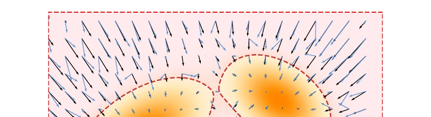
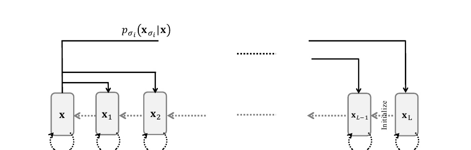

# 3.4 デノイジング・スコアマッチングの多ノイズレベル（NCSN）

- **原題**: Multi-Noise Levels of Denoising Score Matching (NCSN)
- **日本語タイトル**: デノイジング・スコアマッチングの多ノイズレベル（NCSN）
- **出典**: §3.4

## 3.4.1 動機

単一の固定分散のガウスノイズをデータ分布に加えると、ある程度までは平滑化されるが、1 つのノイズレベルだけでスコアベースモデルを学習すると、重要な制約が生じる。注入ノイズが低いレベルでは、低密度領域での勾配消失により、ランジュバン動力学は多峰分布のモード横断に苦戦する。対照的に、高ノイズレベルではサンプリングは容易になるが、モデルは粗い構造しか捉えず、細かい詳細を欠くぼやけたサンプルになる。さらに、ランジュバン動力学は高次元空間では収束が遅いか失敗しうる。対数密度の勾配に誘導を依存するため、特にプラトー領域や鞍点近傍での悪い初期化は、探索を妨げたりサンプラーを単一モードに捕捉させたりしうる。

これらの課題に対処するため、Song and Ermon (2019) は、データ分布に複数レベルのガウスノイズを注入し、ノイズ条件付きスコアネットワーク（NCSN, noise-conditional score network）を共同学習して、ノイズスケールの範囲にわたるスコア関数を推定することを提案した。生成時には、ランジュバン動力学をノイズアニーリング的に適用する：粗い探索を可能にする高ノイズレベルから始め、細かい詳細を回復するため低ノイズレベルへ徐々に精錬する。

## 3.4.2 学習

単一ノイズレベルで学習されたスコアベースモデルの制約を克服するため、Song and Ermon (2019) はデータ分布に複数レベルのガウスノイズを加えることを提案する。具体的には、$L$ 個のノイズレベル $\{\sigma_i\}_{i=1}^L$ の列を

$$
0 < \sigma_1 < \sigma_2 < \cdots < \sigma_L
$$

となるよう選ぶ。ここで $\sigma_1$ はデータの細かい詳細の大部分を保つほど十分小さく、$\sigma_L$ は分布を十分に平滑化して学習を容易にするほど大きい。

各ノイズサンプルは、クリーンデータ点 $x\sim p_{\mathrm{data}}$ を $x_\sigma=x+\sigma\epsilon$（$\epsilon\sim\mathcal{N}(0,I)$）として摂動して構成される。これにより次が定義される。

**摂動核（Perturbation Kernel）:**

$$
p_\sigma(x_\sigma|x):=\mathcal{N}(x_\sigma;x,\sigma^2 I),
$$

これは各ノイズレベル $\sigma$ で次の

**周辺分布（Marginal Distribution）:**

$$
p_\sigma(x_\sigma)=\int p_\sigma(x_\sigma|x)\,p_{\mathrm{data}}(x)\,dx
$$

を誘導する。これはガウス平滑化されたデータ分布を表す。

**NCSN の学習目的。** 目標は、ノイズ条件付きスコアネットワーク $s_\phi(x,\sigma)$ を学習し、すべての $\sigma\in\{\sigma_i\}_{i=1}^L$ についてスコア関数 $\nabla_x\log p_\sigma(x)$ を推定することである。これはすべてのノイズレベルにわたる DSM 目的の最小化により達成される：

$$
\mathcal{L}_{\mathrm{NCSN}}(\phi)
:= \sum_{i=1}^L \lambda(\sigma_i)\,\mathcal{L}_{\mathrm{DSM}}(\phi;\sigma_i),
\quad (3.4.1)
$$

ここで

$$
\mathcal{L}_{\mathrm{DSM}}(\phi;\sigma)
= \tfrac{1}{2}\,\mathbb{E}_{x\sim p_{\mathrm{data}}(x),\,\tilde{x}\sim p_\sigma(\tilde{x}|x)}
\Bigl\|s_\phi(\tilde{x},\sigma)-\frac{x-\tilde{x}}{\sigma^2}\Bigr\|_2^2,
$$

であり、$\lambda(\sigma_i)>0$ は各スケールの重み関数である。

この目的の最小化により、各ノイズレベルで真のスコアを回復するスコアモデル $s^*(x,\sigma)$ が得られる：

$$
s^*(\cdot,\sigma)=\nabla_x\log p_\sigma(\cdot),
\qquad\text{すべての }\sigma\in\{\sigma_i\}_{i=1}^L\text{ について},
$$

本質的に DSM 最小化だからである（定理 3.3.1 を参照）。

**DDPM 損失との関係。** $x_\sigma=x+\sigma\epsilon$（$\epsilon\sim\mathcal{N}(0,I)$）とし、$p_\sigma$ を周辺分布とする。ツイディーの公式により、

$$
\nabla_{x_\sigma}\log p_\sigma(x_\sigma)=-\frac{1}{\sigma}\mathbb{E}[\epsilon|x_\sigma].
$$

したがって NCSN の最適は真のスコア $s^*(x_\sigma,\sigma)=\nabla_{x_\sigma}\log p_\sigma(x_\sigma)$ であり、一方 DDPM 損失式 (2.2.10) の下でのベイズ最適ノイズ予測器は $\epsilon^*(x_\sigma,\sigma)=\mathbb{E}[\epsilon|x_\sigma]$ である。これらは

$$
s^*(x_\sigma,\sigma)=-\frac{1}{\sigma}\epsilon^*(x_\sigma,\sigma),
\qquad
\epsilon^*(x_\sigma,\sigma)=-\sigma\,s^*(x_\sigma,\sigma)
$$

を通じて完全に等価である。DDPM 設定では、ステップ $i$ のノイズサンプルは

$$
\sigma_i:=\sqrt{1-\bar\alpha_i^2},
\qquad
x_i=\bar\alpha_i x_0+\sigma_i\epsilon,
\qquad\epsilon\sim\mathcal{N}(0,I)
$$

と書ける。したがって、スコアと最適ノイズ予測は同じ情報を含む：

$$
s^*(x_i,i)=-\frac{1}{\sigma_i}\mathbb{E}[\epsilon|x_i].
$$

言い換えれば、DDPM でのノイズ予測は、既知のスケール因子 $1/\sigma_i$ を除き、ノイズレベル $i$ でのスコア予測と等価である。

このパラメータ化の等価性を、第 6 章で系統的に比較・要約する。

## 3.4.3 サンプリング

複数のノイズレベルで利用可能な学習済みスコアネットワーク

$$
s_{\phi^\times}(\cdot,\sigma_1),\quad
s_{\phi^\times}(\cdot,\sigma_2),\quad
\cdots,\quad
s_{\phi^\times}(\cdot,\sigma_{L-1}),\quad
s_{\phi^\times}(\cdot,\sigma_L)
$$

に対し、アニーリング・ランジュバン動力学（annealed Langevin dynamics）（Song and Ermon, 2019）として知られるサンプリング手続きは、高ノイズレベル $\sigma_L$ から低ノイズレベル $\sigma_1\approx 0$ へ徐々にデノイズすることでデータを生成する。

> **アルゴリズム 1** アニーリング・ランジュバン動力学
>
> **入力:** 学習済みスコア $s_{\phi^\times}(\cdot,\sigma_\ell)$、ステップサイズ $\eta_\ell$、各ノイズレベル $\ell=L,\ldots,1$ のランジュバン反復予算 $N_\ell$；初期化分布 $p_{\mathrm{init}}$
>
> 1. $x\sim p_{\mathrm{init}}$ ▷ 最大ノイズレベルで構造化されていないノイズから初期化
> 2. **for** $\ell=L,L-1,\ldots,1$ **do**
> 3. &emsp;$\tilde{x}_0\leftarrow x$ ▷ 前のレベルの出力からこのノイズレベルを初期化
> 4. &emsp;**for** $n=0$ to $N_\ell-1$ **do**
> 5. &emsp;&emsp;$\epsilon_n\sim\mathcal{N}(0,I)$
> 6. &emsp;&emsp;$\tilde{x}_{n+1}\leftarrow\tilde{x}_n+\eta_\ell s_{\phi^\times}(\tilde{x}_n,\sigma_\ell)+\sqrt{2\eta_\ell}\,\epsilon_n$
> 7. &emsp;**end for**
> 8. &emsp;$x\leftarrow\tilde{x}_{N_\ell}$ ▷ 最終状態を次に小さいノイズレベルへ渡す（あれば）
> 9. **end for**
>
> **出力:** $x$

ノイズレベル $0<\sigma_1<\cdots<\sigma_L$ で学習されたスコアにより、アニーリング・ランジュバン動力学は高ノイズから低ノイズへ徐々に動くことでサンプルを生成する。単純な初期化 $x\sim p_{\mathrm{init}}$ から始め、まず最大ノイズレベル $\sigma_L$ でランジュバン動力学を適用し、そのスコア $s_{\phi^\times}(\cdot,\sigma_L)$ がサンプルを対応する平滑化分布 $p_{\sigma_L}$ へ導く。得られたサンプルを次に小さいノイズレベルでのランジュバン動力学の初期化に用いる。この手続きを繰り返すことで、最小ノイズレベル $\sigma_1$ に達するまでサンプルを徐々に精錬する。

各ノイズレベル $\sigma_\ell$ で、ランジュバン動力学は更新

$$
\tilde{x}_{n+1}
= \tilde{x}_n + \eta_\ell s_{\phi^\times}(\tilde{x}_n,\sigma_\ell)
+ \sqrt{2\eta_\ell}\,\epsilon_n,
\qquad\epsilon_n\sim\mathcal{N}(0,I)
$$

を行い、前のノイズレベルの出力が初期化 $\tilde{x}_0$ を与える。一般的な選択は、ステップサイズをノイズレベルで

$$
\eta_\ell=\delta\frac{\sigma_\ell^2}{\sigma_1^2},\qquad\delta>0
$$

とスケールすることである。アルゴリズムは $\sigma_1$ を含むすべてのノイズレベルでランジュバン更新を行うので、最終サンプルは最小ノイズレベルでの精錬の後に得られる。アルゴリズム 1 が手続きを要約する。

初期分布 $p_{\mathrm{init}}$ は単にマルコフ連鎖の出発点を与える。最大ノイズレベルでは、ランジュバン動力学がこの初期分布を $p_{\sigma_L}$ へ動かし、その後連続するノイズレベルがサンプルをデータ分布のますます平滑化の弱い版へ徐々に導く。

**NCSN の遅いサンプリング速度。** NCSN はノイズスケール $\{\sigma_i\}_{i=1}^L$ にわたるアニーリング MCMC（通常はランジュバン動力学）でサンプルを生成する。各スケール $\sigma_i$ について、「スコア $s_{\phi^\times}(\tilde{x}_n,\sigma_i)$ と小さなランダム摂動を用いて $\tilde{x}_n$ を更新する」形の $K$ 回の反復更新を行い、各々がスコアネットワークの前向きパスを要する。大きな $L\times K$ を必要とする要因は 2 つある：

(i) **局所的正確性と安定性:** 学習されたスコアは小さな摂動に対してのみ信頼できるため、バイアスや不安定を避けるには各ノイズレベルで小さなステップサイズと多くの反復が必要；

(ii) **高次元での遅い混合:** 局所 MCMC の動きは多峰・高次元ターゲットの探索が非効率で、典型的なデータ領域に達するには多くの反復を要する。

更新は厳密に逐次的（各反復は前のものに依存）であり、各々が高価なネットワーク評価を要するため、全体コストは $O(LK)$ の逐次ネットワークパスとなり、サンプリングは計算上遅くなる。
