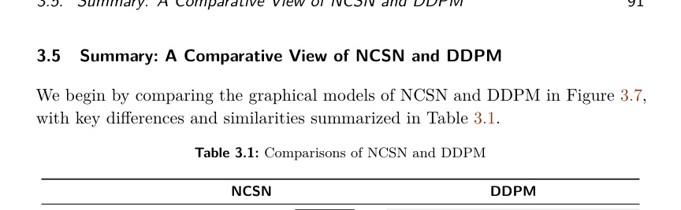

# 3.5 要約：NCSN と DDPM の比較的見方

- **原題**: Summary: A Comparative View of NCSN and DDPM
- **日本語タイトル**: 要約：NCSN と DDPM の比較的見方
- **出典**: §3.5

まず図 3.7 で NCSN と DDPM のグラフィカルモデルを比較し、主要な相違と類似を表 3.1 に要約する。

**共有されるボトルネック。** 定式化は異なるにもかかわらず、NCSN と DDPM の双方は密な時間離散化に依存する。これは重要な制約をもたらす：サンプリングはしばしば数百から数千の反復を要し、生成が遅く計算集約的になる。

> **問い 3.5.1**
>
> 拡散モデルのサンプリングをどのように加速できるか？

この課題には、より効率的なサンプラーを展開する第 9 章；数百のサンプリングステップを要する事前学習済み拡散モデルをより少ないステップの生徒生成器へ圧縮する第 10 章；拡散に触発された原理の下で高速な少数ステップ生成器をゼロから直接学習する方法を研究する第 11 章で立ち戻る。
