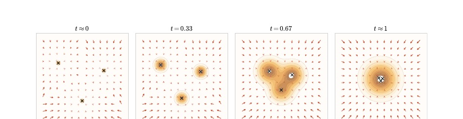
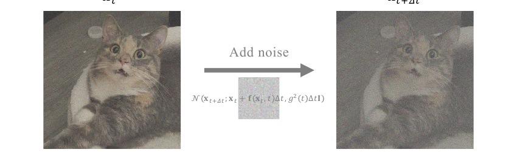
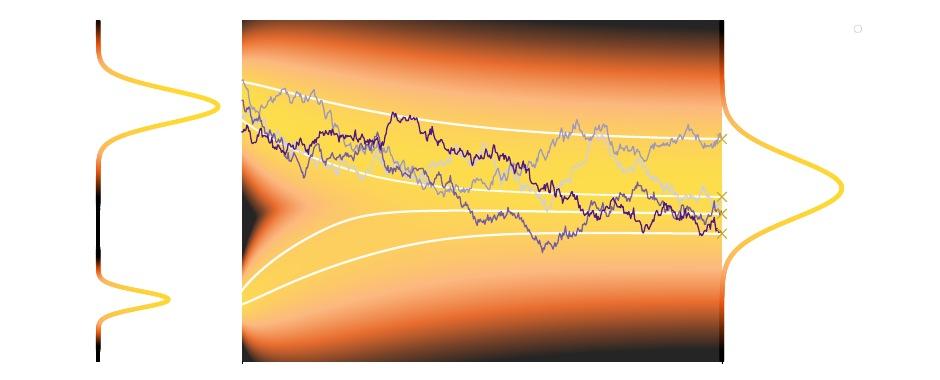

# 4.1 Score SDE：その原理

複数のノイズスケールの使用は、NCSN および DDPM 枠組みの成功における決定的な要素であった。本節では、ノイズレベルの連続体を考えることでこの考えを高める Score SDE（Song et al., 2020c）の基礎を導入する。前向きおよび逆拡散過程の連続時間極限はすでに Sohl-Dickstein et al. (2015) により指摘されていたが、Song et al. (2020c) は、データの発展を確率／常微分方程式として定式化し、ノイズレベルが時間とともに滑らかに増加する視点を中心に据える。この定式化の中心にあるのは時間依存スコア関数 $\nabla_x\log p_t(x)$ である：各ノイズレベル $t$ において、それは現在のノイズ付き分布 $p_t$ の下でより高い密度の領域を指し、まさにこの量が拡散を逆転する方法を定める。図4.1が示すように、スコア場は小さな $t$ では個々のデータモードへ鋭く収束し、大きな $t$ では大域中心へ穏やかに向かうよう発展する。この連続時間定式化は、先行する離散時間モデルを統一するだけでなく、生成モデリングに対する原理的で柔軟な基礎を提供する：すべてのノイズレベルにわたるこのスコア関数の族を学習することは、生成を微分方程式を解く問題へと帰着させる。

## 4.1.1 動機：離散から連続時間過程へ

NCSN と DDPM の前向きノイズ注入スキームを再訪する。NCSN は増加するノイズレベル $\{\sigma_i\}_{i=1}^{L}$ の系列を用いる。各クリーンサンプル $x_0\sim p_{\mathrm{data}}$ は次のように摂動される：

$$
x_{\sigma_i} = x_0 + \sigma_i\epsilon_i, \qquad \epsilon_i\sim\mathcal{N}(0,I).
$$

DDPM は代わりに分散スケジュール $\{\beta_i\}_{i=1}^{L}$ でノイズを段階的に注入する[^1]：

$$
x_i = \sqrt{1-\beta_i}\, x_{i-1} + \sqrt{\beta_i}\,\epsilon_i, \qquad \epsilon_i\sim\mathcal{N}(0,I).
$$

これらを離散時間格子上で一緒に見ると、$x_t$ から $x_{t+\Delta t}$ への逐次更新は次の形をとる[^2]：

$$
\begin{aligned}
\text{NCSN:}\quad
x_{t+\Delta t}
&= x_t + \sqrt{\sigma_{t+\Delta t}^2-\sigma_t^2}\,\epsilon_t
\approx x_t + \sqrt{\frac{d\sigma_t^2}{dt}\,\Delta t}\,\epsilon_t, \\
\text{DDPM:}\quad
x_{t+\Delta t}
&= \sqrt{1-\beta(t)\Delta t}\, x_t + \sqrt{\beta(t)\Delta t}\,\epsilon_t
\approx x_t - \tfrac12\beta(t)x_t\Delta t + \sqrt{\beta(t)\Delta t}\,\epsilon_t,
\end{aligned}
$$

ここで $\epsilon_t\sim\mathcal{N}(0,I)$ である。興味深いことに、両ノイズ注入過程は共通の構造パターンに従う：

$$
x_{t+\Delta t} \approx x_t + f(x_t,t)\Delta t + g(t)\sqrt{\Delta t}\,\epsilon_t, \tag{4.1.1}
$$

ここで $f:\mathbb{R}^D\times\mathbb{R}\to\mathbb{R}^D$ および $g:\mathbb{R}\to\mathbb{R}$ は次で与えられる：

$$
\begin{aligned}
\text{NCSN:}&\quad f(x,t)=0, && g(t)=\sqrt{\frac{d\sigma^2(t)}{dt}}, \\
\text{DDPM:}&\quad f(x,t)=-\tfrac12\beta(t)\,x, && g(t)=\sqrt{\beta(t)}.
\end{aligned}
$$

この定式化は次のガウス遷移に対応する：

$$
p(x_{t+\Delta t}\mid x_t) := \mathcal{N}\bigl(x_{t+\Delta t};\, x_t+f(x_t,t)\Delta t,\, g^2(t)\Delta t\, I\bigr), \tag{4.1.2}
$$

ここで、記法をやや濫用し、$x_t$ を固定サンプル、$x_{t+\Delta t}$ を確率変数として扱う。

$\Delta t\to 0$（概念的には無限に多くのノイズ層を用意することと理解できる）につれ、離散時間過程は時間前向きに発展する連続時間 SDE へと収束する[^3]：

$$
dx(t) = f\bigl(x(t),t\bigr)\, dt + g(t)\, dw(t),
$$

ここで $w(t)$ は標準 Wiener 過程（またはブラウン運動）である。

**注。**

Wiener 過程の完全な形式定義はここでは必要ないが、Wiener 過程とはゼロから始まり、独立増分をもち、任意の $s<t$ について増分 $w(t)-w(s)$ が平均ゼロ・分散 $t-s$ の正規分布に従う連続時間確率過程である。それは時間にわたる独立ガウス揺らぎの蓄積を表し、ほとんど確実に連続であるにもかかわらず、どこでも微分不可能である。

無限小時間区間 $[t,t+dt]$ にわたって、Wiener 過程の増分は

$$
dw(t) := w(t+dt)-w(t)
$$

と定義され、平均ゼロ・分散 $dt$ のガウス確率変数としてモデル化される：

$$
dw(t)\sim\mathcal{N}(0,dt\, I).
$$

SDE の基礎への簡潔な導入は第 A.2 節に、より進んだ議論は第 C 章にある。しかし、離散と連続の定式化の接続は概念的に次のように理解できる：

- $x(t+\Delta t)-x(t)\approx dx(t)$,
- $\Delta t\approx dt$,
- $\sqrt{\Delta t}\,\epsilon_t\sim\mathcal{N}(0,\Delta t\, I)\approx dw(t)$.

いったんドリフト $f(x,t)$ と拡散 $g(t)$ が指定されれば、前向き時間 SDE は自動的に、終端ノイズ分布をデータ分布へ戻す逆時間 SDE を誘導する。逆動力学は、驚くべきことに各連続時間レベルにおけるスコア関数という、単一の未知項のみを含む。これはスコアマッチングを学習目的として同定する；いったんスコアが学習されれば、サンプリングは学習されたスコアをもつ逆時間 SDE を数値積分することに帰着する。

第4.3節が実践的実装を提示する一方、まず第4.1.2節および第4.1.3節で前向きおよび逆過程の理論的基礎を調べる。

[^1]: 第2.2節では、DDPM 前向きステップは $x_i=\sqrt{1-\beta_i^2}\,x_{i-1}+\beta_i\epsilon_i$ と書かれ、$\beta_i$ は注入ノイズの標準偏差を、$\alpha_i:=\sqrt{1-\beta_i^2}$ を表す。本章では Song et al. (2020c) の慣例に従い、$\beta_i$ は代わりに注入ノイズの分散を表し、$x_i=\sqrt{1-\beta_i}\,x_{i-1}+\sqrt{\beta_i}\,\epsilon_i$ となる。二つの慣例は $\beta_i^{(\text{here})}=\bigl(\beta_i^{(\text{Ch.\ 2})}\bigr)^2$ で関係し、同一の動力学を与える。

[^2]: 便宜上、時間 $t$ におけるサンプルを表すために $x(t)$ と $x_t$ を互換的に用いる（他の時間依存変数についても同様）。

[^3]: 式 (4.1.2) の前向き核は、$\Delta t\to 0$ につれ対応する Itô SDE の解へ収束する。完全に厳密な証明は高度な結果に依拠し、文献に委ねる。

## 4.1.2 前向き時間 SDE：データからノイズへ

この定式化により、NCSN（Song and Ermon, 2019）や DDPM（Sohl-Dickstein et al., 2015; Ho et al., 2020）のような離散時間に基づく先行手法は、区間 $[0,T]$ 上で定義された前向き SDE に支配される確率過程 $x(t)$ を通じて、連続時間枠組みの下で統一できる：

$$
dx(t) = f\bigl(x(t),t\bigr)\, dt + g(t)\, dw(t), \qquad x(0)\sim p_{\mathrm{data}}. \tag{4.1.3}
$$

ここで $f(\cdot,t):\mathbb{R}^D\to\mathbb{R}^D$ はドリフト、$g(t)\in\mathbb{R}$ はスカラー拡散係数、$w(t)$ は標準 Wiener 過程を表す。これを前向き SDE と呼び、クリーンデータが時間とともに徐々にノイズへと摂動される様子を記述する。

いったんドリフト $f$ と拡散係数 $g$ が指定されれば、前向き過程は完全に定まり、ガウスノイズの注入を通じてデータ変数がどのように徐々に劣化するかを記述する。とくに、二族の時間依存密度が誘導される：

**摂動核。** 条件付き法則

$$
p_t(x_t\mid x_0)
$$

は、クリーンデータサンプル $x_0\sim p_{\mathrm{data}}$ が時刻 $t$ におけるそのノイズ付き対応物 $x_t$ へどのように発展するかを記述する。一般に、式 (4.1.3) のドリフト項 $f(x,t)$ は $x$ の任意関数でありうるが、一般的で解析的に都合のよい選択はアフィンであると仮定することである：

$$
f(x,t)=f(t)\,x, \tag{4.1.4}
$$

ここで $f(t)$ は $t$ のスカラー関数であり、典型的には非正とされる。この構造の下では、$x_0$ が与えられた条件付き過程はガウスのまま残り、摂動核は関連する平均–分散 ODE を解くことで得られる閉形式解を認める（Särkkä and Solin, 2019）（第4.4.3節も参照）。とくに、

$$
p_t(x_t\mid x_0)=\mathcal{N}\bigl(x_t;\, m(t),\, P(t)I_D\bigr),
$$

ここで

$$
m(t)=\exp\Bigl(\int_0^t f(u)\, du\Bigr)x_0, \qquad
P(t)=\int_0^t\exp\Bigl(2\int_s^t f(u)\, du\Bigr)g^2(s)\, ds,
$$

および初期条件 $m(0)=x_0$、$P(0)=0$ である。

この明示形により、SDE を数値積分することなく $x_0$ が与えられた $x_t$ を直接サンプリングできる。ゆえにシミュレーションフリーという語が用いられる。NCSN と DDPM の双方がこのアフィンドリフト設定に属する。

以降では、任意ドリフト $f(x,t)$ に対する一般理論を展開するが、閉形式解析が有用なときはアフィンドリフトに戻る。

**周辺密度。** 時間周辺密度 $p_t(x_t)$ は摂動核上で積分することで得られる：

$$
p_t(x_t) := \int p_t(x_t\mid x_0)\, p_{\mathrm{data}}(x_0)\, dx_0, \qquad p_0=p_{\mathrm{data}}. \tag{4.1.5}
$$

係数 $f(t)$ と $g(t)$ を適切に選ぶことで、前向き過程は徐々にノイズを加え、初期状態の影響が実質的に忘れられるまで進む。$T$ が大きくなると、条件付き分布 $p_T(x_T\mid x_0)$ はもはや $x_0$ に依存しない。なぜならその平均は

$$
m(T)=\exp\Bigl(\int_0^T f(u)\, du\Bigr)x_0 \longrightarrow 0 \qquad (T\to\infty)
$$

と発展するからである（$f(u)$ が非正で指数因子が減衰するとして）。同時に、分散は成長し、選ばれた事前分布に合うよう安定化する。したがって、当初はデータサンプル上の複雑な混合を表す周辺

$$
p_T(x_T)=\int p_T(x_T\mid x_0)\, p_{\mathrm{data}}(x_0)\, dx_0
$$

は、単純な事前 $p_{\mathrm{prior}}$（典型的にはガウス）へと収束する。この極限では、

$$
p_T(x_T)\approx p_{\mathrm{prior}}(x_T) \qquad\text{かつ}\qquad p_T(x_T\mid x_0)\approx p_{\mathrm{prior}}(x_T)
$$

となり、前向き過程は任意のデータ分布を扱いやすい事前へ写し、逆転と生成のための都合のよい出発点を提供する。

## 4.1.3 生成のための逆時間確率過程

直感的に、ノイズからのデータ生成は前向き過程を「逆転」することで達成できる：事前分布からサンプリングされたランダム点から始め、それを時間を遡って発展させ、生成サンプルを得る。決定論的系（すなわち ODE）では、この考えは自然に働く。ランダム性が関与しないため、時間を逆転することは、前向き過程と同じ経路に沿って点の軌跡を逆方向に辿ることを単に意味する[^4]。対照的に、SDE は各時間ステップで確率性を組み込むため、単一点が多くのもっともらしいランダム軌跡に沿って発展しうる。その結果、そのような過程の逆転はより繊細である[^5]。

個々の確率軌跡は可逆でないが、注目すべき洞察は、これらの軌跡上の分布は逆転できることである。これは Anderson (1982) の基礎的結果により形式化され、式 (4.1.3) の前向き過程の時間逆転過程 $\{\bar{x}(t)\}_{t\in[0,T]}$[^6] 自体が、よく定義された SDE に支配されることを示す。この逆時間過程は $T$ から $0$ へ発展し、その動力学は次で与えられる：

$$
d\bar{x}(t)=\Bigl[f\bigl(\bar{x}(t),t\bigr)-g^2(t)\nabla_x\log p_t\bigl(\bar{x}(t)\bigr)\Bigr]dt + g(t)\, d\bar{w}(t), \tag{4.1.6}
$$

$$
\bar{x}(T)\sim p_{\mathrm{prior}}\approx p_T.
$$

ここで $\bar{w}(t)$ は逆時間の標準 Wiener 過程を表し、$\bar{w}(t):=w(T-t)-w(T)$ と定義される。

**注。**
本章を通じて、$t$ は元の拡散時計を表す：$t=0$ がデータ、$t=T$ がノイズに対応する。したがって式 (4.1.6) の逆時間 SDE は $t=T$ から $t=0$ へ積分され、逆過程に沿って $dt<0$ である。等価に、前向きに走る逆時計 $s:=T-t$ を導入してもよい；特に述べない限り、元の時計 $t$ を保つ。

式 (4.1.6) の直観を築くため、第4.2.2節でガウスデータ分布と線形–ガウス動力学をもつ具体例を提示する。この設定は解析的に扱いやすい：Anderson (1982) の完全な一般理論を呼び出すことなく、基本的な微積分と線形代数を用いて時間逆転公式を直接導出できる。

確率性（$g\neq 0$）の存在が、追加の補正項 $-g^2(t)\nabla_x\log p_t(\bar{x}(t))$ を導入することに注意せよ。これは拡散の効果を考慮し、逆転された動力学が前向き SDE が誘導する周辺分布の発展を正しく再現することを保証する（第4.2節を参照）。

**概念的に、なぜ逆過程は働くのか？** 第4.6.2節は、DDPM の変分枠組みとの接続により逆時間 SDE の直感的導出を提示する（任意だが洞察に富む）。ここでは、逆時間動力学がノイズから構造化されたデータをどのように回復するかについての補完的直観を与える。

一見すると、逆時間過程におけるブラウンノイズの存在は逆説的に見えるかもしれない。前向き拡散がデータをますますノイズの多い配置へ広げるなら、この過程——とくに $\bar{w}(t)$ を通じて追加のランダム性を導入するもの——を逆転することが、データ多様体近傍に集中したクリーンで構造化されたサンプルをどのように生みうるかは不明である。鍵は、逆時間 SDE が任意のランダム性を注入しないことである。拡散項 $g(t)\,d\bar{w}(t)$ は常にスコア駆動ドリフト $-g^2(t)\nabla_x\log p_t(\bar{x}(t))$ と結合している。これらの項は互いに釣り合う：スコアが軌跡をより高い密度の領域へ導き、ノイズが動力学を圧倒することなく探索を可能にする制御された確率性を導入する。

これをより明確に見るため、式 (3.1.6) の Langevin 直観に戻る。$f(t)\equiv 0$ のとき、式 (4.1.6) は次となる：

$$
d\bar{x}(t) = -g^2(t)\nabla_x\log p_t\bigl(\bar{x}(t)\bigr)\, dt + g(t)\, d\bar{w}(t).
$$

時間を $s:=T-t$ で前向きに再パラメータ化し（したがって $dt=-ds$）、法則においてブラウン運動を $d\bar{w}(t)=-dw_s$ と改名する。$\bar{x}_s:=\bar{x}(T-s)$ および $\pi_s:=p_{T-s}$ と書くと、

$$
\begin{aligned}
d\bar{x}_s
&= g^2(T-s)\nabla\log\pi_s(\bar{x}_s)\, ds + g(T-s)\, dw_s \\
&= 2\tau(s)\nabla\log\pi_s(\bar{x}_s)\, ds + \sqrt{2\tau(s)}\, dw_s,
\end{aligned}
$$

ここで $\tau(s):=\tfrac12 g^2(T-s)$ である。これは時間変動温度 $\tau(s)$ をもつ Langevin 形であり、発展する密度 $\pi_s$ を目標とする。Tweedie の公式（式 (3.3.6)）により、スコア方向 $\nabla\log\pi_s$ は各時間スライスにおける条件付きクリーン信号を指すので、ドリフトは絶えずデノイズされた構造を「引き戻す」。

決定的に、$g(t)$ は逆軌跡に沿ってアニーリングする。初期（$s\approx 0$、すなわち $t\approx T$）では $g(T-s)$ は典型的により大きく、注入ノイズは強く過程は広く探索する。$s$ が増すにつれ $g(T-s)$ は減少し、確率項は弱まり、スコア項が支配してサンプルを $\pi_s$ の高密度領域へ引っ張る；$s=T$（すなわち $t=0$）までに、軌跡はデータ多様体近傍に集中する。

**逆時間 SDE の能力の概観。** 時間依存スコア関数

$$
s(x,t):=\nabla_x\log p_t(x)
$$

が式 (4.1.6) に自然に現れる様子は興味深い。いったん前向き係数 $f(t)$ と $g(t)$ が指定されれば、スコアは逆動力学における唯一の残る未知量である。これはその中心的役割を強調する：スコアが手元にあれば逆過程は定まり、サンプリングは学習されたスコアをもつ式 (4.1.6) を数値積分することに帰着する。

オラクルスコアは一般に閉形式表現を欠くため、第3章のアプローチを採用し、スコアマッチングを通じてそれを近似するニューラルネットワーク $s_\phi(x,t)$ を学習する；詳細は第4.3.1節を参照。次いで式 (4.1.6) で $s(x,t)$ を $s_\phi(x,t)$ で置き換えると、逆動力学が完全に指定される。

生成は、$x_T\sim p_{\mathrm{prior}}$ から始め、$t=T$ から $t=0$ へ逆時間 SDE を逆転して解くことに対応する。重要なことに、Anderson (1982) は前向きと逆過程の周辺密度が一致することを証明し、$p_{\mathrm{prior}}\approx p_T$ のとき $t=0$ におけるサンプルが近似的に $p_{\mathrm{data}}$ に従うことを保証する。これを第4.3.2節でさらに探求する。

[^4]: 技術的には、これは時間反転置換 $t\leftrightarrow T-t$ をもつ ODE を解くことに対応する。
[^5]: 素朴に時間を反転しても正しい逆過程は得られない。
[^6]: 「バー」記法を用い、前向き時間 SDE で定義される前向き過程 $\{x(t)\}_{t\in[0,T]}$ と区別して逆過程 $\{\bar{x}(t)\}_{t\in[0,T]}$ を表す。

## 4.1.4 生成のための決定論的過程（確率流 ODE）

式 (4.1.6) の SDE は確率性を導入し、生成サンプルの多様性を潜在的に増すが、次の問いが生じる：

> **問い 4.1.1**
>
> 式 (4.1.6) の SDE を用いてサンプリングすることは必要か？

Maoutsa et al. (2020) に触発され、Song et al. (2020c) はまた、前向き SDE と同じ周辺分布でサンプルを発展させる決定論的過程、すなわち ODE を導入した。この過程 $\{\tilde{x}(t)\}_{t\in[0,T]}$[^7]、確率流 ODE（Probability Flow ODE; PF-ODE）と呼ばれ、次で与えられる：

$$
\frac{d}{dt}\tilde{x}(t) = f\bigl(\tilde{x}(t),t\bigr) - \tfrac12 g^2(t)\nabla_x\log p_t\bigl(\tilde{x}(t)\bigr). \tag{4.1.7}
$$

SDE の場合と同様、真のスコアを学習された近似で置き換え、$t=T$ から $t=0$ へ逆時間 ODE を積分してサンプルを生成できる。具体的には、生成サンプル（時刻 $t=0$ における PF-ODE の解）は次の形をとる：

$$
\tilde{x}(T) + \int_T^{0}\Bigl[f\bigl(\tilde{x}(\tau),\tau\bigr)-\tfrac12 g^2(\tau)\nabla_x\log p_\tau\bigl(\tilde{x}(\tau)\bigr)\Bigr]d\tau,
$$

ここで初期条件 $\tilde{x}(T)\sim p_{\mathrm{prior}}$ である。この積分は閉形式では扱い不能であるため、実践的生成は数値ソルバ（例: Euler 法、式 (4.3.4) を参照）に依拠する。

逆時間 SDE と比較して、PF-ODE は二つの鍵利点を提供する：

- ODE は、選ばれた端点で対応する初期条件が指定されれば、同じ方程式の定式化を用いて、$t=0$ から $t=T$、または $t=T$ から $t=0$ のいずれの方向にも積分できる。この双方向性は、一般に前向き時間積分のみを認める SDE と対照的である。
- ODE のために開発された、確立された既製の数値ソルバの広い範囲から利益を得る。

PF-ODE は式 (4.1.6) の拡散項を単に除去することで得られるのではないことを強調する；とくに、そのドリフト項における因子 $\tfrac12$ は原理的起源をもつ。高水準では、式 (4.1.7) は、その発展が式 (4.1.3) の前向き SDE と同じ周辺密度を保存するよう ODE のドリフトを選ぶことで生じる。この周辺の整合を保証する根底の原理（すなわち Fokker–Planck 方程式（Øksendal, 2003））は次節で詳述する。

[^7]: チルダを用い、前向きおよび逆時間 SDE に関連する過程を区別する。以降、単純化のためこの記法上の区別は省略する。
