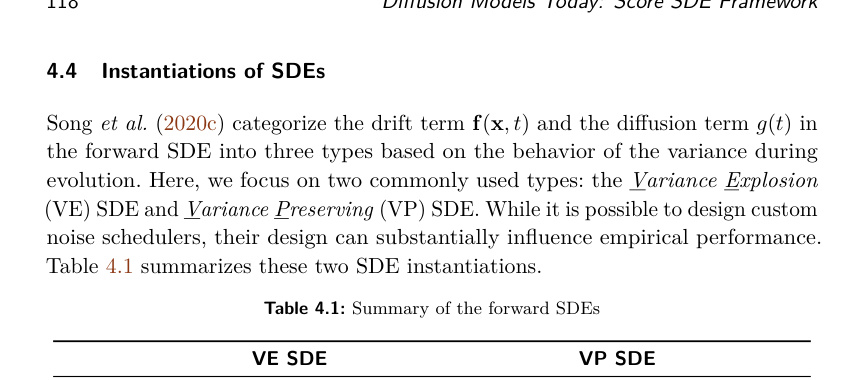

# 4.4 SDE の具体化

Song et al. (2020c) は、発展中の分散の振る舞いに基づき、前向き SDE におけるドリフト項 $f(x,t)$ と拡散項 $g(t)$ を三つの型に分類する。ここでは、よく用いられる二つの型——分散爆発（Variance Explosion; VE）SDE と分散保存（Variance Preserving; VP）SDE——に焦点を当てる。カスタムノイズスケジューラを設計することも可能だが、その設計は経験的性能に実質的に影響しうる。表4.1がこれら二つの SDE 具体化を要約する。

## 4.4.1 VE SDE

VE SDE は次の成分をもつ：

- **ドリフト項**: ゼロドリフト項 $f=0$。
- **拡散項**: ある関数 $\sigma(t)$ について $g(t)=\sqrt{\dfrac{d\sigma^2(t)}{dt}}$。

前向き SDE は次の形をとる：

$$
dx(t)=\sqrt{\frac{d\sigma^2(t)}{dt}}\, dw(t). \tag{4.4.1}
$$

同様に、第4.4.3節の結果は VE SDE の摂動核を含意し、適切な事前分布の選択を示唆する：

- **摂動核**:
  $$
  p_t(x_t\mid x_0)=\mathcal{N}\bigl(x_t;\, x_0,\, \bigl(\sigma^2(t)-\sigma^2(0)\bigr)I\bigr)
  $$

- **事前分布**: $\sigma(t)$ が $t\in[0,T]$ について増加関数であり、$\sigma^2(T)\gg\sigma^2(0)$ と仮定する。事前分布は次で与えられる：
  $$
  p_{\mathrm{prior}}:=\mathcal{N}\bigl(0,\sigma^2(T)I\bigr).
  $$

VE SDE の典型的な実例は、次の設計をもつ NCSN である：

$$
\sigma(t):=\sigma_{\min}\Bigl(\frac{\sigma_{\max}}{\sigma_{\min}}\Bigr)^{t}, \qquad t\in(0,1],
$$

ここで $\sigma_{\min}$ と $\sigma_{\max}$ は事前指定された定数である。すなわち、分散の系列は幾何数列として設計される。これにより、第4.1.1節で議論したように、NCSN は VE SDE の離散化版として見なされる。

## 4.4.2 VP SDE

$\beta:[0,T]\to\mathbb{R}_{\ge 0}$ を $t$ の非負関数とする。VP SDE は次の成分で定義される：

- **ドリフト項**: $f(x,t)=-\tfrac12\beta(t)x$ で与えられる線形ドリフト。
- **拡散項**: $g(t)=\sqrt{\beta(t)}$。

したがって、前向き SDE は次のように表される：

$$
dx(t)=-\tfrac12\beta(t)x(t)\, dt + \sqrt{\beta(t)}\, dw(t). \tag{4.4.2}
$$

第4.4.3節の結果を用い、VP SDE の摂動核を導出し、適切な事前分布を選べる：

- **摂動核**:
  $$
  p_t(x_t\mid x_0)
  =\mathcal{N}\Biggl(
  x_t;\,
  x_0 e^{-\tfrac12\int_0^t\beta(\tau)\,d\tau},\,
  I - I\, e^{-\int_0^t\beta(\tau)\,d\tau}
  \Biggr).
  $$

- **事前分布**: $p_{\mathrm{prior}}:=\mathcal{N}(0,I)$。

摂動核が既知の平均と共分散をもつガウスであるため、式 (D.2.5) を適用してそのスコア関数を計算できることに注意する。

VP SDE の古典的な例は DDPM であり、ノイズスケジュール $\beta(t)$ は次で定義される：

$$
\beta(t):=\beta_{\min}+t(\beta_{\max}-\beta_{\min}), \qquad t\in[0,1].
$$

ここで $\beta_{\min}$ と $\beta_{\max}$ は事前定義された定数である。これにより、第4.1.1節で議論したように、DDPM は VP SDE の離散化として解釈できる。

## 4.4.3 （任意）摂動核 $p_t(x_t\mid x_0)$ はどのように導出されるか？

前向き SDE 式 (4.1.3) のドリフト項が $x$ について線形であり、

$$
f(x,t)=f(t)x
$$

の形をとるとする。ここで $f(t)\in\mathbb{R}$ はあるスカラー値の時間依存関数である。すると式 (4.1.3) は線形 SDE となる：

$$
dx(t)=f(t)x(t)\, dt + g(t)\, dw(t).
$$

たとえ初期分布 $p_{\mathrm{data}}$ が非ガウスであっても、ドリフトの線形性は条件付き過程がガウスのまま残ることを保証する。とくに $t>0$ について、遷移核は次の形を認める：

$$
p_t(x_t\mid x_0)=\mathcal{N}\bigl(x_t;\, m(t),\, P(t)I_D\bigr),
$$

ここで $x_0\sim p_{\mathrm{data}}$ であり、$m(t)\in\mathbb{R}^D$、$P(t)\in\mathbb{R}_{\ge 0}$ は $x_0$ が与えられた条件付き平均と（スカラー）分散を表し、次で定義される：

$$
m(t)=\mathbb{E}[x_t\mid x(0)=x_0], \qquad
P(t)I_D=\mathrm{Cov}[x_t\mid x(0)=x_0].
$$

これらの一次および二次モーメントは、次の ODE に従って発展する（Särkkä and Solin, 2019）：

$$
\begin{aligned}
\frac{dm(t)}{dt} &= f(t)m(t), \\
\frac{dP(t)}{dt} &= 2f(t)P(t)+g^2(t), \tag{4.4.3}
\end{aligned}
$$

初期平均 $m(0)$ と分散 $P(0)$ が有限である限りにおいてである。

両 ODE は線形であるため、積分因子法により閉形式解を認める。初期条件 $x_0$ が与えられると、平均と分散は次のように発展する：

$$
m(t)=E(0\to t)\, x_0, \qquad
P(t)=\int_0^t E^2(s\to t)\, g(s)^2\, ds, \tag{4.4.4}
$$

ここで $m(0)=x_0$、$P(0)=0$ である。$E(s\to t)$ は指数積分因子

$$
E(s\to t):=\exp\Bigl(\int_s^t f(u)\, du\Bigr)
$$

を表し、時刻 $s$ から $t$ へのドリフトの蓄積効果を捉える。したがって、遷移核 $p_t(x_t\mid x_0)$ も閉形式表現を認める。

$p_t(x_t\mid x_0)$ の条件付き共分散が等方的であること、すなわち独立座標と拡散 $g(t)I_D$ をもつ $D$ 次元 Wiener 過程の下で $\mathrm{Cov}[x_t\mid x_0]=P(t)I_D$ であること、ならびに式 (4.4.3) の導出の正当化は、Itô 計算に依拠する第 C.1.5 節に委ねる。

**例: VE SDE の遷移核**

VE SDE の特別な場合：$f\equiv 0$ および $g(t)=\sqrt{\dfrac{d\sigma^2(t)}{dt}}$ では、SDE の解の平均と共分散は次のように発展する。

**平均。**
$$
\frac{dm(t)}{dt}=0, \qquad m(0)=x_0
\implies m(t)=x_0.
$$

**分散。**
$$
\frac{dP(t)}{dt}=\frac{d\sigma^2(t)}{dt}, \qquad P(0)=0
\implies P(t)=\sigma^2(t)-\sigma^2(0).
$$

したがって
$$
p_t(x_t\mid x_0)=\mathcal{N}\bigl(x_t;\, x_0,\, \bigl(\sigma^2(t)-\sigma^2(0)\bigr)I_D\bigr).
$$

■

**例: VP SDE の遷移核**

ドリフト $f(x,t)=-\tfrac12\beta(t)x$、拡散 $g(t)=\sqrt{\beta(t)}$ をもつ VP SDE の場合：

**平均 $m(t)$。**
$$
\frac{dm}{dt}=-\tfrac12\beta(t)m(t), \qquad
B(t):=\int_0^t\beta(s)\, ds, \qquad
m(t)=e^{-\tfrac12 B(t)}x_0.
$$

**分散 $P(t)$。** 分散は
$$
\frac{dP}{dt}=-\beta(t)P(t)+\beta(t)
$$
を満たす。積分因子 $e^{B(t)}$（$B(t)=\int_0^t\beta(s)\,ds$）を適用すると、

$$
\frac{d}{dt}\bigl[P(t)e^{B(t)}\bigr]=\beta(t)e^{B(t)}
$$

が得られる。両辺を積分すると

$$
P(t)=1-e^{-B(t)}.
$$

ゆえに共分散は等方的で

$$
\mathbf{P}(t)=P(t)I_D=\bigl(1-e^{-B(t)}\bigr)I_D
$$

である。

**最終閉形式遷移核。**
$$
p_t(x_t\mid x_0)
=\mathcal{N}\Biggl(
x_t;\,
\underbrace{e^{-\tfrac12 B(t)}x_0}_{m(t)},\,
\underbrace{\bigl(1-e^{-B(t)}\bigr)I_D}_{P(t)I_D}
\Biggr),
\qquad
B(t)=\int_0^t\beta(s)\, ds.
$$

■
