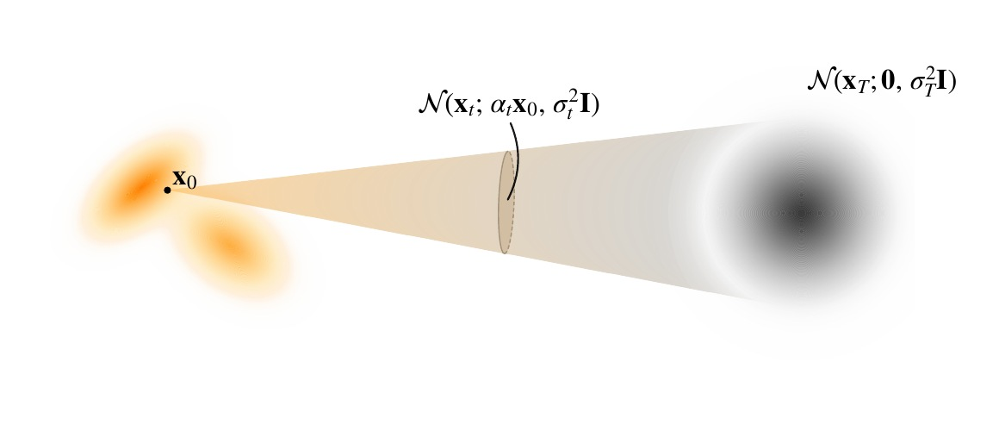
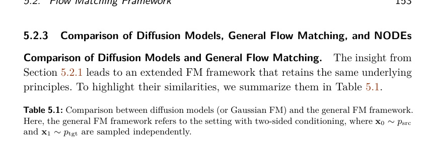

> **原題**: Flow Matching Framework
> **日本語タイトル**: フローマッチングの枠組み
> **出典§**: §5.2 of *The Principles of Diffusion Models*

# 5.2 フローマッチングの枠組み

スコアSDE（第4章）とNODE（§5.1）はいずれも、生成モデリングを連続的な輸送過程として記述する。スコアSDEはこの輸送を確率的ダイナミクスとそれに付随するPF-ODEによって定式化するのに対し、NODEは決定論的ODEを直接パラメータ化する。標準的な生成設定では、いずれも単純なガウス事前分布 $p_{\mathrm{prior}}$ をデータ分布 $p_{\mathrm{data}}$ へ輸送することを目指す。
NODEの実務上の制約は、尤度に基づく学習がODEを繰り返し解くことを要求する点である。フローマッチング（Flow Matching, FM）の枠組み（Lipman et al., 2022; Lipman et al., 2024; Tong et al., 2024）は、回帰目的を通じて速度場を直接予測するようニューラルネットワークを学習することで、このコストを回避する。したがってODE積分は生成時には必要だが、学習ループ内では不要であり、FM学習はシミュレーション不要（simulation-free）となる。
より一般に、FMはガウスからデータへの輸送に限定されない。ソース分布 $p_{\mathrm{src}}$ とターゲット分布 $p_{\mathrm{tgt}}$（いずれも容易にサンプリング可能と仮定）を考える。標準的な生成モデリングは特別な場合として

$$
p_{\mathrm{src}} = p_{\mathrm{prior}}, \qquad p_{\mathrm{tgt}} = p_{\mathrm{data}}
$$

により回復され、ここで $p_{\mathrm{prior}}$ は典型的にはガウスである。
本節ではFMの視点を採用する[^fn52-1]。その目標は、時間依存速度場 $v_t(x_t)$ を学習し、そのODEが規定された確率経路 $\{p_t\}_{t\in[0,1]}$ に沿ってサンプルを輸送することである。ここで

$$
p_0 = p_{\mathrm{src}}, \qquad p_1 = p_{\mathrm{tgt}}.
$$

$p_{\mathrm{src}}$ がガウスのとき、この設定をガウス・フローマッチング（Gaussian Flow Matching）と呼ぶ。こうしてFMは、生成モデリングのためのシミュレーション不要の学習法と、任意の端点分布間の連続輸送を学習する一般枠組みの両方を与える。

[^fn52-1]: いくつかの関連手法は、連続時間フローを用いて端点分布間を輸送するという核心的着想を共有するが、定式化はわずかに異なる。これにはフローマッチング（FM）（Lipman et al., 2022; Neklyudov et al., 2023）、整流フロー（Rectified Flow, RF）（Liu, 2022; Heitz et al., 2023）、確率的補間子（Stochastic Interpolants）（Albergo et al., 2023; Albergo and Vanden-Eijnden, 2023; Ma et al., 2024）が含まれる。ここではFMを統一的な用語として用いる。

## 5.2.1 スコアに基づく手法からの教訓

スコアSDEの枠組み（第4章）を、わずかに異なるが同値な定式化で再訪し、FMアプローチを動機づける鍵となる洞察を取り出す。この分析は、拡散モデルがいかにして確率流を暗黙に学習するかを明らかにし、より直接的な定式化を動機づける。

*図5.6: 条件付き遷移分布の模式図。$p_t(x_t|x_0)=\mathcal{N}(x_t;\alpha_t x_0,\sigma_t^2 I)$ は、データサンプル $x_0\sim p_{\mathrm{data}}$（左）からガウス事前分布 $p_{\mathrm{prior}}$（右）へ向かう（ガウス）条件付き確率経路を定義する。*
出典: Created by the authors.

**ステップ1: 条件付き経路とその周辺密度の定義。** 拡散モデルは、$t=1$ における単純な事前分布 $p_{\mathrm{prior}}$（例：ガウス）をソース、$t=0$ におけるターゲットのデータ分布 $p_{\mathrm{data}}$ へ輸送する連続時間の密度族 $\{p_t\}_{t\in[0,1]}$ を指定する：

$$
p_1(x_1)=p_{\mathrm{prior}}(x_1),\qquad p_0(x_0)=p_{\mathrm{data}}(x_0).
$$

この経路は前方条件付き分布

$$
p_t(x_t|x_0)=\mathcal{N}(x_t;\alpha_t x_0,\sigma_t^2 I),\qquad x_0\sim p_{\mathrm{data}} \tag{5.2.1}
$$

により暗黙に定義され、周辺密度

$$
p_t(x_t):=\int p_t(x_t|x_0)\,p_{\mathrm{data}}(x_0)\,dx_0
$$

を誘導する。条件付きガウスの増大する分散 $\sigma_t^2$ が、$p_t$ のガウス事前分布への発展を駆動する。

**ステップ2: 速度場。** 周辺密度 $p_t$ の時間発展は、Fokker–Planck方程式から導かれる速度場 $v_t:\mathbb{R}^D\to\mathbb{R}^D$ によって支配される：

$$
v_t(x):=f(t)x-\frac{1}{2}g^2(t)\nabla_x\log p_t(x), \tag{5.2.2}
$$

これはPF-ODEを通じて決定論的な粒子流を定義する：

$$
\frac{dx(t)}{dt}=f(t)x(t)-\frac{1}{2}g^2(t)\nabla_x\log p_t\bigl(x(t)\bigr)=\underbrace{v_t\bigl(x(t)\bigr)}_{}.
$$

このODEは初期確率変数 $x(0)\sim p_{\mathrm{data}}$ を時間前向きに、あるいは $x(1)\sim p_{\mathrm{prior}}$ を時間後ろ向きに輸送し、任意の $t\in[0,1]$ で $x(t)$ の発展する周辺密度が $p_t$ と一致するようにする（下記「基礎となる規則」を参照）。
スカラー関数 $f(t)$ と $g(t)$ は、対応する前方SDEの係数、あるいは同値に条件付き経路で定義されるガウス核パラメータ $\alpha_t$ と $\sigma_t$ によって定まる（補題4.5.1を参照）。

**ステップ3: 条件付け戦略による学習。** 式 (5.2.2) のPF-ODE速度は周辺スコア $\nabla_{x_t}\log p_t(x_t)$ に依存し、これは一般に未知である。したがってスコアに基づく手法は、理想的なスコアマッチング目的

$$
\mathcal{L}_{\mathrm{SM}}(\phi)=\mathbb{E}_{t\sim\mathcal{U}[0,1],\,x_t\sim p_t}\bigl[\|s_\phi(x_t,t)-\nabla_{x_t}\log p_t(x_t)\|_2^2\bigr]
$$

を通じてニューラルネットワーク $s_\phi(x_t,t)$ によりこのスコアを学習する。スコアが学習されれば、PF-ODE速度は

$$
v_t(x_t)=f(t)x_t-\frac{1}{2}g^2(t)\nabla_{x_t}\log p_t(x_t)
$$

として得られ、$s_{\phi^\times}(x,t)\approx\nabla_{x_t}\log p_t(x)$ である。
困難は、回帰目標を計算する際に周辺スコア自体がアクセス不能である点である。第3章と同様、条件付けの技法でこれを克服する。条件付き分布 $p_t(x_t|x_0)$ は扱いやすく、その条件付きスコアは

$$
\nabla_{x_t}\log p_t(x_t)=\mathbb{E}_{x_0\sim p(\cdot|x_t)}\bigl[\nabla_{x_t}\log p_t(x_t|x_0)\bigr] \tag{5.2.3}
$$

を満たす。これはデノイジング・スコアマッチング目的

$$
\mathcal{L}_{\mathrm{DSM}}(\phi):=\mathbb{E}_{t,\,x_0\sim p_{\mathrm{data}},\,x_t\sim p_t(\cdot|x_0)}\bigl[\|s_\phi(x_t,t)-\nabla_{x_t}\log p_t(x_t|x_0)\|_2^2\bigr]
$$

を動機づける。定理3.3.1で示したように、$\mathcal{L}_{\mathrm{SM}}$ と $\mathcal{L}_{\mathrm{DSM}}$ は $\phi$ に独立な定数だけ異なり、したがって同じ母集団最小化子をもつ：

$$
s^*(x_t,t)=\mathbb{E}_{x_0\sim p(\cdot|x_t)}\bigl[\nabla_{x_t}\log p_t(x_t|x_0)\bigr]=\nabla_{x_t}\log p_t(x_t).
$$

重要なことに、同じ条件付け原理はPF-ODE速度の水準でも直接表現できる。条件付き速度

$$
v_t(x_t|x_0):=f(t)x_t-\frac{1}{2}g^2(t)\nabla_{x_t}\log p_t(x_t|x_0)
$$

を定義する。式 (5.2.3) を用いると直ちに

$$
v_t(x_t)=\mathbb{E}_{x_0\sim p(\cdot|x_t)}\bigl[v_t(x_t|x_0)\bigr]
$$

が得られる。こうしてスコアに基づく拡散は、扱いやすい条件付き目標を通じてスコアを学習し、それを用いてPF-ODE速度を構成する。フローマッチングは、同じ条件付きから周辺への原理を速度場に直接適用する。

![図5.7: 拡散における条件付き視点と周辺視点の模式図。（本図は Lipman et al. (2024) に動機づけられる。）(1) 条件付きガウス経路 $p_t(\cdot|x_0)$：固定された $x_0$ から事前分布へ向かう拡大する密度。(2) 条件付き速度 $v_t(x_t|x_0)=f(t)x_t-\frac{1}{2}g^2(t)\nabla_{x_t}\log p_t(x_t|x_0)$。(3) 周辺密度 $p_t$：データ分布 $p_{\mathrm{data}}$（橙）を事前分布 $p_{\mathrm{prior}}$（灰）へ輸送する。(4) 周辺速度 $v_t(x_t)=f(t)x_t-\frac{1}{2}g^2(t)\nabla_{x_t}\log p_t(x_t)$：複数の妥当な起源への条件付き方向（破線）を平均して得られる赤矢印。片側条件付け $z=x_0$ をもつFM枠組みでは、スコア $\nabla_{x_t}\log p_t(x_t|x_0)$ や $\nabla_{x_t}\log p_t(x_t)$ による明示的な書き直しを要せず、同じ図が $v_t(x_t|x_0)$ と $v_t(x_t)$ に適用される。](images/fig-5-7.jpg)

*図5.7: 拡散における条件付き視点と周辺視点の模式図。（本図は Lipman et al. (2024) に動機づけられる。）(1) 条件付きガウス経路 $p_t(\cdot|x_0)$：固定された $x_0$ から事前分布へ向かう拡大する密度。(2) 条件付き速度 $v_t(x_t|x_0)=f(t)x_t-\frac{1}{2}g^2(t)\nabla_{x_t}\log p_t(x_t|x_0)$。(3) 周辺密度 $p_t$：データ分布 $p_{\mathrm{data}}$（橙）を事前分布 $p_{\mathrm{prior}}$（灰）へ輸送する。(4) 周辺速度 $v_t(x_t)=f(t)x_t-\frac{1}{2}g^2(t)\nabla_{x_t}\log p_t(x_t)$：複数の妥当な起源への条件付き方向（破線）を平均して得られる赤矢印。片側条件付け $z=x_0$ をもつFM枠組みでは、スコア $\nabla_{x_t}\log p_t(x_t|x_0)$ や $\nabla_{x_t}\log p_t(x_t)$ による明示的な書き直しを要せず、同じ図が $v_t(x_t|x_0)$ と $v_t(x_t)$ に適用される。*
出典: Created by the authors.

**基礎となる規則：Fokker–Planck方程式。** 周辺密度 $p_t$ はFokker–Planck方程式に従って発展する：

$$
\frac{\partial p_t(x)}{\partial t}+\nabla\cdot\Biggl(\underbrace{\Bigl(f(t)x-\frac{1}{2}g^2(t)\nabla_x\log p_t(x)\Bigr)}_{v_t(x)}p_t(x)\Biggr)=0.
$$

このPDEは、PF-ODEが与える密度が前方SDEの周辺分布と一致することを保証する。これを見るために、式 (4.2.2) で定義されたPF-ODEのフロー写像 $\Psi_{s\to t}(x_s)$ を思い出す。これは時刻 $s$ の初期状態 $x_s$ を直接時刻 $t$ の状態へ運ぶ。$t=1$ から $t=0$ へ、$x_1\sim p_{\mathrm{prior}}$ から出発してPF-ODEを後ろ向きに走らせると、押し出し公式により時間依存密度が得られる：

$$
p_t^{\mathrm{rev}}(x)=\int \delta\bigl(x-\Psi_{1\to t}(x_1)\bigr)\,p_{\mathrm{prior}}(x_1)\,dx_1. \tag{5.2.4}
$$

Fokker–Planck方程式は、誘導される密度経路が同じ発展密度と一致することを保証する：

$$
p_t^{\mathrm{rev}}=p_t. \tag{5.2.5}
$$

特にこれは $p_0^{\mathrm{rev}}=p_0=p_{\mathrm{data}}$ を含意し、時刻 $t=0$ でデータ分布を回復する。ODEの解写像は双方向なので、$x_0\sim p_{\mathrm{data}}$ で初期化しODEを前向きに解くことも同様に考えられ、並行した分析が可能になる。

## 5.2.2 フローマッチングの枠組み

§5.2.1の分析は、拡散モデルが、境界条件を満たしつつ分布間を輸送する速度場——具体的にはスコア——を学習することで成功することを明らかにする。式 (5.2.1) のガウス条件付き経路の設計（分散 $\sigma_t^2$ が増大）は、一方の端点をガウス事前分布に暗黙に固定しつつ、条件付き密度を全空間上で定義し、スコアに基づく勾配計算を可能にする。
本小節では、この洞察に基づくFM枠組みを導入する（図5.7の同じ模式図はFM枠組みにも適用される）。これを拡張し、任意の2分布 $p_{\mathrm{src}}$ と $p_{\mathrm{tgt}}$ の間でサンプルを輸送する連続フローの学習を考える。

**ステップ1: 条件付き経路とその周辺密度の定義。** $\mathbb{R}^D$ 上の任意のソース・ターゲット確率分布 $p_{\mathrm{src}}$ と $p_{\mathrm{tgt}}$ を考える。次のように置く[^fn52-2]：

$$
p_0(x)=p_{\mathrm{src}}(x),\qquad p_1(x)=p_{\mathrm{tgt}}(x). \tag{5.2.6}
$$

FMは、これらの端点の間を補間する中間密度の連続族 $\{p_t\}_{t\in[0,1]}$ を暗黙に定義する。各周辺 $p_t$ は、既知分布 $\pi(z)$ から抽出される潜在変数 $z$ と条件付き分布 $p_t(x_t|z)$ を通じて表される：

$$
p_t(x_t)=\int p_t(x_t|z)\,\pi(z)\,dz, \tag{5.2.7}
$$

ここで $(\pi(z),\{p_t(\cdot|z)\})$ は式 (5.2.6) の境界条件を満たすように選ばれる。
一般に、周辺密度 $p_t$ は扱いやすくないことに注意する。なぜなら $\pi(z)$ 上の積分を要し、$\pi(z)$ と条件付き分布 $p_t(x_t|z)$ の両方が複雑になり得るからである。それでも、潜在 $z$ への条件付けは、§5.2.1で議論したものを超える広いクラスの補間経路をモデル化する柔軟性をFMに与える。$z$ のよくある選択には次がある：

- **両側条件付け:** $z=(x_0,x_1)\sim p_{\mathrm{src}}(x_0)p_{\mathrm{tgt}}(x_1)$。$\pi$ がソースとターゲット分布をカップリングする。これによりFMは任意分布間の輸送を定義できる。
- **片側条件付け:** $z=x_0$ または $z=x_1$。特にソース分布をガウスに選ぶと拡散様の設定を回復する。

いずれの場合も、条件付き経路 $p_t(x_t|z)$ は効率的にサンプリング可能であり、対応する条件付き速度は扱いやすいべきである。以下の確率経路優先の構成では、さらに閉形式の扱いやすい表現をもつ条件付き分布を用いる。具体的な構成は§5.3.2で示し、図5.9に模式図を与える。

[^fn52-2]: FM文献の標準的記法に合わせるため、以前の節と比べて時間軸を反転する：$t=0$ がソース分布、$t=1$ がターゲットに対応する。

**ステップ2: 速度場。** 確率経路 $\{p_t\}_{t\in[0,1]}$ は分布が時間とともにどう発展すべきかを指定するが、個々のサンプルがどう動くべきかを一般には指定しない。言い換えれば、同じ周辺密度列は異なる速度場によって実現され得る[^fn52-3]。
したがってFMの目標は、誘導されるODE

$$
\frac{dx(t)}{dt}=v_t\bigl(x(t)\bigr),\qquad t\in[0,1]
$$

が、各時刻 $t$ で規定された $p_t$ に一致する周辺分布を生じるような速度場 $v_t(x)$ を見つけることである。これが成り立つとき、ODEは $x(0)\sim p_{\mathrm{src}}$ から $p_{\mathrm{tgt}}$ へ前向きに、あるいは $x(1)\sim p_{\mathrm{tgt}}$ から $p_{\mathrm{src}}$ へ後ろ向きにサンプルを輸送できる（より形式的な議論は§5.2.4を参照）。
この要件は連続の式[^fn52-4]によって捉えられる：

$$
\frac{\partial p_t(x)}{\partial t}+\nabla\cdot\bigl(v_t(x)\,p_t(x)\bigr)=0. \tag{5.2.8}
$$

式 (5.2.8) を満たす任意の速度場 $v_t$ は、初期条件 $p_0=p_{\mathrm{src}}$ とともに、適切な正則性条件下で発展する周辺が規定経路 $\{p_t\}$ に従うODEを生成する。したがってODEを解くことは、$p_{\mathrm{src}}$ と $p_{\mathrm{tgt}}$ の間のサンプルごとの輸送を与えつつ中間分布を整合させる。
重要なことに、連続の式は確率密度の発展を制約するが、一般には速度場を一意に定めない。したがって異なるサンプル軌道が、まったく同じ周辺密度発展を生じ得る。例えば $p_t>0$ の領域では、もし $v_t$ が式 (5.2.8) を満たすなら、任意の十分正則な発散なし場 $\tilde{v}_t$（$\nabla\cdot\tilde{v}_t=0$）に対し

$$
v_t+\frac{1}{p_t}\tilde{v}_t
$$

もそれを満たす。
したがってFMは、規定された確率経路を実現する速度場を求める。一般のソース・ターゲット分布に対し、周辺密度 $p_t$ もそのような速度場も通常は閉形式では得られない。これが次に導入する条件付き構成を動機づける。そこでは扱いやすい条件付き経路と速度を用いて、妥当な周辺速度場を学習する。

[^fn52-3]: 鍵となる区別は、確率経路が分布の発展を指定するが、一般にはそれを実現する粒子水準の輸送を指定しないことである。特定の速度は、追加の輸送構造が指定された後に初めて定まる。例えば、十分正則で可逆なフロー写像 $\Psi_{0\to t}$ は、オイラー速度 $v_t=\partial_t\Psi_{0\to t}\circ\Psi_{0\to t}^{-1}$ を定める。同様に、前方拡散SDEが指定されると、付随するPF-ODEは特定の速度 $v_t(x)=f(t)x-\frac{1}{2}g^2(t)\nabla_x\log p_t(x)$ を選ぶ。したがって両場合とも、周辺経路 $\{p_t\}$ 自体を超えて粒子水準の輸送構造を追加する。
[^fn52-4]: 拡散項のない、Fokker–Planck方程式の決定論的類似物。

具体例として、§5.3.1ではガウスからガウスへの経路と特定のアフィンフロー写像を考え、対応する速度場を明示的に計算できる。

**ステップ3: 条件付け戦略による学習。** 確率経路と対応する周辺速度場 $v_t$ が選ばれたら、FMはこの速度場をニューラルネットワーク $v_\phi$ により直接学習する。理想的なFM目的は

$$
\mathcal{L}_{\mathrm{FM}}(\phi)=\mathbb{E}_{t,\,x_t\sim p_t}\bigl[\|v_\phi(x_t,t)-v_t(x_t)\|_2^2\bigr]
$$

である。このニューラルネットワークパラメータ化を $v$-予測（速度予測）と呼ぶ。ネットワークがODEのドリフトを直接予測するからである。これは§5.2.1のスコアに基づく構成——まずスコアを学習し、それを用いてPF-ODE速度を構成する——とは異なる。
困難は、周辺速度 $v_t(x_t)$ が一般に扱いづらい点である。デノイジング・スコアマッチングと同様、条件付け戦略でこれを克服する。潜在変数 $z\sim\pi(z)$ を導入し、扱いやすい条件付き確率経路 $p_t(x_t|z)$ と対応する条件付き速度場 $v_t(x_t|z)$ を構成する。
各条件付き速度場が対応する条件付き確率経路を生成するなら、$z$ 上で周辺化すると妥当な周辺速度場が得られる：

$$
v_t(x_t):=\mathbb{E}_{z\sim p(\cdot|x_t)}\bigl[v_t(x_t|z)\bigr]. \tag{5.2.9}
$$

こうして、一般に扱いづらい周辺速度は、扱いやすい条件付き速度の条件付き平均である。これは式 (5.2.3) の条件付きスコア恒等式と直接類似する。
この観察は条件付きフローマッチング（Conditional Flow Matching, CFM）目的へ至る：

$$
\mathcal{L}_{\mathrm{CFM}}(\phi):=\mathbb{E}_{t,\,z\sim\pi(z),\,x_t\sim p_t(\cdot|z)}\bigl[\|v_\phi(x_t,t)-v_t(x_t|z)\|_2^2\bigr]. \tag{5.2.10}
$$

ここで $z$ は訓練サンプル $x_t$ と条件付き回帰目標 $v_t(x_t|z)$ の構成に用いられ、ニューラルネットワーク $v_\phi(x_t,t)$ への追加入力ではない。重要なことに、2つの目的は $\phi$ に独立な定数 $C\le 0$ だけ異なる：

$$
\mathcal{L}_{\mathrm{FM}}(\phi)=\mathcal{L}_{\mathrm{CFM}}(\phi)+C.
$$

したがって同じ母集団最小化子をもつ：

$$
v^*(x_t,t)=v_t(x_t). \tag{5.2.11}
$$

言い換えれば、各訓練例は条件付き速度 $v_t(x_t|z)$ を目標として用いるが、これらの例上で平均すると望ましい周辺速度場が回復される。

CFMが扱いやすいシミュレーション不要の学習を与えるには、2つの実務的条件が必要である：

- (i) ODEを解かずに $x_t\sim p_t(\cdot|z)$ を容易にサンプリングできること；
- (ii) 条件付き速度 $v_t(x_t|z)$ が、回帰目標として使える扱いやすい表現をもつこと。

これらの条件を満たす具体的構成は§5.3.2で与える。こうして、デノイジング・スコアマッチングが扱いやすい条件付きスコアを通じて扱いづらい周辺スコアを学習するように、フローマッチングは扱いやすい条件付き速度目標を通じて扱いづらい周辺速度を学習する。

![図5.8: フローマッチングにおける条件付けの技法。ここで $x_1\sim p_{\mathrm{tgt}}$ はターゲットデータサンプルを表す。（左）固定された中間サンプル $x_t$ に対し、周辺速度 $v_t(x_t)$ は、$x_t$ を生じ得たすべての可能なターゲットサンプル $x_1$ に付随する条件付き速度を平均する。各 $x_1$ の寄与は、観測された $x_t$ との整合性で重み付けられる。この平均を直接計算するにはターゲット分布全体上の積分が必要で、一般に扱いづらい。（右）一方、訓練中は $x_t$ の構成に用いた特定のターゲットサンプル $x_1$ が既知である。このサンプルへの条件付けにより、閉形式の速度 $v_t(x_t|x_1)=b_t'x_1+(a_t'/a_t)(x_t-b_t x_1)$ が得られ、単純な1ベクトルを回帰目標として与える（命題5.3.1）。各訓練例は1つのターゲットサンプルにのみ条件付けるが、条件付き訓練目的をデータ上で平均すると同じ最適周辺速度場が得られる；定理5.2.1を参照。こうして条件付きフローマッチングは、一般に扱いづらい周辺速度へ直接回帰することなく $v_t(x_t)$ を学習する。これは変分的視点（定理2.2.1）およびデノイジング・スコアマッチング（定理3.3.1）で用いられたのと同じ条件付け原理である。](images/fig-5-8.jpg)

*図5.8: フローマッチングにおける条件付けの技法。ここで $x_1\sim p_{\mathrm{tgt}}$ はターゲットデータサンプルを表す。（左）固定された中間サンプル $x_t$ に対し、周辺速度 $v_t(x_t)$ は、$x_t$ を生じ得たすべての可能なターゲットサンプル $x_1$ に付随する条件付き速度を平均する。各 $x_1$ の寄与は、観測された $x_t$ との整合性で重み付けられる。この平均を直接計算するにはターゲット分布全体上の積分が必要で、一般に扱いづらい。（右）一方、訓練中は $x_t$ の構成に用いた特定のターゲットサンプル $x_1$ が既知である。このサンプルへの条件付けにより、閉形式の速度 $v_t(x_t|x_1)=b_t'x_1+(a_t'/a_t)(x_t-b_t x_1)$ が得られ、単純な1ベクトルを回帰目標として与える（命題5.3.1）。各訓練例は1つのターゲットサンプルにのみ条件付けるが、条件付き訓練目的をデータ上で平均すると同じ最適周辺速度場が得られる；定理5.2.1を参照。こうして条件付きフローマッチングは、一般に扱いづらい周辺速度へ直接回帰することなく $v_t(x_t)$ を学習する。これは変分的視点（定理2.2.1）およびデノイジング・スコアマッチング（定理3.3.1）で用いられたのと同じ条件付け原理である。*
出典: Created by the authors with AI-assisted coding.

以上の議論を次のように要約する。

> **定理 5.2.1（$\mathcal{L}_{\mathrm{FM}}$ と $\mathcal{L}_{\mathrm{CFM}}$ の同値性）**
>
> 次が成り立つ：
>
> $$
> \mathcal{L}_{\mathrm{FM}}(\phi)=\mathcal{L}_{\mathrm{CFM}}(\phi)+C,
> $$
>
> ここで $C$ はパラメータ $\phi$ に独立な定数である。さらに、両損失の最小化子 $v^*$ は
>
> $$
> v^*(x_t,t)=v_t(x_t),\qquad\text{ほとんど至るところの }x_t\sim p_t\text{ に対して}
> $$
>
> を満たし、$v_t(x_t)$ は式 (5.2.9) で定義される。

**証明の概要。** 最小化子の議論と導出は、命題4.3.1のスコアマッチングの場合とまったく同じ推論に従う。■

これは、条件付けの技法が扱いやすい学習目的を生じる3つ目の事例であり、図5.8に示される。注目すべきことに、変分的・スコアに基づく・フローに基づくアプローチはすべて、同じ根底の原理を反映している。

**注意。** $\pi=p_{\mathrm{data}}$ とすると、Bayesの公式により

$$
p(x_0|x_t)=\frac{p_t(x_t|x_0)\,p_{\mathrm{data}}(x_0)}{p_t(x_t)}
$$

であり、式 (5.2.9) と同様の分解がスコアに基づくモデルに現れる：

$$
\begin{aligned}
\nabla_{x_t}\log p_t(x_t)
&=\mathbb{E}_{x_0\sim p(\cdot|x_t)}\bigl[\nabla_{x_t}\log p_t(x_t|x_0)\bigr] \\
&=\mathbb{E}_{x_0\sim p_{\mathrm{data}}}\Bigl[\nabla_{x_t}\log p_t(x_t|x_0)\cdot\frac{p_t(x_t|x_0)}{p_t(x_t)}\Bigr],
\end{aligned}
$$

これは式 (5.2.9) の周辺化戦略を鏡映する。
§5.2.1では条件付き密度 $p_t(x_t|z)$ と条件付き速度場 $v_t(x_t|z)$ を明示的に指定する必要があった——$p_t(x_t|x_0)=\mathcal{N}(x_t;\alpha_t x_0,\sigma_t^2 I)$ および $v_t(x_t|x_0)=f(t)x_t-\frac{1}{2}g^2(t)\nabla_{x_t}\log p_t(x_t|x_0)$——のと同様に、一般の条件付きフローマッチング枠組みでもこれら2成分が必要である。しかしこの一般の場合では、まだ条件付き密度 $p_t(x_t|z)$ や条件付き速度場 $v_t(x_t|z)$ を構成していない。§5.3ではこれらの成分のいくつかの共通の具体化を導入する。

## 5.2.3 拡散モデル・一般フローマッチング・NODEの比較

**拡散モデルと一般フローマッチングの比較。** §5.2.1からの洞察は、同じ根底の原理を保持する拡張されたFM枠組みへ至る。類似性を強調するため、表5.1に要約する。

*表5.1: 拡散モデル（またはガウスFM）と一般FM枠組みの比較。ここで一般FM枠組みは両側条件付けの設定を指し、$x_0\sim p_{\mathrm{src}}$ と $x_1\sim p_{\mathrm{tgt}}$ が独立にサンプリングされる。観点ごとの対応は、ソース分布 $p_{\mathrm{src}}$（ガウス事前／任意）、ターゲット分布 $p_{\mathrm{tgt}}$（データ分布／任意）、潜在分布 $\pi(z)$（$p_{\mathrm{data}}$／§5.3.2参照）、条件付き分布 $p_t(x_t|z)$（$\mathcal{N}(x_t;\alpha_t x_0,\sigma_t^2 I)$／§5.3.2参照）、周辺分布 $p_t(x_t)$、条件付き速度・周辺速度、学習目的（$\mathcal{L}_{\mathrm{SM}}=\mathcal{L}_{\mathrm{DSM}}+C$／$\mathcal{L}_{\mathrm{FM}}=\mathcal{L}_{\mathrm{CFM}}+C$）、および基礎となる規則（Fokker–Planck／連続の式）である。*

ガウススケジュールが補題4.5.1の拡散SDE整合条件を満たすと仮定すると、ガウスFMは本質的に対応する拡散定式化と同値である（詳細は第6章）；したがって明示しない限り両者を区別しない。

**NODEとの接続。** FMは、§5.1.2で導入されたNODEに対するシミュレーション不要の代替とみなせる。CNFが最尤学習中にODEを解くことを要求し計算コストが高いのに対し、FMは規定された速度場へ単純な回帰損失で直接回帰することでこれを迂回する。鍵となる洞察は、ソースとターゲット分布を結ぶ周辺密度経路が固定されているとき、学習中の厳密なシミュレーションが不要になることである。

## 5.2.4 （任意）基礎となる規則

**連続の式：質量保存基準。** §5.2.1のPF-ODEとFokker–Planck解析と同様に、ODEフローが誘導する密度経路が規定経路 $\{p_t\}_{t\in[0,1]}$ と整合するかを検証する基準を提示する。
時間依存速度場 $v_t$ の下での粒子の流れを記述するODE

$$
\frac{dx(t)}{dt}=v_t\bigl(x(t)\bigr)
$$

を考える。
式 (5.2.4) と同様、このODEは任意の $s,t\in[0,1]$ に対するフロー写像 $\Psi_{s\to t}(x_0)$ を定義し、特に時刻 $0$ の初期点 $x_0\sim p_{\mathrm{src}}$ を時刻 $t$ の状態へ輸送する。時刻 $t$ での誘導分布は押し出しにより与えられる：

$$
p_t^{\mathrm{fwd}}(x)=\int \delta\bigl(x-\Psi_{0\to t}(x_0)\bigr)\,p_{\mathrm{src}}(x_0)\,dx_0=:\Psi_{0\to t}\# p_{\mathrm{src}}, \tag{5.2.12}
$$

したがって $x_0\sim p_{\mathrm{src}}$ のとき $\Psi_{0\to t}(x_0)\sim p_t^{\mathrm{fwd}}$ である。同様に、$x_1\sim p_{\mathrm{tgt}}$ から $\Psi_{1\to 0}(x_1)$ により $p_{\mathrm{src}}$ へ後ろ向きに輸送できる。
規定密度経路 $\{p_t\}_{t\in[0,1]}$ が与えられ、粒子流を定義する速度場 $\{v_t\}_{t\in[0,1]}$ を構成するとき、自然に次の問いが生じる：

> **問い 5.2.1**
>
> どのような条件下で、フロー誘導密度 $p_t^{\mathrm{fwd}}$ がすべての $t\in[0,1]$ でターゲット密度 $p_t$ と厳密に一致するか？

2つの密度発展が整合すれば、ODEを解くことで $p_{\mathrm{src}}$ と $p_{\mathrm{tgt}}$ の間で柔軟にサンプルを輸送できる。
式 (5.2.5) と同様、この整合を検証する原理的な方法は、時間発展する密度における質量保存を捉える連続の式による：

> **定理 5.2.2（質量保存基準）**
>
> フロー誘導密度 $p_t^{\mathrm{fwd}}$ がすべての $t\in[0,1]$ で規定経路 $p_t$ に等しい；すなわち
>
> $$
> p_t^{\mathrm{fwd}}=p_t,\qquad\text{すべての }t\in[0,1]\text{ に対して}
> $$
>
> であるのは、対 $(p_t,v_t)$ が連続の式
>
> $$
> \partial_t p_t(x)+\nabla_x\cdot\bigl(p_t(x)\,v_t(x)\bigr)=0
> $$
>
> をすべての $t\in[0,1]$ と $x$ に対して満たすとき、かつそのときに限る。

**証明の概要。** 概念的導出は§D.3.2に、より厳密な扱いは (Villani et al., 2008)（「質量保存公式」を参照）にある。■

**条件付き経路から周辺経路へ。** §5.2.2で見たように、まず条件付き確率経路 $p_t(\cdot|z)$ と対応する条件付き速度場 $v_t(\cdot|z)$ を定義する。次いで周辺速度場を

$$
v_t(x)=\int v_t(x|z)\,\frac{p_t(x|z)\pi(z)}{p_t(x)}\,dz
$$

として構成する（式 (5.2.9)）。しかしなお、結果の周辺速度 $v_t$ が、密度経路が規定の $p_t$ と整合するODEフローを誘導することを保証する必要がある。幸い、この検証は完全に条件付き水準で行える：各条件付き速度場 $v_t(\cdot|z)$ が条件付き密度経路 $p_t(\cdot|z)$ を誘導するなら、結果の周辺速度 $v_t$ も正しい周辺経路を誘導する。形式的には次の結果を述べ、周辺速度場がこの形をとることを明示的に示すため、完全な導出を一箇所にまとめる：

> **命題 5.2.3（周辺速度場は与えられた周辺密度を生成する）**
>
> 条件付き速度場 $v_t(\cdot|z)$ が、条件付き密度経路を $p_t(\cdot|z)$ に一致させる（$p_0(\cdot|z)$ から出発する）なら、式 (5.2.9) で定義される周辺速度場 $v_t(\cdot)$ は、$p_0(\cdot)$ から出発して周辺密度経路を $p_t(\cdot)$ と整合させる。

**証明の概要。** この結果は、対 $(p_t,v_t)$ が連続の式を満たすことを検証することで従う。式 (5.2.9) の形の周辺化された速度場がなぜ生じるかに直観を与えるため、議論を逆向きに提示する。
条件付き速度場 $v_t(\cdot|z)$ が $z\sim\pi$ に対して条件付き密度 $p_t(\cdot|z)$ に一致する密度経路を誘導するので、各条件付き対について連続の式が成り立つ：

$$
\frac{d}{dt}p_t(x|z)=-\nabla_x\cdot\bigl(v_t(x|z)\,p_t(x|z)\bigr). \tag{5.2.13}
$$

周辺密度 $p_t$ と整合する誘導密度をもつ速度場 $v_t(\cdot)$、すなわち

$$
\frac{d}{dt}p_t(x)=-\nabla_x\cdot\bigl(v_t(x)\,p_t(x)\bigr) \tag{5.2.14}
$$

を満たすものを求める。式 (5.2.7) の $p_t$ の定義から出発して、

$$
\begin{aligned}
\frac{d}{dt}p_t(x)
&=\int\frac{d}{dt}p_t(x_t|z)\,\pi(z)\,dz \\
&=-\int\nabla_x\cdot\bigl(v_t(x|z)\,p_t(x|z)\bigr)\,\pi(z)\,dz \\
&=-\nabla_x\cdot\Biggl(\int v_t(x|z)\,p_t(x|z)\,\pi(z)\,dz\Biggr),
\end{aligned}
$$

ここで第2の等号は式 (5.2.13) の適用による。これを式 (5.2.14) の右辺と比較すると、発散なし項を除いて

$$
v_t(x)\,p_t(x)=\int v_t(x|z)\,p_t(x|z)\,\pi(z)\,dz
$$

が示される。したがって

$$
v_t(x):=\int v_t(x|z)\,\frac{p_t(x|z)}{p_t(x)}\,\pi(z)\,dz
$$

と定義でき、これはまさに式 (5.2.9) の形である。本定理の証明は本質的にこの議論の逆に従う。■

この接続により、潜在的に扱いづらい周辺速度場の構成を、構成上扱いやすいより単純な条件付き場 $v_t(\cdot|z)$ の定義へ帰着できる。
