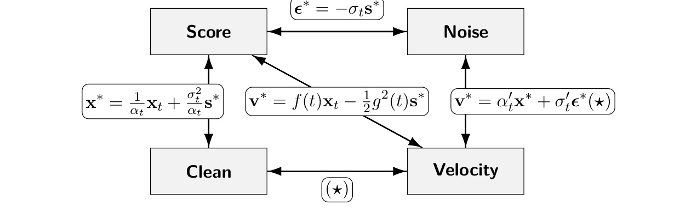

> **原題**: Equivalence in Diffusion Models
> **日本語タイトル**: 拡散モデルにおける同値性
> **出典§**: §6.3 of *The Principles of Diffusion Models*

# 6.3 拡散モデルにおける同値性

拡散モデルの多くの定式化は、予測型・学習目的・ノイズスケジュール・連続時間ダイナミクスが異なるために異なって見える。本節では、厳密な理論水準でこれらの定式化がいかなる意味で同値になり得るか、また学習済みモデルでは実務上どのように振る舞いがなお異なり得るかを明確にする。
厳密またはオラクル水準では、いくつかの同値性の概念が現れる：

- **予測。** ノイズ観測 $x_t$ と前方スケジュールが与えられれば、クリーンデータ・ノイズ・スコア・速度のオラクルは同じ情報を含み、代数的に相互変換できる。
- **学習目的。** 異なる予測型で書かれた二乗誤差目的は、正の時間依存因子だけ異なりつつ同じ点ごとのオラクル最小化子を共有し得る。これらの因子は、学習中に異なるノイズ水準がどれだけ強く重み付けられるかを定める。
- **アフィン前方過程。** 粒子水準では、アフィン前方過程
  $$
  x_t=\alpha_t x_0+\sigma_t\epsilon
  $$
  は状態の再スケールと対応する正準座標を通じて正準アフィン形と関係づけられる。この座標が時間とともに単調に発展するとき、関係は時間再パラメータ化も定義する。
- **周辺密度経路。** 密度水準では、異なる決定論的・確率的ダイナミクスが同じ周辺経路 $\{p_t\}_{t\in[0,T]}$ を生じ得る。サンプル軌道は異なり得るが、$p_t$ の発展は対応する連続の式またはFokker–Planck方程式によって支配される。

これらの接続を予測からサンプリングへ展開する。§6.3.1ではまず4つの共通オラクル予測型とその学習損失を関係づける。§6.3.2ではこれらの予測が同じオラクルPF-ODEの異なる表現へ至ることを示す。次に§6.3.3ではアフィン確率経路を正準線形形および三角法形と関係づける。最後に§6.3.4では正準線形スケジュールと速度予測について追加の直観を展開し、学習と数値積分への含意を含む。
これらの厳密な関係は共通の数学的基盤を与える一方、実務上の選択はなお意味をもつ。有限ニューラルネットワークは同値なオラクル量を異なる仕方で近似し得、損失の重み付け・最適化・モデルアーキテクチャ・数値積分が異なる学習・サンプリング振る舞いへ至り得る。

## 6.3.1 4つの予測型は同値である

式 (6.2.5) の成分 (B) の設計選択の分析から始める。
4つの予測型が独立な選択ではなく、同じ根底の量の異なる視点であることを見てきた。例えば、ノイズ予測とクリーン予測は直接関係し（§2.2.4）、スコア予測とノイズ予測も同様である（§3.4）。この繰り返し現れるパターンはより深い原理を指し示す：4つのパラメータ化はすべて代数的に同値であり、単純な変換により相互変換できる。この接続を精密にするため、図6.1に図示する次の命題を述べる（Kingma et al., 2021に従う）。

> **命題 6.3.1（パラメータ化の同値性）**
>
> それぞれの目的を最小化する最適予測を
>
> $$
> \epsilon^*(x_t,t),\quad x^*(x_t,t),\quad s^*(x_t,t),\quad v^*(x_t,t)
> $$
>
> とし、ノイズ・クリーン・スコア・速度パラメータ化に対応させる。これらは次の同値性を満たす：
>
> $$
> \begin{aligned}
> \epsilon^*(x_t,t)&=-\sigma_t\,s^*(x_t,t), \\
> x^*(x_t,t)&=\frac{1}{\alpha_t}x_t+\frac{\sigma_t^2}{\alpha_t}s^*(x_t,t), \tag{6.3.1} \\
> v^*(x_t,t)&=\alpha_t'x^*+\sigma_t'\epsilon^*=f(t)x_t-\frac{1}{2}g^2(t)s^*(x_t,t).
> \end{aligned}
> $$
>
> ここで $f(t)$ と $g(t)$ は補題4.5.1を通じて $\alpha_t$ と $\sigma_t$ に関係する。さらにこれらの最小化子は式 (6.2.1)–(6.2.4) の恒等式を満たす。

**証明の概要。** 証明は定理4.3.1——DSM目的の下での各種マッチング損失の大域的最適を分析する——と同様である。詳細は§D.4を参照。■

この命題は、オラクル情報の同値性として最も自然に理解される。任意のノイズ水準で、1つのオラクル予測とノイズ観測 $x_t$ および前方スケジュールを知れば、式 (6.3.1) の恒等式を通じて他が定まる。例えばスコアは事後平均クリーン予測を定め、これらのいずれかがPF-ODE速度を定める。したがってオラクル水準では、これらのパラメータ化は根底の拡散過程について同じ情報を含む。
しかし学習済みモデルでは、このオラクル同値性を、ニューラルネットワークが直接予測する量から区別しなければならない。次のいずれか

$$
\epsilon_\phi(x_t,t),\quad x_\phi(x_t,t),\quad s_\phi(x_t,t),\quad v_\phi(x_t,t)
$$

をネットワーク出力として選んでよい。1つの予測を一次的にとれば、他は式 (6.3.1) と同じ代数変換により定義できる。特に、パラメータ $\phi^\times$ をもつ訓練済みモデルに対し、これらの変換された予測は構成上厳密に整合する；例えば

$$
x=\alpha_t x_{\phi^\times}(x,t)+\sigma_t\epsilon_{\phi^\times}(x,t).
$$

これらの変換は学習中・学習後の両方で有用である。例えばノイズ予測は、逆時間SDEサンプリング用のスコアへ、あるいはPF-ODEサンプリング用の速度へ変換できる。
ネットワーク予測のパラメータ化は、学習損失からも区別すべきである。式 (6.2.5) の成分 (B) で議論したように、ネットワークが出力する量は損失が評価される量である必要はない：目的を計算する前に予測を別のパラメータ化へ変換してよい。そのような変換は一般に、式 (6.3.6) で後に示すように、二乗誤差目的を時間依存の重み付けで変える。
これらの区別は有限ニューラルネットワークにとって重要である。オラクル目標は情報同値であっても、異なる量を直接予測するとネットワークは異なる関数を表現・最適化し、対応する目的はノイズ水準を異なる仕方で重み付け得る。したがって、異なる予測パラメータ化の下で独立に訓練されたモデルが、同一の経験的予測や同一のPF-ODEを生じる必要はない。本命題の同値性は、理想的オラクル予測が運ぶ情報に関するものであり、ネットワーク出力パラメータ化と学習目的は別個で意味のある設計選択のままである。

*図6.1: 4つのオラクルパラメータ化間の同値関係。各オラクル予測は前方スケジュールと観測状態 $x_t$ を用いて他へ変換できる。例えば $v^*=\alpha_t'x^*+\sigma_t'\epsilon^*$ であり、$x$-予測と $\epsilon$-予測は $x_t=\alpha_t x^*+\sigma_t\epsilon^*$ を満たす。*
出典: Created by the authors.

## 6.3.2 異なるパラメータ化におけるPF-ODE

PF-ODEはいくつかの同値なパラメータ化（スコア・ノイズ・デノイズ・速度）を許容する。原理上は交換可能でも、選択には実務的帰結がある：ベクトル場の剛性、離散化誤差の振る舞い、最適化の容易さが変わる。高度なODEソルバによる高速サンプリング（第9章参照）では、実務家はしばしば $\epsilon$ または $x$ 予測を用いる。ソルバ入力と整合し誤差蓄積を減らすからである。少数の関数評価しか用いない生成器の訓練（第11章参照）では、$x$ または $v$ 予測がしばしばより滑らかな目的とステップ間のより良い一貫性を生じる。
各パラメータ化の下でPF-ODEを書き、式 (6.3.1) を用いて変換を明示する。結果を次の命題にまとめる。

> **命題 6.3.2（異なるパラメータ化におけるPF-ODE）**
>
> $\alpha_t$ と $\sigma_t$ を前方摂動スケジュールとし、時間微分を $\alpha_t':=d\alpha_t/dt$、$\sigma_t':=d\sigma_t/dt$ と表記する。すると経験的PF-ODEは同値な形
>
> $$
> \begin{aligned}
> \frac{dx(t)}{dt}
> &=\frac{\alpha_t'}{\alpha_t}x(t)-\sigma_t\Biggl(\frac{\alpha_t'}{\alpha_t\sigma_t}-\frac{\sigma_t'}{\sigma_t}\Biggr)\epsilon^*(x(t),t) \\
> &=\frac{\sigma_t'}{\sigma_t}x(t)+\alpha_t\Biggl(\frac{\alpha_t'}{\alpha_t\sigma_t}-\frac{\sigma_t'}{\sigma_t}\Biggr)x^*(x(t),t) \\
> &=\frac{\alpha_t'}{\alpha_t}x(t)+\sigma_t^2\Biggl(\frac{\alpha_t'}{\alpha_t\sigma_t}-\frac{\sigma_t'}{\sigma_t}\Biggr)s^*(x(t),t) \tag{6.3.2} \\
> &=\alpha_t'x^*(x(t),t)+\sigma_t'\epsilon^*(x(t),t) \\
> &=v^*(x(t),t)
> \end{aligned}
> $$
>
> を許容する。

スコアSDEの記法を見るために、補題4.5.1を思い出す。

$$
f(t)=\frac{\alpha_t'}{\alpha_t},\qquad
g^2(t)=\frac{d}{dt}(\sigma_t^2)-2\frac{\alpha_t'}{\alpha_t}\sigma_t^2=2\sigma_t\sigma_t'-2\frac{\alpha_t'}{\alpha_t}\sigma_t^2
$$

と置けば、PF-ODEはおなじみのスコアSDE形

$$
\frac{dx(t)}{dt}=f(t)x(t)-\frac{1}{2}g^2(t)s^*(x(t),t)
$$

で書ける。
サンプリングのためのPF-ODEの離散化がどうなるかの具体的感覚を与えるため、§9.2で広く用いられる拡散に基づくODEサンプラであるDDIMスキームの更新則を提示する。この例は、オイラー離散化が自然にPF-ODEとどう結び付くかを示す。

## 6.3.3 すべてのアフィンフローは同値である

次に式 (6.2.5) の成分 (A) の設計選択を分析する。

**状態水準の同値性。** FM（Lipman et al., 2022）とRF（Liu, 2022）で用いられる便利な正準補間は

$$
x_t^{\mathrm{FM}}=(1-t)x_0+t\epsilon=x_0+t(\epsilon-x_0)
$$

であり、その速度は一定ベクトル $\epsilon-x_0$ である。本小節の要点は、この選択の見かけの単純さが本質的ではないことである：任意のアフィン補間

$$
x_t=\alpha_t x_0+\sigma_t\epsilon
$$

は、正準経路の時間再パラメータ化および再スケール版として書ける。次を定義する：

$$
c(t):=\alpha_t+\sigma_t,\qquad
\tau(t):=\frac{\sigma_t}{\alpha_t+\sigma_t}\quad\bigl(c(t)\neq 0\bigr).
$$

直接の代数的書き換えにより

$$
\begin{aligned}
x_t&=\alpha_t x_0+\sigma_t\epsilon \\
&=(\alpha_t+\sigma_t)\Biggl(\frac{\alpha_t}{\alpha_t+\sigma_t}x_0+\frac{\sigma_t}{\alpha_t+\sigma_t}\epsilon\Biggr) \\
&=c(t)\bigl((1-\tau(t))x_0+\tau(t)\epsilon\bigr)=c(t)\,x_{\tau(t)}^{\mathrm{FM}}
\end{aligned}
$$

が得られる。したがって $c(t)\neq 0$ である限り、すべてのアフィン経路は点ごとに正準経路のスカラー再スケールとして表せる。さらに $\tau(t)$ が関心で関心単調なら、$t\mapsto\tau(t)$ は真正な時間変数の変更でもあり、2つの経路は時間再パラメータ化と再スケール $c(t)$ によって関係づけられる。通常の前方拡散スケジュールでは、信号対雑音比の単調減衰が $\tau(t)$ の単調発展を含意する。
付随する速度については、$x_t=c(t)x_{\tau(t)}^{\mathrm{FM}}$ に連鎖律を適用する：

$$
\begin{aligned}
v(x_t,t)&:=\frac{d}{dt}(\alpha_t x_0+\sigma_t\epsilon) \\
&=\frac{d}{dt}\bigl(c(t)x_{\tau(t)}^{\mathrm{FM}}\bigr) \\
&=c'(t)x_{\tau(t)}^{\mathrm{FM}}+c(t)\tau'(t)\frac{d}{ds}x_s^{\mathrm{FM}}\Bigm|_{s=\tau(t)} \\
&=c'(t)x_{\tau(t)}^{\mathrm{FM}}+c(t)\tau'(t)\,v^{\mathrm{FM}}\bigl(x_{\tau(t)}^{\mathrm{FM}},\tau(t)\bigr),
\end{aligned}
$$

ここで正準経路に沿って $v^{\mathrm{FM}}(x_{\tau}^{\mathrm{FM}},\tau)=-x_0+\epsilon$ である。
以上の導出を次の命題として形式化する。

> **命題 6.3.3（アフィンフローの同値性）**
>
> $x_t^{\mathrm{FM}}=(1-t)x_0+t\epsilon$ および $x_t=\alpha_t x_0+\sigma_t\epsilon$ とし、$c(t):=\alpha_t+\sigma_t\neq 0$、$\tau(t):=\sigma_t/(\alpha_t+\sigma_t)$ とする。すると
>
> $$
> \begin{aligned}
> x_t&=c(t)\,x_{\tau(t)}^{\mathrm{FM}}, \\
> v(x_t,t)&=c'(t)x_{\tau(t)}^{\mathrm{FM}}+c(t)\tau'(t)\,v^{\mathrm{FM}}\bigl(x_{\tau(t)}^{\mathrm{FM}},\tau(t)\bigr). \tag{6.3.3}
> \end{aligned}
> $$
>
> したがって $c(t)\neq 0$ のすべてのアフィン補間はこの正準状態水準表現を許容する。$\tau(t)$ がさらに連続で厳密単調なら、スカラー再スケール $c(t)$ とともに時間再パラメータ化としても解釈できる。

**三角法フローとの同値性。** 広く用いられる別のアフィンフローは三角法補間である（Salimans and Ho, 2021; Albergo et al., 2023; Lu and Song, 2024）。具体例として、任意のアフィンフローがこの形でも表せることを示す。三角法経路は

$$
x_u^{\mathrm{Trig}}:=\cos(u)x_0+\sin(u)\epsilon \tag{6.3.4}
$$

で定義される。$R_t:=\sqrt{\alpha_t^2+\sigma_t^2}$ とし $R_t>0$ を仮定する。角度 $\tau_t$ を

$$
\cos\tau_t=\frac{\alpha_t}{R_t},\qquad\sin\tau_t=\frac{\sigma_t}{R_t}
$$

となるように選ぶ。するとすべてのアフィン補間 $x_t=\alpha_t x_0+\sigma_t\epsilon$ は点ごとに再スケール・再時間化された三角法経路を許容する：

$$
x_t=\alpha_t x_0+\sigma_t\epsilon=R_t\Biggl(\frac{\alpha_t}{R_t}x_0+\frac{\sigma_t}{R_t}\epsilon\Biggr)=R_t\,x_{\tau_t}^{\mathrm{Trig}}. \tag{6.3.5}
$$

対 $(\alpha_t,\sigma_t)$ は平面上の点である。$R_t$ で正規化すると単位円上に置かれ、角度 $\tau_t$ したがって状態 $x_{\tau_t}^{\mathrm{Trig}}$ が固定され、半径 $R_t$ が全体スケールを与える。$\tau_t$ をさらに関心で厳密単調な $t$ の関数として選べるなら、この状態水準表現は真正な時間再パラメータ化も定義する。
$x_u^{\mathrm{Trig}}$ を $u$ について微分するとその速度

$$
v_u^{\mathrm{Trig}}=-\sin(u)x_0+\cos(u)\epsilon
$$

が得られる。式 (6.3.5) と同じ変数変換を通じて、この関係は速度（および同様に他のパラメータ化）の閉形式変換を与える。
以上をまとめると次の結論に至る：

> **結論 6.3.1**
>
> スケジュール $(\alpha_t,\sigma_t)$——VE、VP（三角法を含む）、FM、RFを含む——に関わらず、アフィン補間は適切な時間変数の変更とスカラー再スケールにより相互に変換可能である。

**4つのパラメータ化の学習目的。** $x_t=\alpha_t x_0+\sigma_t\epsilon$ で $\sigma_t>0$、微分可能な $(\alpha_t,\sigma_t)$ が $\alpha_t'\sigma_t-\alpha_t\sigma_t'\neq 0$ を満たすとする。オラクル目標

$$
\epsilon^*(x_t,t)=\mathbb{E}[\epsilon|x_t],\quad
x_0^*(x_t,t)=\mathbb{E}[x_0|x_t],\quad
v^*(x_t,t)=\mathbb{E}[\alpha_t'x_0+\sigma_t'\epsilon|x_t]
$$

を考える。命題6.3.1より

$$
\nabla_{x_t}\log p_t(x_t)=-\frac{1}{\sigma_t}\epsilon^*(x_t,t)=\frac{\alpha_t}{\sigma_t^2}x_0^*(x_t,t)-\frac{x_t}{\alpha_t},\qquad
v^*=\alpha_t'x_0^*+\sigma_t'\epsilon^*
$$

が成り立つ。ヘッド変換

$$
s_\phi\equiv-\frac{1}{\sigma_t}\epsilon_\phi\equiv\frac{\alpha_t}{\sigma_t^2}x_\phi-\frac{x_t}{\alpha_t}
$$

および速度からスコアへの変換

$$
s_\phi=\frac{\alpha_t}{\sigma_t(\alpha_t'\sigma_t-\alpha_t\sigma_t')}v_\phi-\frac{\alpha_t'}{\sigma_t(\alpha_t'\sigma_t-\alpha_t\sigma_t')}x_t
$$

の下で、サンプルごとの二乗損失は時間依存重みを除いて一致する：

$$
\begin{aligned}
\|s_\phi-\nabla_{x_t}\log p_t(x_t)\|_2^2
&=\frac{1}{\sigma_t^2}\|\epsilon_\phi-\epsilon^*\|_2^2 \\
&=\frac{\alpha_t^2}{\sigma_t^4}\|x_\phi-x_0^*\|_2^2 \tag{6.3.6} \\
&=\Biggl(\frac{\alpha_t}{\sigma_t(\alpha_t'\sigma_t-\alpha_t\sigma_t')}\Biggr)^2\|v_\phi-v^*\|_2^2.
\end{aligned}
$$

命題6.3.3により、任意のアフィンフロー $x_t=\alpha_t x_0+\sigma_t\epsilon$ は $x_t=c(t)x_{\tau(t)}^{\mathrm{FM}}$（$c(t)=\alpha_t+\sigma_t$、$\tau(t)=\sigma_t/(\alpha_t+\sigma_t)$）を通じて正準FM経路へ移せる。微分すると

$$
v_\phi(x_t,t)=c'(t)x_{\tau(t)}^{\mathrm{FM}}+c(t)\tau'(t)\,v_\phi^{\mathrm{FM}}\bigl(x_{\tau(t)}^{\mathrm{FM}},\tau(t)\bigr),\qquad
x_{\tau(t)}^{\mathrm{FM}}=\frac{x_t}{c(t)}
$$

となり、$v^*$ についても同じ関係が成り立つ。ゆえに速度損失は

$$
\|v_\phi(x_t,t)-v^*(x_t,t)\|_2^2=\bigl(c(t)\tau'(t)\bigr)^2\Biggl\|v_\phi^{\mathrm{FM}}\Biggl(\frac{x_t}{c(t)},\tau(t)\Biggr)-\bigl(v^{\mathrm{FM}}\bigr)^*\Biggl(\frac{x_t}{c(t)},\tau(t)\Biggr)\Biggr\|_2^2
$$

と変換される。
以上の観察により次の結論に至る：

> **結論 6.3.2**
>
> スコア・ノイズ・クリーン・速度の学習目的は、理論上、$(\alpha_t,\sigma_t)$ により定まる時間依存重み（および速度については $x_t$ を含むアフィンヘッド変換）を除いて同値である。

## 6.3.4 （任意）パラメータ化と正準フローの分析

前節までで、4つのパラメータ化が数学的に同値で相互変換可能であること、および前方アフィンノイズ注入フローが正準形

$$
x_t^{\mathrm{FM}}=(1-t)x_0+t\epsilon
$$

と同値であることを示したが、本小節では $v$-予測パラメータ化とこの正準アフィンフローを組み合わせることの潜在的利点について、さらなる直観と分析を与える。
本小節は単純な問いを問う：異なるパラメータ化とスケジュールは、モデルが何を学習しどうサンプリングするかをどのように形づくるか？次の2つの概念的視点で進める：

- **回帰目標とスケジュール。** $v$-予測と正準線形スケジュール $(\alpha_t,\sigma_t)=(1-t,t)$ の組み合わせがなぜ自然かを焦点化する：条件付き速度目標の尺度を時間について一定に保ち、速度分解から明示的なスケジュール曲率項を除く。
- **ソルバへの含意。** このパラメータ化が数値積分とどう相互作用するかを調べ、詳細なソルバ分析は第9章へ委ねる。

進む前に、曖昧さを避けるため2種類の速度場を区別する。扱いやすい訓練目標となる条件付き速度は

$$
v_t(x_t|z)=x_t'=\alpha_t'x_0+\sigma_t'\epsilon,\qquad z=(x_0,\epsilon)
$$

で定義され、推論でPF-ODEを解く際にサンプルを動かすオラクル（周辺化された）速度は

$$
v^*(x,t)=\mathbb{E}\bigl[v_t(\cdot|z)\bigm|x_t=x\bigr]
$$

で与えられる。

### 視点1：なぜ $(\alpha_t,\sigma_t)=(1-t,t)$ が自然なスケジュールか

時間変化する $\zeta(t)$ に対し $\sigma_t:=\zeta(t)$、$\alpha_t:=1-\zeta(t)$ と書くと、条件付き速度は

$$
v_t(x_t|z)=\zeta'(t)(\epsilon-x_0),\qquad z=(x_0,\epsilon)
$$

となる。

**単位尺度の回帰目標。** 正準スケジュール $\zeta(t)=t$ では、条件付き速度 $v_t(\cdot|z)$ は

$$
\mathbb{E}\bigl[\|v_t(\cdot|z)\|_2^2\bigr]=\mathbb{E}_\epsilon\|\epsilon\|_2^2+\mathbb{E}_{x_0}\|x_0\|_2^2=D+\underbrace{\mathrm{Tr}\,\mathrm{Cov}[x_0]}_{\text{総分散}}+\underbrace{\|\mathbb{E}x_0\|_2^2}_{\text{平均}} \tag{6.3.7}
$$

を満たす。したがって期待目標大きさは $t$ について一定である。データを零平均・単位共分散（すなわち $\mathrm{Cov}[x_0]=I$）へ標準化した後、2成分 $\alpha_t'x_0$ と $\sigma_t'\epsilon$ はすべての $t$ で同程度に寄与し、端点付近での勾配爆発／消失を避ける。これを見るために、拡散の学習目的

$$
\mathcal{L}_{\mathrm{velocity}}(\phi)=\mathbb{E}_t\,\mathbb{E}_{x_0,\epsilon}\bigl\|v_\phi(x_t,t)-v_t(x_t|z)\bigr\|_2^2
$$

を考える。連鎖律により、モデルパラメータ $\phi$ に関するこの損失の勾配は

$$
\nabla_\phi\mathcal{L}_{\mathrm{velocity}}(\phi)=2\mathbb{E}_t\,\mathbb{E}_{x_0,\epsilon}\Bigl[\partial_\phi v_\phi(x_t,t)^\top\bigl(v_\phi(x_t,t)-v_t(x_t|z)\bigr)\Bigr]
$$

である。したがって目標 $\|v_t(x_t|z)\|_2$ の尺度が勾配安定性に影響する：ある $t$ で $0$ に潰れる（または発散する）と、他が等しければ勾配は消失（または爆発）しがちである。正準選択 $\zeta(t)=t$ では、式 (6.3.7) が $t$ 独立の目標大きさを与えるので、回帰信号に起因する端点（$t=0$ または $t=1$）での潰し／発散はない（$\mathbb{E}\|\partial_\phi v_\phi(x_t,t)\|_2$ および任意の時間重みが制御されていると仮定）。

**正準スケジュールと $v$-予測の相互作用。** アフィン経路 $x_t=\alpha_t x_0+\sigma_t\epsilon$ の下で、オラクル速度は

$$
v^*(x,t)=\alpha_t'x^*(x,t)+\sigma_t'\epsilon^*(x,t)
$$

と分解され、$x^*=\mathbb{E}[x_0|x_t=x]$、$\epsilon^*=\mathbb{E}[\epsilon|x_t=x]$ である。固定 $x$ での微分は

$$
\partial_t v^*=\underbrace{\alpha_t''x^*+\sigma_t''\epsilon^*}_{\text{スケジュール曲率}}+\alpha_t'\partial_t x^*+\sigma_t'\partial_t\epsilon^*
$$

を与える。線形スケジュール $\alpha_t=1-t$、$\sigma_t=t$ では曲率項が消え（$\alpha_t''=\sigma_t''=0$）、$v^*$ の時間変化は主にスケジュールではなく事後の発展（$\partial_t x^*$、$\partial_t\epsilon^*$）を反映する。この効果は $v$-予測で特にきれいである：係数 $\alpha_t'$、$\sigma_t'$ は定数（$-1$ と $+1$）であり、ドリフトに余分な $t$ 依存の再スケールを避ける。対照的に、スコア・$x_0$・$\epsilon$ パラメータ化はしばしば $\sigma_t'/\sigma_t$ や $\alpha_t'/\alpha_t$ のような比を導入し、線形スケジュールの下でも端点付近で急激に変化し得る。したがって原理上は排他的ではないが、線形 $(1-t,t)$ スケジュールと $v$-予測の組み合わせは、オラクル速度の特に安定で透明な時間依存を与える。

**条件付きエネルギーの最小化。** 次により理論的な最適輸送の視点を採る（第7章参照）。ここで条件付き運動エネルギーは、前方経路に沿った条件付き速度の総期待運動——すなわち $x_0$ から $\epsilon$ へ横断するのに要する瞬時の動き（または運動の努力）の量——を定量化する：

$$
K[\zeta]:=\int_0^1\mathbb{E}_{x_0,\epsilon}\bigl[\|v_t(\cdot|z)\|_2^2\bigr]\,dt
=\Bigl(D+\mathrm{Tr}\,\mathrm{Cov}[x_0]+\|\mathbb{E}x_0\|_2^2\Bigr)\int_0^1\bigl(\zeta'(t)\bigr)^2\,dt.
$$

したがって $K[\zeta]$ の最小化は、アフィン補間族

$$
x_t=(1-\zeta(t))x_0+\zeta(t)\epsilon
$$

内で、期待における最も滑らかで最小エネルギーの経路を見つけることに対応する。境界条件 $\zeta(0)=0$、$\zeta(1)=1$ の下で、オイラー–ラグランジュ方程式 $\zeta''(t)=0$ は最小化子 $\zeta(t)=t$ を与え、直線条件付き経路に対応する。これは、この族のすべての滑らかなスケジュール $\zeta$ の中で、正準フロー $\zeta(t)=t$ が $x_0$ から $\epsilon$ へ動く最もエネルギー効率の良い方法であることを意味する。より詳細な扱いは命題7.5.1で再訪する。

**オラクル速度のエネルギーに関する注意。** 線形スケジュール $\zeta(t)=t$ は上で導いた条件付き速度エネルギーを常に最小化するが、周辺化されたオラクル速度 $v^*$ のエネルギーを最小化する必要はない。理由は、$v^*$ の大きさが確率経路に沿って変化し得るため、エネルギー最小化スケジュールが経路の異なる部分を異なる速度で横断し得るからである。
この依存を明示するため、

$$
y_u=(1-u)x_0+u\epsilon,\qquad u\in[0,1]
$$

と置き（$u$ はアフィン確率経路上の位置）、

$$
b_u(y):=\mathbb{E}[\epsilon-x_0|y_u=y],\qquad
\kappa(u):=\mathbb{E}_{y_u}\|b_u(y_u)\|_2^2
$$

を定義する。ここで $\kappa(u)$ は、経路に沿った単位移動あたりのオラクル速度の期待二乗大きさを測る。
スケジュール $u=\zeta(t)$ は、この経路をどれだけ速く横断するかを指定する。$x_t=y_{\zeta(t)}$ なので、オラクル速度は

$$
v^*(x,t)=\zeta'(t)\,b_{\zeta(t)}(x)
$$

となり、運動エネルギーは

$$
K_{\mathrm{marg}}[\zeta]=\int_0^1\kappa\bigl(\zeta(t)\bigr)\bigl(\zeta'(t)\bigr)^2\,dt
$$

である。$\kappa(u)>0$ と十分な正則性を仮定すると、このエネルギーの最小化は

$$
\kappa\bigl(\zeta(t)\bigr)\bigl(\zeta'(t)\bigr)^2=\text{定数},\qquad\text{あるいは同値に}\qquad
\zeta'(t)\propto\frac{1}{\sqrt{\kappa(\zeta(t))}}
$$

を与える。したがってエネルギー最小化スケジュールは、オラクル速度の期待大きさが大きいところで遅く、小さいところで速く動く。
結果として、$\zeta(t)=t$ が周辺速度エネルギーを最小化するのは、$\kappa(u)$ が経路に沿って一定のときに限る。これは上の条件付き速度の結果——線形スケジュールがアフィン族内で常に一定速の最小エネルギー選択である——との区別を際立たせる。

### 視点2：なぜ速度予測がサンプリングに自然とみなされ得るか

PF-ODEによるサンプリングは最終的にその速度場を要する。これにより $v$-予測は特に直接的になる：ネットワークがODEの右辺そのものに現れる量を予測するからである。比較すると、$x$-・$\epsilon$-・$s$-予測は、現在状態とネットワーク予測の組み合わせを通じて同じオラクル速度を符号化する。
オラクル水準では、これらは式 (6.3.2) により同じ $v^*(x,t)$ の厳密に変換可能な形であり、したがって根底のオラクルPF-ODEはパラメータ化の選択で変わらない。ここでは、サンプリング中に学習済みPF-ODEがどう表現されるかに焦点を当てる；対応する予測を訓練する損失は別途選べる。

**$x$-・$\epsilon$-・$s$-予測の下でのPF-ODE。** 式 (6.3.2) の最初の3つの恒等式は共通して

$$
\frac{dx(t)}{dt}=\underbrace{L(t)x(t)}_{\text{既知の線形項}}+\underbrace{N_{\phi^\times}(x(t),t)}_{\text{ネットワーク依存項}}
$$

の形をもち、$L(t)$ はノイズスケジュールにより定まる対応する既知スカラー係数、$N_{\phi^\times}$ はクリーン・ノイズ・スコア予測に乗じる適切な時間依存係数を含む。例えば $\epsilon$-予測の下では

$$
L(t)=\frac{\alpha_t'}{\alpha_t},\qquad
N_{\phi^\times}(x,t)=-\sigma_t\Biggl(\frac{\alpha_t'}{\alpha_t\sigma_t}-\frac{\sigma_t'}{\sigma_t}\Biggr)\epsilon_{\phi^\times}(x,t).
$$

この形は数値積分に有用である。既知の線形項を解析的に扱い、ネットワーク依存項を数値近似できるからである。DPM-Solver（Lu et al., 2022b）のような指数積分器に基づく拡散ソルバはまさにこの構造を利用する。このソルバ視点は第9章で詳しく展開する。

**$v$-予測の下でのPF-ODE。** $v$-予測では、PF-ODEは直接で単純な形

$$
\frac{dx(t)}{dt}=v_{\phi^\times}(x(t),t)\approx v^*(x(t),t)
$$

をとる。したがって単一のネットワーク評価が、別の線形項と予測を組み合わせることなく、標準ODEソルバが要する量を直接与える。
正準線形スケジュールはこの接続を特に透明にする。

$$
x_t=(1-t)x_0+t\epsilon
$$

に対し、速度予測は対応する端点予測

$$
\hat{x}_0=x_t-t\,v_{\phi^\times}(x_t,t),\qquad
\hat{\epsilon}=x_t+(1-t)v_{\phi^\times}(x_t,t)
$$

を定める。この単一予測を用いて $t$ から $s$ へ動かすと

$$
(1-s)\hat{x}_0+s\hat{\epsilon}=x_t+(s-t)v_{\phi^\times}(x_t,t)
$$

となり、これは正準線形スケジュールの下での学習済み速度場に対する通常のオイラー更新そのものである。こうして $v$-予測と線形スケジュールの組み合わせは、モデル予測とPF-ODEの数値積分の間に特に直接的な接続を与える。数値ソルバとより一般のスケジュールの詳細な議論は第9章へ委ねる。
まとめると、$v$-予測はPF-ODEが要する速度を直接与えるのに対し、他の予測型はスケジュール依存の変換を通じて同じオラクルダイナミクスを表現する。この直接対応が、速度予測がサンプリングに自然とみなされ得る主な意味である。

### 結論

$v$-予測と正準線形スケジュールの組み合わせは、一定の目標大きさやスケジュール曲率の不在といった一定の理論的利点を与えるが、これらの性質が普遍的に優れているとは限らない。実務上、モデル性能はネットワークアーキテクチャ・正規化スキーム・時間上の損失重み付け・サンプラと離散化ステップの選択・ガイダンス強度・正則化戦略・データスケーリング・全体の訓練予算など、相互作用する要因の範囲に依存する。異なるデータセットと目的は別のパラメータ化やスケジュールを好み得、最適構成は最終的に検証とアブレーション研究を通じて解決すべき経験的問いである。
