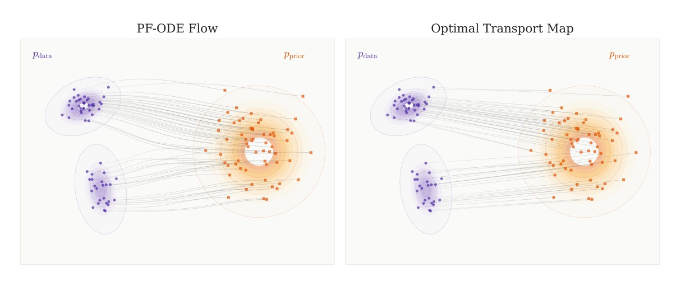

# 7.5 拡散モデルのODEはOT問題への最適写像か？

本節では二次費用の最適輸送問題に焦点を当てる。

## 7.5.1 PF-ODEフローは一般に最適輸送ではない

自然な問いは、拡散過程が誘導する決定論的フロー写像が、二次費用の下での最適輸送写像と一致するかどうかである。答えは一般に否であり、明示的な反例はすでにガウス設定で利用可能である。特に tanana2017comparison は、より一般のガウス参照をもつ拡散フローについて、端点分布がガウスであっても、結果の決定論的輸送写像がBrenier最適輸送写像と異なり得ることを示した。この設定では両写像が明示的なので、その差は直接検証できる。
以下では、拡散モデルに直接関連する標準ガウスOrnstein–Uhlenbeck設定における Lavenant and Santambrogio (2022) のより強い構成を提示する。彼らの議論は、より広いクラスの初期分布に対する非最適性を確立し、対応するPF-ODEフロー写像が最適輸送写像である必要がない理由への構造的洞察を与える。

*図7.6: 2次元で $p_{\mathrm{data}}$ から $p_{\mathrm{prior}}$ へのPF-ODEフロー写像と真のOT写像の比較。右：Hungarianアルゴリズムで厳密に計算された二次費用OT写像。左：PF-ODEを積分して得られるPF-ODEフロー写像。2つの写像は可視的に異なり、PF-ODEが一般に最適輸送写像を回復しないことを示す。*
出典: Created by the authors with AI-assisted coding.

**設定。** VP SDE、具体的にはOrnstein–Uhlenbeck過程を考える。これは滑らかな初期密度 $p_0$ を標準ガウス $\mathcal{N}(0,I)$ へ発展させる：

$$
dx(t)=-x(t)\,dt+\sqrt{2}\,dw(t),\qquad x(0)\sim p_0.
$$

付随するPF-ODEは

$$
\frac{dS_t(x)}{dt}=-S_t(x)-\nabla\log p_t\bigl(S_t(x)\bigr),\qquad S_0(x)=x
$$

で与えられる。ここで $S_t$ は $p_0$ を周辺 $p_t$ へ押し出すフロー写像を表す：

$$
(S_t)\#p_0=p_t,\qquad\text{すなわち}\qquad
p_t(y)=\int_{\mathbb{R}^D}\delta\bigl(y-S_t(x)\bigr)\,p_0(x)\,dx.
$$

これらの密度 $p_t$ はFokker–Planck方程式

$$
\frac{\partial p_t}{\partial t}=\nabla\cdot(x p_t)+\Delta p_t
$$

により発展する。これは速度場

$$
v_t(x)=-x-\nabla\log p_t(x)
$$

をもつ連続の式と同値であり、そのフローが $S_t(x)$ で与えられる。言い換えれば、PF-ODEは

$$
\frac{dS_t(x)}{dt}=v_t\bigl(S_t(x)\bigr)
$$

と書ける。$t\to\infty$ で写像は初期分布を事前へ輸送する：

$$
S_\infty\#p_0=\mathcal{N}(0,I)=:p_{\mathrm{prior}}.
$$

**Lavenant and Santambrogio (2022) の議論の目標。** Lavenant and Santambrogio (2022) は、$p_0$ からガウスへの終端写像 $S_\infty$ が最適かどうかを直接評価しない。代わりに特定の初期分布 $p_0$ を構成し、PF-ODE軌道全体を調べる。彼らの鍵となる観察は、最適性がフローのある点で失敗し得ることである。
彼らは中間周辺 $p_t=S_t\#p_0$ を考え、$p_t$ からガウスへの残差輸送写像を

$$
T_{t\to\infty}:=S_\infty\circ S_t^{-1},\qquad\text{すべての }t\ge 0
$$

と定義する。議論の核心は、注意深く選ばれた $p_0$ に対し、ある時刻 $t_0\ge 0$ が存在し、$T_{t_0\to\infty}$ が新しい出発分布 $p_{t_0}$ から $\mathcal{N}(0,I)$ への二次費用最適輸送写像ではないことを示すことである。
この結果は、PF-ODEフローが一般に最適輸送写像を与えないこと、および最適性の性質がある初期分布で破綻し得ることを示す。

**いくつかの道具。** Lavenant and Santambrogio (2022) の議論は、Brenierの定理として知られる次の結果に決定的に依拠する：

> **定理 7.1（非形式的Brenierの定理）。** $\nu_1,\nu_2$ を滑らかな密度をもつ $\mathbb{R}^D$ 上の2つの確率分布とする。滑らかな写像 $T:\mathbb{R}^D\to\mathbb{R}^D$ が $\nu_1$ から $\nu_2$ への最適輸送（二次費用の下）であるのは、$T=\nabla u$ となるある凸関数 $u$ が存在するとき、かつそのときに限る。この場合、$DT$ は対称かつ半正定値であり、$u$ はMonge–Ampère方程式
>
> $$
> \det D^2 u(x)=\frac{\nu_1(x)}{\nu_2(\nabla u(x))}
> $$
>
> を満たす。

証明はまた、暗黙に次の事実を用いる（毎回繰り返さない）：写像が2分布間の最適輸送であるのは、その逆が逆方向の最適輸送であるとき、かつそのときに限る。

**証明スケッチ：PF-ODEは一般にOT写像ではない。** Lavenant and Santambrogio (2022) は背理法を用いる：すべての $t\ge 0$ で写像

$$
T_t=S_t\circ S_\infty^{-1}
$$

が $\mathcal{N}(0,I)$ から $p_t$ への二次費用最適輸送写像であると仮定する。

**ステップ1: Brenierの定理。** Brenierの定理により、ガウスからの任意の最適輸送写像のヤコビアンは対称かつ半正定値でなければならない。したがって

$$
DT_t(x)=DS_t\bigl(S_\infty^{-1}(x)\bigr)\,D(S_\infty^{-1})(x)
$$

はすべての $t$ と $x$ で対称でなければならない。ここで $DT_t(x)$ は $x$ に関する全微分を表す。

**ステップ2: 対称性条件の時間微分。** 時間について微分する：

$$
\frac{\partial}{\partial t}DT_t(x)=\frac{\partial}{\partial t}\Bigl(DS_t\bigl(S_\infty^{-1}(x)\bigr)\,D(S_\infty^{-1})(x)\Bigr).
$$

対称性がすべての $t$ で成り立つので、この導関数も対称のままである。フローODEを用い（$x$ について微分して）

$$
\frac{\partial(DS_t)}{\partial t}=Dv_t(S_t)\cdot DS_t=\bigl(-I-D^2\log p_t(S_t)\bigr)\cdot DS_t
$$

を得る。上を合わせると

$$
\bigl(-I-D^2\log p_t(S_t)\bigr)\cdot DS_t\cdot D(S_\infty^{-1})
$$

がすべての $t\ge 0$ で対称であることが分かる。$t=0$ では $S_0=I$、$DS_0=I$ なので

$$
\bigl(-I-D^2\log p_0\bigl(S_\infty^{-1}(x)\bigr)\bigr)\cdot D(S_\infty^{-1})(x)
$$

が対称である。

**ステップ3: 可換条件。** $T_0=S_\infty^{-1}$ が最適と仮定されているので、そのヤコビアン $DT_0=D(S_\infty^{-1})$ は対称である。さらにヘッセ行列 $D^2\log p_0$ も対称である。2つの対称行列の積が対称であるのはそれらが可換するとき、かつそのときに限ることを思い出す。ゆえにすべての $x\in\mathbb{R}^D$ に対し

$$
D^2\log p_0\bigl(S_\infty^{-1}(x)\bigr)\quad\text{は}\quad D(S_\infty^{-1})(x)\quad\text{と可換しなければならない。}
$$

$y=S_\infty^{-1}(x)$ と置くと同値な条件：すべての $y\in\mathbb{R}^D$ に対し

$$
D^2\log p_0(y)\quad\text{は}\quad DS_\infty(y)\quad\text{と可換しなければならない。}
$$

次にこの条件をより計算可能な形へ変換する。$S_\infty$ が $p_0$ と $\mathcal{N}(0,I)$ の間で最適なので、Brenierの定理は $S_\infty=\nabla u$ となるある凸関数 $u$ を保証する。Monge–Ampère方程式から

$$
\log p_0(y)=\log\det\bigl(D^2 u(y)\bigr)-\frac{1}{2}\|\nabla u(y)\|^2+\text{定数}
$$

が従う。条件は（$DS_\infty=D^2 u$ として）

$$
D^2\Biggl(\log\det D^2 u-\frac{1}{2}\|\nabla u\|^2\Biggr)\quad\text{が}\quad D^2 u\quad\text{と可換しなければならない} \tag{7.5.1}
$$

となる。これは $T_t$ が最適であるための必要条件を与える。

**ステップ4: 反例の構成。** この必要条件を用いて矛盾を導く方法を示す。
凸関数 $u$ を構成でき、ある $x\in\mathbb{R}^D$ で

$$
D^2\Biggl(\log\det D^2 u(x)-\frac{1}{2}|\nabla u(x)|^2\Biggr)
$$

が $D^2 u(x)$ と可換しないと仮定する。$p_0=(\nabla u)^{-1}\#\mathcal{N}(0,I)$ と定義すると、Brenierの定理は $\nabla u$ が $p_0$ から $\mathcal{N}(0,I)$ への最適輸送であることを含意する。しかし式 (7.5.1) の条件は失敗し、矛盾に至る。したがってそのような関数を構成することが目標である。

$$
u(x)=\frac{1}{2}\|x\|^2+\varepsilon\varphi(x)\quad\text{（小さな }\varepsilon\text{）}
$$

を考える。すると $D^2 u(0)=I+\varepsilon D^2\varphi(0)$ であり、$x=0$ での可換条件は $D^2\varphi(0)$ が $D^2(\Delta\varphi)(0)$ と可換することを要求する。
例えば $\mathbb{R}^2$ で

$$
\varphi(x_1,x_2)=x_1 x_2+x_1^4
$$

を選ぶと、ヘッセ $D^2\log p_0$ とヤコビアン $D^2 u$ が可換しない反例が得られる。
この矛盾は、$T_t$ がすべての $t\ge 0$ で最適ではあり得ないことを示す。したがってある $t_0\ge 0$ が存在し、写像 $T_{t_0\to\infty}$ は最適ではない。

## 7.5.2 正準線形フローと Reflow はOT写像へ至り得るか？

PF-ODE（特にVP型前方核）が一般にOT写像ではないことを見てきた。次の自然な問いは：

> **問い 7.5.1**
>
> 独立カップリング $\pi(x_0,x_1)=p_{\mathrm{src}}(x_0)p_{\mathrm{tgt}}(x_1)$ に適用される線形補間フロー $(1-t)x_0+t x_1$（$x_0\sim p_{\mathrm{src}}$、$x_1\sim p_{\mathrm{tgt}}$）は、OT写像を回復するか？

この問いへの答えは否である。
それでも、線形経路と与えられたカップリングの組み合わせは、真のOT費用の実務的上界を与える。可能なすべての経路の中で、線形補間はこの上界の最もタイトなものを与える。以下で見る。

**正準線形フローと最適輸送。** 二次費用の最適輸送に焦点を当て、式 (7.2.1) の同値形である式 (7.2.3) のBenamou–Brenier定式化を考える：

$$
K(p_{\mathrm{src}},p_{\mathrm{tgt}}):=\min_{(p_t,v_t)\ \mathrm{s.t.}\ \partial_t p_t+\nabla\cdot(p_t v_t)=0,\ p_0=p_{\mathrm{src}},\ p_1=p_{\mathrm{tgt}}}\int_0^1\int_{\mathbb{R}^D}\|v_t(x)\|^2\,p_t(x)\,dx\,dt.
$$

静的Monge定式化（式 (7.2.2)）——最適写像の計算がMonge–Ampère方程式（式 (7.2.4)）の求解を要する——とは異なり、Benamou–Brenier問題は運動量場 $m_t:=p_t v_t$ を導入した後に凸な再定式化を許容する。それでも、この凸問題を $\mathbb{R}^D$ 上の格子で離散化することは高次元ではなお扱いづらい。
Benamou–Brenier定式化の求解は一般に扱いづらいが、Liu (2022) と Lipman et al. (2024) は、その運動エネルギーが実務的上界を許容することを明らかにした。これは、探索を、ソースとターゲット分布のカップリング $\pi_{0,1}$ から抽出された固定端点 $(x_0,x_1)$ により各経路が定義される、より単純な条件付きフロー族へ制限することで達成される。この条件付きフロー族内では、正準線形補間が最適選択として現れる。次に形式化する。

> **命題 7.5.1（条件付きフローによるOT運動エネルギーの上界）**
>
> $\pi_{0,1}$ を $p_{\mathrm{src}}$ と $p_{\mathrm{tgt}}$ の任意のカップリングとする。
>
> (1) 運動エネルギーは、端点を結ぶ任意の条件付きフロー $\Psi_t(x_0,x_1)$ の期待経路エネルギーにより上から抑えられる：
>
> $$
> K(p_{\mathrm{src}},p_{\mathrm{tgt}})\le\mathbb{E}_{(x_0,x_1)\sim\pi_{0,1}}\Biggl[\int_0^1\|\Psi_t'(x_0,x_1)\|^2\,dt\Biggr].
> $$
>
> (2) 右辺の上界を最小化する一意な条件付きフロー $\Psi_t^*$ は線形補間経路
>
> $$
> \Psi_t^*(x_0,x_1)=(1-t)x_0+t x_1
> $$
>
> である。この最適経路を代入すると、上界の最もタイトな版
>
> $$
> K(p_{\mathrm{src}},p_{\mathrm{tgt}})\le\mathbb{E}_{(x_0,x_1)\sim\pi_{0,1}}\|x_1-x_0\|^2
> $$
>
> が得られる。

**証明の概要。** 証明はJensenの不等式と条件付き期待値の塔性質の素直な適用に依拠し、その後オイラー–ラグランジュ方程式で簡略化された変分問題を解く；完全な議論は (Lipman et al., 2024) の §4.7 を参照。■

言い換えれば、線形補間 $\Psi_t^*$（すなわちフローマッチングと整流フローが用いる前方核）は、選ばれた任意のカップリング $\pi_{0,1}$ に対する真の運動エネルギーの上界を最小化する。
このクラスの条件付きフロー内での最適性が、周辺分布上の大域的最適性を保証しないことを強調する。

**Reflowと最適輸送。** 2分布間の最も素朴な輸送計画は、単純な独立カップリングを用いてサンプルを直線で結ぶことである。しかしこのアプローチが最適でないことは明らかであり、失敗は直線経路自体ではなく、点の非効率な初期対付けにある。
Reflow手続きは構成的な応答を与え得る。それはこの対付けを補正するために設計された反復アルゴリズムであり、決定的に、各ステップは費用非増加であることが保証される（Liu, Gong, et al., 2022）。この性質は、Reflowが輸送計画をより最適な配置へ体系的に押し進めることを示唆し、その収束に関する中心的問いを自然に動機づける。

> **問い 7.5.2**
>
> Rectify演算子を反復適用すると何が起きるか？結果の輸送計画列は最適なものへ収束し得るか、あるいは Reflow 過程の不動点がOT写像を与えるか？

短い答えは、一般には否である。以下で何がうまくいかないかを説明する。思い出すと、Reflow手続きは更新

$$
\pi^{(k+1)}=\mathrm{Rectify}(\pi^{(k)})
$$

により $p_{\mathrm{src}}$ と $p_{\mathrm{tgt}}$ の間のカップリングを反復的に洗練し、積カップリング $\pi^{(0)}:=p_{\mathrm{src}}(x_0)p_{\mathrm{tgt}}(x_1)$ で初期化する。より正確には、Rectifyは次により更新カップリング $\pi^{(k+1)}$ を出力する：各反復 $k=0,1,2,\ldots$ で速度場 $v_t^{(k)}$ を

$$
v_t^{(k)}\in\arg\min_{u_t}\mathcal{L}(u_t|\pi^{(k)})
$$

により学習する。ここで $\mathcal{L}(u_t|\pi^{(k)})$ は式 (5.4.1) で定義される損失（例：RFまたはFM損失）である。記法の簡略化のため、速度場に他の文脈で用いるパラメータ化形 $\phi$ ではなく、非パラメータ定式化を採用する。更新カップリングは次いで

$$
\pi^{(k+1)}(x_0,x_1):=p_{\mathrm{src}}(x_0)\,\delta\bigl(x_1-\Psi_1^{(k)}(x_0)\bigr)
$$

で与えられ、$\Psi_1^{(k)}$ は初期条件 $x_0$ から $v_t^{(k)}$ を積分して得られる時刻 $t=1$ の解写像を表す。
(Liu, Gong, et al., 2022) で観察されているように、$p_{\mathrm{src}}$ と $p_{\mathrm{tgt}}$ の間のカップリング $\pi$ に対し、Reflow損失を最小化する——すなわち $\mathcal{L}(v_t|\pi)=0$ を満たす——速度場 $v_t$ の存在は、輸送が最適であることを必ずしも含意しない。
最適輸送速度がポテンシャル関数の勾配であることが知られているBenamou–Brenier枠組みに動機づけられ、Liu (2022) は追加制約を提案した：速度場 $v_t$ はポテンシャル場であるべきである。したがって式 (5.4.1) の目的は、$v_t$ を勾配ベクトル場（ポテンシャルフローとしても知られる）の空間へ制限するよう修正される：

$$
w_t^{(k)}\in\arg\min_{\substack{u_t:u_t=\nabla\phi\\\text{ある }\phi:\mathbb{R}^D\to\mathbb{R}\text{ に対して}}}\mathcal{L}(u_t|\pi^{(k)}), \tag{7.5.2}
$$

手続きの残りは Rectify と同じである。この関連演算子を $\mathrm{Rectify}_\perp$ と表記し、非回転ベクトル場への射影を強調する。
$\pi$ を $p_{\mathrm{src}}$ と $p_{\mathrm{tgt}}$ の間のカップリングとする。Liu, Gong, et al. (2022) は最適性を特徴づける次の同値性を予想する：

1. $\pi$ は最適輸送カップリングである。
2. $\pi$ はポテンシャル整流演算子の不動点である：$\pi=\mathrm{Rectify}_\perp(\pi)$。
3. 整流損失が消える勾配速度場 $v_t=\nabla\phi_t$ が存在する：$\mathcal{L}(v_t|\pi)=0$。

しかし Hertrich et al. (2025) は2種類の反例を示す：

1. 中間分布 $p_t$ が非連結サポートをもつとき、零 Reflow 損失と勾配速度場をもつ $\mathrm{Rectify}_\perp$ の不動点で、それでも最適カップリングを生じないものを見つけられる。
2. 両端点分布がガウスであっても、損失が任意に小さく、最適カップリングからのずれが任意に大きいカップリングが存在する。

したがって、整流フローは強い生成モデルを生じ得る一方、最適輸送ソルバとしての信頼性はなお限定的である。これは生成モデリングと原理的な最適輸送理論の間の重要なギャップを際立たせ、その交差でのさらなる研究を誘う。
最後に、輸送費用は常に下流性能と相関するわけではない；したがって厳密な最適輸送写像の計算が必ずしもより良い実務的成果へつながるとは限らないことに注意する。それでも、最適輸送の諸変種は科学と工学の多くの問題に基礎的であり続ける。拡散モデルはこれらの課題を探究するための強力な枠組みを提供する。
