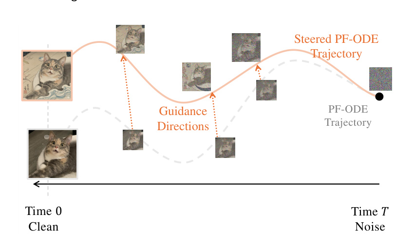

# 8.1 プロローグ

*図8.1: 操舵された拡散サンプリングの模式図。逆時間PF-ODEサンプリングは右の純ノイズ（$t=T$）から始まり、左のクリーンサンプル（$t=0$）へ向かって徐々に発展する。この過程で、重み $w_t$ で重み付けられた時間依存ガイダンス方向が無条件スコア場を修正し、サンプルが粗から細の詳細へ段階的に洗練される間に、軌道を望ましい属性（日本画スタイル）へ操舵する。*
出典: Created by the authors.

拡散モデルの生成過程は粗から細へ進み、制御可能な生成のための柔軟な枠組みを与える。各ステップで少量のノイズが除去されサンプルがより明瞭になり、構造と詳細が徐々に明らかになる。この性質は生成過程の制御を可能にする：学習済みの時間依存速度場にガイダンス項を加えることで、ユーザー意図を反映するよう生成軌道を操舵できる。
拡散モデルにおけるガイダンスに基づくサンプリングの原理的基盤は、条件付きスコアのBayes分解である。各ノイズ水準 $t$ に対し、

$$
\nabla_{x_t}\log p_t(x_t|c)=\underbrace{\nabla_{x_t}\log p_t(x_t)}_{\text{無条件方向}}+\underbrace{\nabla_{x_t}\log p_t(c|x_t)}_{\text{ガイダンス方向}}. \tag{8.1.1}
$$

この恒等式は、厳密な条件付き逆時間ダイナミクスが、無条件スコアの上にガイダンス項 $\nabla_{x_t}\log p_t(c|x_t)$ を加えることで得られることを示す。後で見るように、クラシファイア・ガイダンス（Dhariwal and Nichol, 2021）はこの項を直接推定し、クラシファイアフリー・ガイダンス（Ho and Salimans, 2021）はそれを結合学習された条件付き・無条件スコアの差として暗黙に推定し、より一般の訓練不要手法は代わりにタスク固有の代理ガイダンス方向を用い得る。
厳密な条件付きスコアの下で、PF-ODEは

$$
\begin{aligned}
\frac{dx(t)}{dt}
&=f(t)x(t)-\frac{1}{2}g^2(t)\underbrace{\nabla_{x_t}\log p_t\bigl(x(t)|c\bigr)}_{\text{条件付きスコア}} \tag{8.1.2} \\
&=f(t)x(t)-\frac{1}{2}g^2(t)\Bigl[\nabla_{x_t}\log p_t\bigl(x(t)\bigr)+\nabla_{x_t}\log p_t\bigl(c|x(t)\bigr)\Bigr]
\end{aligned}
$$

となる。厳密なスコアと厳密な積分の下で、これらのダイナミクスは対応する終端周辺 $p_T(x_T|c)$ から初期化すれば $p_0(x_0|c)$ を回復する。標準的な拡散構成では、終端ノイズ化は $p_T(x_T|c)$ が通常の条件非依存事前により近似的に整合するよう選ばれる。
以下の議論は明快さのためスコア予測で定式化する。標準的な $x$-・$\epsilon$-・スコア・$v$-予測パラメータ化は、これらの変換が適切に定義される限り時間依存線形変換で関係するので、同じガイダンス補正は式 (6.3.1) の関係を用いて他のパラメータ化でも表現できる。

## ガイダンス方向の具体化

**1. クラシファイア・ガイダンス（CG）。** §8.2では、クラシファイア・ガイダンス（CG）が、ノイズ付きデータ $x_t$（クリーンなラベル付きサンプルを水準 $t$ で壊して得られる）上で時間条件付きクラシファイア $p_\psi(c|x_t,t)$ を訓練する。サンプリング時、その入力勾配がガイダンス項

$$
\nabla_{x_t}\log p_\psi(c|x_t,t)\approx\nabla_{x_t}\log p_t(c|x_t)
$$

を与え、無条件スコアに加えられる（Dhariwal and Nichol, 2021）。

**2. クラシファイアフリー・ガイダンス（CFG）。** §8.3では、CFGが単一の条件付きモデル

$$
s_\phi(x_t,t,c)\approx\nabla_{x_t}\log p_t(x_t|c)
$$

を直接訓練する。無条件モデルは、訓練ステップの一部で条件を特別なヌルトークンにランダム置換することで結合学習される。

**3. 訓練不要（代理）ガイダンス。** 標準的な前方ノイズ化構成の下では、まず $(x_0,c)\sim p_{\mathrm{data}}$ を引き、次いで $x_t\sim p_t(\cdot|x_0)$ をサンプリングする。前方核は $c$ に追加依存しない。したがって $c\perp x_t\mid x_0$ である[^fn81-1]。
結果として

$$
p_t(c|x_t)=\int p(c|x_0)\,p(x_0|x_t)\,dx_0.
$$

この事後平均は一般に扱いづらく、代わりにタスク固有の代理ガイダンス方向を構成する訓練不要手法を動機づける。
§8.4.1では、訓練不要（損失に基づく）ガイダンスが条件付き尤度 $p_t(c|x_t)$ を直接評価することを避ける。代わりに、現在サンプルが望ましい条件をどれだけ満たすかを測る既製の損失 $\ell(x_t,c;t)$ から出発する。損失が小さいほど整合が良い。この損失から正のガイダンスポテンシャル

$$
h_t(x_t;c):=\exp\bigl(-\tau\,\ell(x_t,c;t)\bigr),\qquad\tau>0
$$

を定義する。こうして損失の低いサンプルがより大きなポテンシャル値を受ける。対応するガイダンス方向を

$$
G_t(x_t,c):=\nabla_{x_t}\log h_t(x_t;c)=-\tau\nabla_{x_t}\ell(x_t,c;t)
$$

と表記する。
クラシファイア・ガイダンスは同じ図に自然に収まる。母集団水準では、そのガイダンスポテンシャルは

$$
h_t(x_t;c)=p_t(c|x_t)
$$

であり、実務上は学習済みクラシファイア $p_{\psi^\times}(c|x_t,t)$ で近似される。同値に、学習済みクラシファイアは損失

$$
\ell(x_t,c;t)=-\log p_{\psi^\times}(c|x_t,t),\qquad\tau=1
$$

に対応する。

[^fn81-1]: 実際、
$$
p_t(c|x_t)=\int p(c,x_0|x_t)\,dx_0=\int p(c|x_0,x_t)\,p(x_0|x_t)\,dx_0.
$$
標準的な前方核が $p_t(x_t|x_0,c)=p_t(x_t|x_0)$ を満たすので、$p(c|x_0,x_t)=p(c|x_0)$ となり、下記の表現が得られる。

母集団水準では、上の3つの構成は同じ加法的ガイダンス雛形を共有する。正のポテンシャル $h_t(x_t;c)$ とガイダンス強度 $w_t\ge 0$ が与えられたとき、誘導スコア場を

$$
s^{\mathrm{guide}}(x_t,t,c;w_t):=\nabla_{x_t}\log p_t(x_t)+w_t\,G_t(x_t,c) \tag{8.1.3}
$$

と定義する。損失に基づくガイダンスでは $G_t(x_t,c)=-\tau\nabla_{x_t}\ell(x_t,c;t)$。厳密なクラシファイア・ガイダンスでは $G_t(x_t,c)=\nabla_{x_t}\log p_t(c|x_t)$；クラシファイアフリー・ガイダンスは同じ母集団ガイダンス方向を条件付き・無条件スコアの差を通じて表現する。
各固定時刻 $t$ で、式 (8.1.3) は正規化可能な限り、傾いた密度

$$
\tilde{p}_t^{\mathrm{tilt}}(x_t|c)\propto p_t(x_t)\,h_t(x_t;c)^{w_t}
$$

のスコアである。これは有用なエネルギー解釈を与える：基底密度は拡散モデルが支持するサンプルを好み、ポテンシャルはそれらを望ましい条件へ向けて再重み付けする。
実務上、式 (8.1.3) の対応する学習済みまたは代理版が逆時間ダイナミクスに挿入される。重要なことに、上の傾いた密度は固定時刻の解釈にすぎない：族 $\{\tilde{p}_t^{\mathrm{tilt}}(\cdot|c)\}_t$ は誘導サンプラが生成する周辺と一致する必要がない。したがって、一般の損失またはガイダンススケジュールに対し、$T$ から $0$ へ誘導PF-ODEを積分しても、一般には $\tilde{p}_0^{\mathrm{tilt}}(\cdot|c)$ に従って分布するサンプルは生じない。この解釈が成り立つために必要な追加のクロスタイム整合は §8.4.2 で議論する。
サンプリング軌道へのガイダンスの効果は図8.1に図示される。同じ原理は、すでに条件付きのモデルの上にも適用でき、追加の制御信号がそのサンプリングダイナミクスを修正することを許す。

## 制御から Direct Preference Optimization によるより良い整合へ

強い制御は on-condition だが off-preference になり得る：サンプルは条件付け信号（例：プロンプト）を満たしつつも、人間が実際に好むものから外れ得る。これを、$t=0$ での条件付きターゲットを選好評価で傾けることで形式化する：

$$
\tilde{p}_0^{\mathrm{tilt}}(x_0|c)\propto p_0(x_0|c)\,\exp\bigl(\lambda_{\mathrm{pref}}\,r(x_0,c)\bigr),\qquad\lambda_{\mathrm{pref}}>0,
$$

ここで $r(x_0,c)$ はクリーンサンプル $x_0$ と条件 $c$ に対するスカラー整合評価であり、値が大きいほど選好が強いことを示し、$\lambda_{\mathrm{pref}}$ は選好再重み付けの強度を制御する。後に導入するKL正則化定式化では、最適化子はこの形をとり、参照方策が基底分布、$\lambda_{\mathrm{pref}}=1/\beta$ となる。
そのような操舵性を達成する既存手法は、典型的にモデル生成の相対品質に関する人間ラベルを収集し、これらの選好に整合するよう条件付き拡散モデルを微調整する。しばしば人間フィードバックからの強化学習（RLHF）を通じてである。しかしRLHFは複雑でしばしば不安定な手続きである：まず人間選好を捉える報酬モデルを適合し、次いでこの推定報酬を最大化しつつ元モデルからの方策ドリフトを制約するよう、強化学習で条件付き拡散モデルを微調整する。
これは自然に次の問いを提起する：報酬モデル訓練段階を完全に除去できるか？我々は Diffusion-DPO（Wallace et al., 2024）——もともと大規模言語モデル向けに開発された Direct Preference Optimization（Rafailov et al., 2023）の適応——でこれに対処する。§8.5で述べるように、Diffusion-DPOはペアワイズ選択から選好傾きを直接学習し、したがって条件付き拡散モデルは別個の報酬モデルなしに選好へ整合するよう微調整される。
